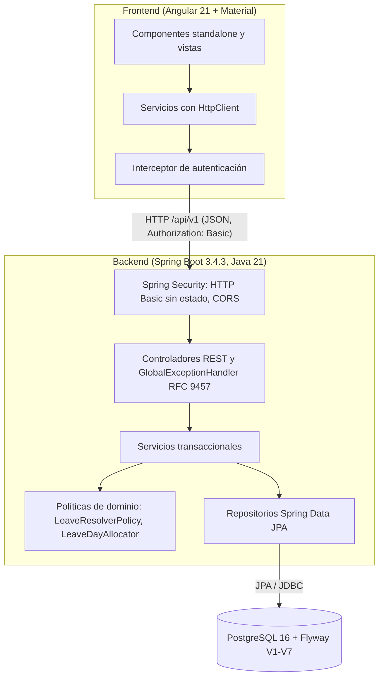

# Memoria del Proyecto: Sistema de Gestión de Recursos Humanos y Vacaciones
## Desarrollo de un sistema de información mediante *Spec-Driven Development* (SDD)

---

## Índice

1. [Portada y resumen](#1-portada-y-resumen)
2. [URL del repositorio en GITHUB](#2-url-del-repositorio-en-github)
3. [Introducción](#3-introducción)
4. [Análisis](#4-análisis)
5. [Diseño](#5-diseño)
6. [Implementación](#6-implementación)
7. [Pruebas y validación](#7-pruebas-y-validación)
8. [Despliegue y uso](#8-despliegue-y-uso)
9. [Planificación y seguimiento](#9-planificación-y-seguimiento)
10. [Conclusiones](#10-conclusiones)
11. [Demo](#11-demo)
12. [Anexos](#12-anexos)

---

## 1. Portada y resumen

### 1.1 Datos del proyecto

* **Asignatura:** Ingeniería Web (IW)
* **Sistema desarrollado:** Sistema de información para la gestión de empleados y contratos, vacaciones y permisos, calendario de equipo, informes de absentismo y evaluación de desempeño (SI-09)
* **Metodología:** *Spec-Driven Development* (SDD) con GitHub Spec Kit 1.0.6 (integración `agy`, ver `.specify/init-options.json`)
* **Versión del código de esta memoria:** rama `memoria-y-entregables`, sobre el commit `662da39`; commit de referencia previo al refinamiento: tag `ref-refinamiento` (`afed4c4`, 2026-11-10)
* **Fecha de entrega:** noviembre de 2026

### 1.2 Equipo de desarrollo y reparto de responsabilidades

Cada integrante se responsabiliza de dos historias de usuario, desde su especificación hasta su verificación. El reparto está documentado en [`docs/AGRUPAMIENTO.md`](AGRUPAMIENTO.md) y en el `README.md`.

| Integrante | Historias asignadas | Especificaciones | Revisor de sus criterios |
| :--- | :--- | :--- | :---: |
| **Joaquín Navarro Belmonte** | HU-01 Alta de empleados y trayectoria contractual · HU-02 Ficha personal y saldo de vacaciones | `spec-001`, `spec-002` | Iván / Andrei |
| **Iván Soler Fuentes** | HU-03 Solicitud de vacaciones o permisos · HU-04 Seguimiento y cancelación de solicitudes | `spec-003`, `spec-004` | Joaquín / José |
| **Andrei Radu** | HU-05 Aprobación o rechazo de solicitudes · HU-06 Calendario de ausencias del equipo | `spec-005`, `spec-006` | Joaquín / Iván |
| **José Ramón Castells** | HU-07 Informes de absentismo y uso de vacaciones · HU-08 Evaluación de desempeño con conformidad | `spec-007`, `spec-008` | Andrei / Iván |

---

### 1.3 Resumen ejecutivo

El sistema es una aplicación web para el departamento de Recursos Humanos de una empresa y para los empleados y responsables de equipo que interactúan con él. Permite dar de alta empleados con su trayectoria contractual y convenio colectivo, consultar el saldo de vacaciones (un valor derivado, nunca almacenado), solicitar vacaciones y permisos, que el responsable los apruebe o rechace con notificación al empleado, ver el calendario de ausencias del equipo con las coincidencias resaltadas, generar informes de absentismo por departamento con exportación a CSV, y formalizar evaluaciones de desempeño con doble conformidad.

Se construyó siguiendo el ciclo *specify → clarify → plan → tasks → analyze → implement → converge* sobre ocho historias de usuario, con una constitución del proyecto que fija los principios no negociables. El resultado es un monorepo con un backend Spring Boot 3.4.3 (Java 21, PostgreSQL 16, Flyway) y una SPA Angular 21 con Angular Material. En la versión final, las suites automatizadas ejecutan **224 pruebas de backend y 86 de frontend sin fallos**, y dos recorridos E2E que cruzan las ocho historias se ejecutaron contra la API real con **49 de 49 pasos conformes**. De los 66 criterios de la matriz de trazabilidad, 65 están verificados por una prueba nombrada o por un recorrido. Quedan cuatro límites de alcance aceptados y documentados (apartado 10.3).

---

## 2. URL del repositorio en GITHUB

* **Repositorio:** [https://github.com/Arid3n/recursos-humanos-IW](https://github.com/Arid3n/recursos-humanos-IW)
* **Rama principal:** `main`
* **Ramas de trabajo (integradas mediante pull request):** `spec-001`, `spec-002`, `spec-004`, `rama-Andrei`, `hu-7`, `hu-8`, `refinamiento-HU5-HU6`, `refinamiento-hu7-hu8`
* **Rama de esta entrega:** `memoria-y-entregables`
* **Etiqueta de referencia previa al refinamiento:** `ref-refinamiento`

---

## 3. Introducción

### 3.1 Contexto y problema que resuelve

Los departamentos de Recursos Humanos de empresas medianas suelen trabajar con datos dispersos: contratos en hojas de cálculo, solicitudes de vacaciones por correo y evaluaciones en documentos sin trazabilidad. Eso provoca cuatro problemas que el sistema ataca de forma específica:

1. **Saldos de vacaciones erróneos.** Los convenios colectivos fijan días distintos (en el sistema, el convenio General da 22 días y el TIC 23), hay altas a mitad de año que exigen prorrateo, y los contadores mutables se desincronizan. El sistema trata el saldo como un dato **derivado** que se calcula al consultarlo.
2. **Falta de visibilidad al aprobar.** Un responsable que aprueba sin ver el calendario del equipo provoca solapamientos. El sistema ofrece un calendario mensual que resalta los días con dos o más ausencias.
3. **Privacidad.** El calendario nunca expone motivos, justificaciones ni causas de rechazo (Art. 16 y 20 de la constitución).
4. **Trazabilidad de las decisiones.** Cada resolución queda registrada con quién la tomó y cuándo, es inmutable, y se notifica al empleado dentro de la misma transacción.

### 3.2 Objetivos del sistema

* Mantener una **trayectoria contractual inmutable** (append-only) por empleado, con fecha de efectos, también retroactiva (Art. 11).
* Calcular el **saldo de vacaciones en tiempo real** a partir del convenio y de las solicitudes aprobadas y pendientes, con prorrateo por fecha de alta (Art. 12).
* Cubrir el **ciclo de vida completo de una solicitud**: creación con validación preventiva, seguimiento, cancelación, aprobación o rechazo (Art. 13).
* Mostrar el **calendario del equipo** con coincidencias, respetando el alcance jerárquico.
* Ofrecer **informes agregados** de absentismo y uso de vacaciones con paridad entre pantalla y CSV (Art. 17).
* Formalizar **evaluaciones de desempeño** con conformidad del empleado e inmutabilidad posterior (Art. 18).
* Respetar el enunciado de la práctica: ocho historias, ciclo SDD con *loop engineering*, y refinamiento con clarify, analyze y converge.

### 3.3 Metodología Spec-Driven Development (SDD)

La especificación funcional dirige el proceso y el código es un producto derivado. Cada historia recorre el ciclo siguiente, y cualquier fase puede reabrir la anterior (*loop engineering*):

```
 specify ─► clarify ─► plan ─► tasks ─► analyze ─► implement ─► converge
    ▲          │         │        │         │            │            │
    └──────────┴─────────┴────────┴─────────┴────────────┴────────────┘
              (volver a la fase que corresponda cuando falla algo)
```

| Fase | Artefacto en `specs/spec-00N/` | Qué contiene |
| :-- | :-- | :-- |
| Specify | `spec.md` | Historia, escenarios de aceptación, requisitos (FR), criterios de éxito (SC), supuestos |
| Clarify | sección «Clarifications» de `spec.md`, `clarify.md` | Preguntas, respuestas y decisiones, con la sesión en que se tomaron |
| Plan | `plan.md`, `research.md`, `data-model.md`, `contracts/*.yaml`, `quickstart.md` | Diseño técnico, modelo de datos, contrato OpenAPI y escenarios de validación |
| Tasks | `tasks.md` | Tareas pequeñas, trazables a la historia y al criterio |
| Analyze | `analysis.md` | Coherencia y cobertura entre spec, plan y tareas |
| Implement | código en `backend/` y `frontend/`, `implementation-report.md` | Implementación test-first |
| Converge | `converge.md`, fases «Convergence» de `tasks.md` | Obligaciones aún no cumplidas por el código |

Además existe una **constitución** (`.specify/memory/constitution.md`, versión 1.2.0) con 28 artículos y tres anexos. Es la norma superior: ante un conflicto, se enmienda la constitución antes que el código (Art. 1 y 27).

---

## 4. Análisis

### 4.1 Actores y control de acceso por roles

El sistema tiene cuatro roles, guardados en `users.role` y aplicados en el servidor con `@PreAuthorize` (Art. 10). La interfaz oculta opciones, pero nunca es la barrera de seguridad.

| Rol | Alcance real en la versión final |
| :--- | :--- |
| `EMPLEADO` | Ver su ficha y su saldo, solicitar ausencias, seguir y cancelar sus solicitudes, ver sus notificaciones y dar conformidad a sus evaluaciones. |
| `RESPONSABLE_EQUIPO` | Todo lo del empleado, más: bandeja de solicitudes pendientes de su equipo directo, aprobar y rechazar, calendario del equipo, saldo de las personas de su equipo y crear evaluaciones. |
| `RRHH` | Alta de empleados, trayectoria contractual y baja (por API), saldo de cualquier empleado, informes y exportación CSV. Desde FR-018 resuelve solicitudes y ve el calendario **solo de las personas que lo tienen como superior directo**; el Art. 13.8 no se enmendó. |
| `DIRECCION_GENERAL` | No solicita ausencias (`422`) y no tiene saldo propio (`403`). Resuelve solicitudes y ve el calendario de sus subordinados directos. No accede a los informes (solo `RRHH`) ni crea evaluaciones. |

Jerarquía de los datos semilla: `direccion@` → `rrhh@` → `responsable@` → `empleado@`.

### 4.2 Catálogo de historias de usuario

La descripción funcional del sistema no traía historias; se identificaron ocho a partir del texto. Cada una tiene su carpeta en `specs/`. Las cifras de requisitos son las de la versión final.

| HU | Spec | Responsable | Qué resuelve | FR | Tareas |
| :-: | :-- | :-- | :-- | :-: | :-: |
| HU-01 | [spec-001](../specs/spec-001/spec.md) | Joaquín | Alta de empleados, cuenta de acceso con clave provisional, trayectoria contractual append-only, baja lógica | 13 | 38 |
| HU-02 | [spec-002](../specs/spec-002/spec.md) | Joaquín | Ficha personal y saldo desglosado (correspondientes, disfrutados, pendientes, disponibles) con prorrateo y consulta de años cerrados | 9 | 33 |
| HU-03 | [spec-003](../specs/spec-003/spec.md) | Iván | Formulario de solicitud con cómputo de días en servidor, validación de saldo y solapamientos | 11 | 25 |
| HU-04 | [spec-004](../specs/spec-004/spec.md) | Iván | Listado paginado con filtros, motivo de rechazo visible y cancelación de solicitudes pendientes | 6 | 22 |
| HU-05 | [spec-005](../specs/spec-005/spec.md) | Andrei | Bandeja del responsable, aprobación con comentario, rechazo con motivo, notificación y revalidación atómica del saldo | 18 | 103 |
| HU-06 | [spec-006](../specs/spec-006/spec.md) | Andrei | Calendario mensual del equipo con coincidencias, vista de lista en pantallas estrechas y filtro por empleado | 11 | 32 |
| HU-07 | [spec-007](../specs/spec-007/spec.md) | José | Informes por departamento y rango de fechas, desglose por empleado, exportación CSV | 7 | 18 |
| HU-08 | [spec-008](../specs/spec-008/spec.md) | José | Evaluación 1-5 del responsable y conformidad del empleado, con inmutabilidad posterior | 8 | 19 |

Reglas de negocio clave por historia (todas verificadas contra el código, ver apartado 7):

* **HU-01.** El alta crea el empleado, su cuenta de usuario con clave provisional y su primer registro contractual. El responsable es obligatorio salvo que RRHH elija «Sin responsable (solo Dirección General)» (`withoutManager=true`), que crea el rol `DIRECCION_GENERAL`; sin esa indicación o con ambas cosas, el alta devuelve `400`. Dar de baja a un responsable cancela en la misma transacción las solicitudes `PENDING` de sus subordinados (FR-012).
* **HU-02.** `disponibles = correspondientes − disfrutados`; los pendientes se informan aparte. El saldo se calcula en `LeaveBalanceServiceImpl`; las solicitudes que cruzan el 31 de diciembre se reparten por año natural.
* **HU-03.** La solicitud nace `PENDING`, asignada al responsable actual. Se rechazan fechas pasadas y rangos invertidos (`400`), el saldo insuficiente y los solapamientos (`409`) y la creación sin resolutor válido o desde Dirección General (`422`). Los permisos no descuentan vacaciones y exigen justificación.
* **HU-04.** Solo se cancelan solicitudes `PENDING`; pasan a `CANCELLED` (`204`), liberan fechas y saldo, y siguen visibles en el historial.
* **HU-05.** Solo se resuelve una solicitud `PENDING` de un subordinado directo. El motivo de rechazo exige de 5 a 500 caracteres tras recortar espacios. Códigos: `409` ya resuelta o resolución simultánea, `404` retirada, `403` fuera de alcance o solicitud propia, `422` año cerrado o saldo insuficiente. Estado, saldo y notificación se registran en una única transacción.
* **HU-06.** Se ven solicitudes aprobadas y pendientes; las rechazadas y las retiradas no aparecen ni cuentan. Hay coincidencia cuando dos o más personas están ausentes un día laborable. Nunca se devuelve justificación ni motivo de rechazo. Por debajo de 600 px se muestra una lista vertical.
* **HU-07.** Solo `RRHH`. Informe y CSV salen del mismo método de servicio, lo que garantiza la paridad; el CSV es UTF-8 con BOM y respeta RFC 4180. Periodo sin datos: `hasData=false` y `204` en la exportación.
* **HU-08.** El responsable crea la evaluación (`PENDING_ACKNOWLEDGMENT`), el empleado da su conformidad (`FINALIZED` con `finalizedAt`). Después no puede modificarse: lo impiden el servicio (`409`) y un disparador de base de datos. La conformidad usa bloqueo pesimista para evitar condiciones de carrera.

### 4.3 Requisitos no funcionales

Los requisitos transversales salen de la constitución (Títulos II y IV) y de los criterios de éxito (SC) de cada spec.

| Área | Requisito | Dónde se verifica |
| :-- | :-- | :-- |
| Seguridad | Autorización siempre en el servidor (Art. 10); contraseñas con BCrypt; sesión sin estado con HTTP Basic; acceso denegado y operaciones sensibles registrados sin datos personales (Art. 20) | Pruebas de integración con `403` por rol; recorrido 2 |
| Errores | Respuestas `ProblemDetail` RFC 9457 con `type`, `title`, `status`, `detail`, `instance` (Art. 19) | `GlobalExceptionHandler`; todos los recorridos |
| Fechas | Cómputo de días y festivos solo en el backend, zona `Europe/Madrid` (Art. 14) | `HolidayCalendarServiceTest` |
| Datos | Saldo derivado, nunca persistido (Art. 12); trayectoria contractual inmutable (Art. 11); migraciones Flyway versionadas V1 a V7 | `LeaveBalanceServiceTest`, `EmployeeIntegrationTest` |
| Concurrencia | `@Version` en solicitudes y evaluaciones; bloqueo pesimista en la conformidad | `LeaveResolutionAtomicityIntegrationTest`, `PerformanceReviewIntegrationTest` |
| Accesibilidad | WCAG 2.1 AA: estados no transmitidos solo por color, `aria-*`, etiquetas visibles (Art. 21) | Pruebas de componentes; verificación manual |
| Calidad | Desarrollo test-first y trazabilidad HU → criterio → prueba (Art. 2 y 22) | Matriz de trazabilidad |
| Rendimiento | Objetivos por spec (p. ej. calendario y saldo en menos de 800 ms, informes en menos de 1,5 s) | **No medidos**: excepción documentada en `docs/verificacion-integrada.md` |

### 4.4 Refinamiento y *loop engineering*

El refinamiento parte de la versión funcional de `ref-refinamiento` y aplica clarify, analyze y converge según el enunciado. Resultado: de 29 a 83 preguntas de clarify respondidas, de 72 a 83 requisitos funcionales y de 160 a 290 tareas. Ejemplos de iteraciones reales, con el motivo del cambio de rumbo:

* **HU-05 fase 6 (2026-11-16).** Tras clarify, se decidió que nadie resuelve su propia solicitud, que los días de una vacación interanual se reparten por año natural (`LeaveDayAllocator`) y que el motivo de rechazo se valida tras recortar espacios.
* **HU-05 fases 9 y 10 (2026-11-18 y 2026-11-19).** Una pregunta del propietario sobre quién resuelve la solicitud de un responsable produjo cuatro reglas nuevas: bloqueo de la solicitud sin resolutor válido (FR-015), cancelación automática de pendientes al dejar de ser válido el superior (FR-016), el rol `DIRECCION_GENERAL` (FR-017) y RRHH como resolutor de sus subordinados directos con Dirección General sin saldo propio (FR-018). La respuesta a una pregunta se revirtió una vez registrada («permanecen pendientes» pasó a «se cancelan»), lo que obligó a añadir FR-016. Un solo cambio tocó cuatro specs y la constitución (1.1.0 y 1.2.0), por lo que se tramitó con commits separados.
* **HU-06 fase 6 (2026-11-18).** Se decidió ocultar las solicitudes retiradas, excluir las ausencias propias del responsable, fijar el mes inicial en `Europe/Madrid` y presentar una lista vertical por debajo de 600 px.
* **HU-03 (2026-11-17).** Converge detectó que faltaban la justificación, el rechazo de fechas pasadas y la reserva preventiva de saldo; se añadieron T020 a T025.
* **HU-01 (2026-11-19).** FR-011 pasó de «excepción por puesto» a «excepción explícita con `withoutManager`».

La evidencia de cada actividad está en `specs/spec-00N/clarify.md`, `analysis.md` y `converge.md`, en [`docs/registro-hallazgos.md`](registro-hallazgos.md), en [`docs/matriz-trazabilidad.md`](matriz-trazabilidad.md) y en [`docs/verificacion-integrada.md`](verificacion-integrada.md).

---

## 5. Diseño

### 5.1 Arquitectura

Monorepo con cuatro capas desacopladas (Art. 5): presentación (SPA Angular), contrato de API (REST más OpenAPI), aplicación y dominio (Spring Boot: controlador → servicio → repositorio) y persistencia (PostgreSQL). El frontend solo conoce el contrato, nunca el esquema.



* La API cuelga de `/api/v1` (`server.servlet.context-path`). El login (`POST /auth/login`) devuelve el `token` que el frontend envía como `Authorization: Basic`.
* En desarrollo, `proxy.conf.json` reenvía `/api` desde `4200` hacia `8080`; el CORS del backend admite el origen `http://localhost:4200`.
* Los contratos OpenAPI de cada historia están en `specs/spec-00N/contracts/`; springdoc publica además la documentación generada.

### 5.2 Modelo de datos

Siete tablas, creadas por `V1__init_shared_schema.sql` y modificadas por `V3` a `V7` (`V2` carga los datos semilla):

| Tabla | Contenido y claves |
| :-- | :-- |
| `users` | `username` (único), `password_hash` (BCrypt), `role`, `active`. Restricción `chk_user_role` con los cuatro roles (V7). |
| `collective_agreements` | `code`, `name`, `vacation_days_per_year`. Semilla: GENERAL (22 días) y TIC (23). |
| `employees` | Datos personales, `user_id` único, `manager_id` autorreferencia, `hire_date`, `active`, `version`. |
| `contract_records` | Historial append-only: `employee_id`, `effective_from`, puesto, departamento, salario, convenio y responsable de cada variación. |
| `leave_requests` | Tipo (`VACATION`, `PERMIT`), fechas, `calculated_days`, `status` (`PENDING`, `APPROVED`, `REJECTED`, `CANCELLED`), `rejection_reason`, `justification`, `resolved_by`, `resolved_at`, `version`. |
| `notifications` | `recipient_id`, título, mensaje, `is_read`. |
| `performance_reviews` | Empleado, evaluador, periodo, objetivos, `rating` 1-5, comentarios, `status`, `employee_acknowledged_at`, `finalized_at`, `version`. Disparador de inmutabilidad en V4. |

El modelo unificado y su diagrama ER están en [`specs/data-model.md`](../specs/data-model.md), y el de cada historia en su `data-model.md`. No existe ninguna columna de saldo: se calcula (Art. 12).

### 5.3 Decisiones técnicas y por qué se tomaron

| Decisión | Motivo | Origen |
| :-- | :-- | :-- |
| Saldo derivado, no persistido | Evita contadores desincronizados y carreras entre aprobaciones | Art. 12, `spec-002` |
| Trayectoria contractual append-only con fecha de efectos | Permite cambios retroactivos sin perder el historial | Art. 11, `spec-001` |
| `disponibles` no resta los pendientes; la reserva se aplica al validar la solicitud nueva | Mantiene el invariante `correspondientes = disfrutados + disponibles` y evita doble descuento | `spec-002` y `spec-003` FR-004 |
| `LeaveDayAllocator` único para repartir días entre años | Un solo componente de cómputo (Art. 14.3) para resolución y saldo | `spec-005`, aclaración C4 |
| `LeaveResolverPolicy` única para decidir quién puede resolver | Una sola regla para crear solicitudes, bandeja y cancelación automática | `spec-005` FR-015 a FR-018 |
| Estado `CANCELLED` en lugar de borrar | Conserva la auditoría y libera fechas y saldo | `spec-004`, migración V5 |
| Estado, saldo y notificación en una transacción | Si falla una parte, no se registra nada | `spec-005` FR-010 |
| Informe y CSV desde el mismo método | Paridad imposible de romper | Art. 17, `spec-007` FR-004 |
| Disparador de BD más control en servicio para evaluaciones finalizadas | Inmutabilidad también ante SQL directo | Art. 18, migración V4 |
| HTTP Basic sin estado en lugar de tokens firmados | Simplicidad y proporcionalidad para el alcance de la práctica (Art. 23) | `plan.md` compartido |
| No editar jamás una migración Flyway aplicada | Un cambio rompe la suma de verificación; el rollback se documenta en `tasks.md` | Incidencia 2026-11-19 |

### 5.4 Principios de la constitución

La constitución (`.specify/memory/constitution.md`, v1.2.0) ordena sus 28 artículos en cinco títulos: principios SDD (Art. 1 a 4), arquitectura (5 a 9), reglas de dominio inviolables (10 a 18), calidad transversal (19 a 25) y gobernanza (26 a 28). Las más determinantes: Art. 1 (la especificación es la fuente de verdad), Art. 2 (trazabilidad HU → criterio → prueba), Art. 10 (autorización en servidor), Art. 12 (saldo derivado), Art. 19 (RFC 9457), Art. 22 (test-first) y Art. 27 (toda enmienda exige revisar specs, planes y tareas afectados). Registro de enmiendas: v1.1.0 añadió el rol `DIRECCION_GENERAL`; v1.2.0, RRHH como resolutor de sus subordinados y el saldo de Dirección General.

---

## 6. Implementación

### 6.1 Pila tecnológica

* **Backend:** Java 21, Spring Boot 3.4.3 (Web, Security, Validation, Data JPA, Actuator), Flyway, driver PostgreSQL, springdoc-openapi, Maven con `mvnw`.
* **Frontend:** Angular 21, Angular Material y CDK 21, RxJS 7.8, TypeScript 5.9, Vitest 4.
* **Base de datos:** PostgreSQL 16 (imagen `postgres:16-alpine`) con Docker Compose.
* **Pruebas:** JUnit 5, Mockito, Spring Security Test y Testcontainers con PostgreSQL real.
* **Metodología:** GitHub Spec Kit 1.0.6, desarrollo test-first.

### 6.2 Estructura del repositorio

```
recursos-humanos-IW/
├── .specify/            # Spec Kit: constitución (memory/constitution.md), plantillas, configuración
├── backend/             # Spring Boot (paquete com.iw.rrhh)
│   └── src/main/java/com/iw/rrhh/
│       ├── common/      # Configuración, excepciones, calendario de festivos
│       ├── security/    # Usuarios, roles, autenticación
│       ├── employee/    # HU-01 y HU-02 (ficha)
│       ├── leave/       # HU-02 a HU-06: saldo, solicitudes, resolución, calendario
│       ├── notification/# Notificaciones del empleado
│       ├── report/      # HU-07
│       └── performance/ # HU-08
│   └── src/main/resources/db/migration/   # V1 a V7
├── frontend/src/app/    # core, employees, features/{employees,leave,performance,reports,team-calendar}
├── specs/               # spec-001 a spec-008, plan.md y data-model.md compartidos
├── docs/                # memoria, agrupamiento, matriz, recorridos, verificación, registro, evidencias
├── demo/                # Material de demostración
└── docker-compose.yml   # PostgreSQL
```

### 6.3 Partes más relevantes del código

* **`LeaveBalanceServiceImpl`.** Calcula el saldo al vuelo con un `Clock` inyectado: correspondientes por convenio y fecha de alta, disfrutados (`APPROVED`) y pendientes (`PENDING`) por año natural. Niega con `403` el saldo propio a Dirección General.
* **`LeaveDayAllocator`.** Reparte los días de una solicitud entre los años naturales que abarca; el total siempre es `calculatedDays`. Lo usan el saldo y la aprobación.
* **`LeaveRequestServiceImpl`.** Validaciones de creación: fechas, justificación en permisos, solapamiento, saldo con reserva de pendientes y resolutor válido (`LeaveResolverPolicy`).
* **`LeaveResolutionServiceImpl`.** Aprobar y rechazar con alcance por jerarquía, revalidación atómica del saldo, `@Version`, notificación y registro de auditoría sin datos personales.
* **`LeaveRequestAutoCancelService`.** Cancela las solicitudes pendientes de los subordinados cuando el superior deja de ser válido; se invoca dentro de la transacción de la baja (HU-01).
* **`TeamCalendarServiceImpl`.** Proyecta ausencias por día con festivos y fines de semana, y calcula las coincidencias; el DTO no contiene motivos.
* **`DepartmentReportServiceImpl`.** Agrega por departamento con SQL nativo y genera el CSV con BOM a partir del mismo `DepartmentReportResponse`.
* **`PerformanceReviewService` y `V4__immutable_finalized_performance_reviews.sql`.** Creación por el responsable, conformidad con `PESSIMISTIC_WRITE` e inmutabilidad en servicio y en base de datos.
* **Frontend.** Componentes standalone con carga diferida por ruta (`app.routes.ts`), `auth.interceptor.ts` y guardas por rol; el calendario cambia a lista con `BreakpointObserver` (CDK).

### 6.4 Decisiones tomadas sobre la marcha

* El saldo `disponible` no descuenta los pendientes (el primer diseño de los recorridos asumía lo contrario; se corrigió el documento, no el código).
* El saldo insuficiente se devuelve como `409` y la cancelación como `204`, según los contratos de HU-03 y HU-04.
* Un hallazgo de HU-05 (el tamaño del motivo no se medía tras recortar espacios) se corrigió moviendo el recorte al DTO.
* Se descubrió y corrigió en HU-05 un fallo previo: `LeaveRequestServiceImpl` tenía dos constructores sin `@Autowired` y la aplicación no arrancaba.
* Una migración Flyway ya aplicada se editó por error (añadir un comentario a `V7`): el backend dejó de arrancar por la suma de verificación. Se restauró y el plan de reversión se documentó en `tasks.md`.
* Testcontainers 1.20 con Docker 29 necesita `JAVA_TOOL_OPTIONS="-Dapi.version=1.44"`.

---

## 7. Pruebas y validación

### 7.1 Estrategia

1. **Unitarias** (JUnit 5 y Mockito en backend; Vitest en frontend) para reglas de dominio y componentes.
2. **Integración** (MockMvc y Testcontainers con PostgreSQL real) para controladores, seguridad, migraciones y transaccionalidad.
3. **Recorridos E2E** que cruzan historias de distintos integrantes, ejecutados contra la API real.
4. **Validación manual** en navegador real de las historias HU-05 y HU-06 y, por API, de los escenarios de `quickstart.md`.

Las pruebas siguen el criterio test-first (Art. 22) y se etiquetan, en las historias más refinadas, con `HU-0N.CA-M`.

### 7.2 Resultados de la regresión (commit `662da39`)

| Suite | Comando | Resultado | Evidencia |
| :-- | :-- | :-- | :-- |
| Backend | `cd backend && JAVA_TOOL_OPTIONS="-Dapi.version=1.44" sh ./mvnw test` | **224 pruebas, 0 fallos, 0 errores, 0 omitidas** | [`docs/evidencias/backend-tests.txt`](evidencias/backend-tests.txt) |
| Frontend | `cd frontend && npx ng test --watch=false` | **86 pruebas en 16 ficheros, todas en verde** | [`docs/evidencias/frontend-tests.txt`](evidencias/frontend-tests.txt) |

Desglose del backend por clase: `LeaveResolutionIntegrationTest` 37, `LeaveRequestServiceTest` 19, `LeaveRequestIntegrationTest` 18, `LeaveResolutionServiceTest` 16, `TeamCalendarIntegrationTest` 15, `LeaveBalanceServiceTest` 14, `LeaveProratingUnitTest` 14, `EmployeeIntegrationTest` 12, `LeaveBalanceIntegrationTest` 10, `HolidayCalendarServiceTest` 10, `TeamCalendarServiceTest` 10, `LeaveResolverPolicyTest` 9, `LeaveDayAllocatorTest` 6, `LeaveRequestTrackingServiceTest` 6, `LeaveRequestTrackingIntegrationTest` 6, `LeaveRequestAutoCancelServiceTest` 5, `NotificationIntegrationTest` 5, `DepartmentReportIntegrationTest` 5, `PerformanceReviewIntegrationTest` 4, `EmployeeDeactivationAtomicityIntegrationTest` 1, `LeaveResolutionAtomicityIntegrationTest` 1 y `RecursosHumanosBackendApplicationTests` 1.

### 7.3 Recorridos completos integrados (E2E)

Dos recorridos que cruzan las ocho historias y los módulos de los cuatro integrantes, ejecutados contra la API real (backend sobre PostgreSQL limpio, migraciones V1 a V7 y datos semilla) con [`docs/evidencias/e2e/run_recorridos.py`](evidencias/e2e/run_recorridos.py).

| Recorrido | Tipo | Pasos conformes |
| :-- | :-- | :-: |
| 1 | Satisfactorio: solicitud de vacaciones, aprobación con comentario, notificación, saldo, calendario, informe, CSV con BOM y evaluación | 17 de 17 |
| 2 | Errores, permisos y estados: alta rechazada sin responsable, fecha pasada, justificación ausente, saldo insuficiente, solapamiento, `403` cruzados, rechazo con motivo corto, doble resolución (`409`), cancelación, Dirección General sin solicitudes, informe prohibido, evaluación inmutable | 32 de 32 |

El resultado paso a paso (precondiciones, datos, esperado, observado y versión) está en [`docs/evidencias/e2e/resultado-recorridos.md`](evidencias/e2e/resultado-recorridos.md), y el diseño en [`docs/recorridos-e2e.md`](recorridos-e2e.md). Limitación: se ejecutaron por API, no por la interfaz gráfica. Los valores esperados de la primera redacción se corrigieron donde no coincidían con los contratos (saldo con pendientes, `409` por saldo insuficiente, `204` al cancelar); véase `docs/verificacion-integrada.md`.

### 7.4 Validación manual

HU-05 y HU-06 se validaron en un navegador Chrome real con backend y frontend locales (escenarios de `quickstart.md`), y los escenarios restantes por API: detalle en `specs/spec-005/converge.md` y `specs/spec-006/converge.md`. No se emularon escalas de grises ni se midieron tiempos de carga.

### 7.5 Balance de la iteración (versión inicial `ref-refinamiento` frente a la final)

| Indicador | Inicial | Final | Evidencia |
| :-- | :-: | :-: | :-- |
| Preguntas de clarify respondidas | 29 | 83 de 83 | `specs/spec-00N/clarify.md` |
| Requisitos funcionales | 72 | 83 | `docs/evidencias/spec-diffs/` |
| Tareas en `tasks.md` | 160 | 290 (0 abiertas) | `specs/spec-00N/tasks.md` |
| Hallazgos documentales de analyze | — | 27 registrados, 25 con remediación marcada | `docs/registro-hallazgos.md` |
| Hallazgos de analyze de spec-005 | 21 | 12 cerrados, 4 aceptados, 5 menores abiertos | `docs/evidencias/analyze/estado-spec-005-2026-11-21.md` |
| Brechas de implementación detectadas | — | 9 cerradas; 4 aceptadas como límite conocido; 0 accionables abiertas | `specs/spec-00N/converge.md` |
| Criterios de la matriz verificados | — | 65 de 66 | `docs/matriz-trazabilidad.md` y `docs/verificacion-integrada.md` |

Los denominadores y la tabla de registro mínimo (historia y criterio, hallazgo, comando, documentos afectados, tarea y commit, prueba, responsable, revisor y estado) están en [`docs/verificacion-integrada.md`](verificacion-integrada.md). El único criterio sin evidencia directa es el tiempo de carga de HU-02 (SC-001), que no se ha medido.

---

## 8. Despliegue y uso

### 8.1 Requisitos previos

* JDK 21, Node.js 20 o superior con npm, Docker con Docker Compose (también necesario para las pruebas de integración) y Git.

### 8.2 Instalación y ejecución en local

```bash
git clone https://github.com/Arid3n/recursos-humanos-IW.git
cd recursos-humanos-IW

# 1. Base de datos (PostgreSQL 16 en el puerto 5433 del anfitrión)
docker compose up -d

# 2. Backend (puerto 8080, contexto /api/v1). Flyway aplica V1 a V7 y los datos semilla
cd backend
sh ./mvnw spring-boot:run

# 3. Frontend (otra terminal; puerto 4200 con proxy hacia el backend)
cd frontend
npm install
npm start
```

**Configuración.** No hay `.env.example`: el backend lee variables de entorno con valores por defecto adecuados para el entorno local (`DB_URL`, `DB_PORT` = 5433, `DB_USERNAME` = `rrhh_user`, `DB_PASSWORD` = `rrhh_password`, y `SERVER_PORT` para cambiar el puerto), y `docker-compose.yml` fija `rrhh_db`, `rrhh_user`, `rrhh_password` y `DB_PORT` (por defecto 5433). El script `mvnw` no tiene bit de ejecución, de ahí `sh ./mvnw`.

**Ejecutar las pruebas.**

```bash
cd backend  && JAVA_TOOL_OPTIONS="-Dapi.version=1.44" sh ./mvnw test
cd frontend && npx ng test --watch=false
```

### 8.3 Credenciales de los datos semilla

Todas con la contraseña `admin123`:

| Rol | Usuario | Persona semilla |
| :--- | :--- | :--- |
| RRHH | `rrhh@empresa.com` | Administración de RR. HH. |
| Dirección General | `direccion@empresa.com` | Sin responsable; superior de `rrhh@` |
| Responsable de equipo | `responsable@empresa.com` | Carlos Ruiz Navarro |
| Empleado | `empleado@empresa.com` | Laura Martínez Gómez, con Carlos como responsable |

### 8.4 Manual de usuario breve

La barra superior muestra solo las opciones del rol: **Inicio**, **Mi Ficha y Saldo** (**Mi Ficha** para Dirección General), **Solicitar Ausencia**, **Mis Solicitudes**, **Evaluaciones**, **Solicitudes del Equipo**, **Calendario del Equipo**, **Alta de Empleado** e **Informes**.

* **Empleado.** En «Mi Ficha y Saldo» consulta sus datos y el saldo del año (con selector de ejercicios anteriores). En «Solicitar Ausencia» elige el tipo, las fechas y la justificación (obligatoria en permisos), ve el cómputo de días laborables y envía. En «Mis Solicitudes» filtra por estado, lee el motivo de un rechazo y cancela las pendientes. La campana muestra las notificaciones. En «Evaluaciones» revisa las suyas y da su conformidad.
* **Responsable de equipo.** En «Solicitudes del Equipo» ve las pendientes de su equipo y las aprueba (comentario opcional) o rechaza (motivo de 5 a 500 caracteres). En «Calendario del Equipo» navega por meses, filtra por empleado y ve resaltadas las coincidencias. En «Evaluaciones» crea la de cada persona a su cargo.
* **RRHH.** En «Alta de Empleado» registra a una persona: la aplicación crea su cuenta y muestra la clave provisional en un diálogo. En «Informes» elige tipo (absentismo o uso de vacaciones) y rango, expande el desglose por empleado y descarga el CSV. Además resuelve y ve el calendario de sus subordinados directos.
* **Dirección General.** Resuelve y ve el calendario de sus subordinados directos; no solicita ausencias ni tiene saldo.

La variación contractual, la consulta de la trayectoria y la baja de empleados se operan por API (`POST` y `GET /api/v1/employees/{id}/contracts`, `DELETE /api/v1/employees/{id}`); no tienen pantalla enlazada en esta versión (apartado 10.3).

---

## 9. Planificación y seguimiento

### 9.1 Iteraciones y cronograma real

El repositorio tiene 56 commits entre el 2026-10-20 y el 2026-11-21. Los pull requests integrados en `main` marcan las entregas:

| Fecha | Hito | Pull request |
| :-- | :-- | :-- |
| 2026-10-20 | Inicialización: backend, frontend, Docker y Spec Kit | — |
| 2026-10-27 | Base común (plan, modelo de datos, specs), clarify de todas las historias y HU-01 | #1 `spec-001` |
| 2026-10-29 | HU-02: ficha y saldo | #2 `spec-002` |
| 2026-11-01 | HU-03: solicitud de ausencias | commit `1b3d99b` |
| 2026-11-02 | HU-04: seguimiento y cancelación | #3 `spec-004` |
| 2026-11-03 | HU-05 y HU-06 | #4 `rama-Andrei` |
| 2026-11-10 | HU-07 y HU-08; **se fija el commit de referencia** (`ref-refinamiento`) | #6 `hu-7`, #8 `hu-8` |
| 2026-11-16 a 2026-11-19 | Refinamiento de HU-05 y HU-06 (fases 6, 9 y 10; Constitución 1.1.0 y 1.2.0) | #9 `refinamiento-HU5-HU6` |
| 2026-11-17 | Clarify, analyze y converge de HU-03 y HU-04 | — |
| 2026-11-20 a 2026-11-21 | Refinamiento de HU-07 y HU-08 | #11 `refinamiento-hu7-hu8` |
| 2026-11-21 | Verificación integrada, registros de clarify, analyze y converge, memoria | rama `memoria-y-entregables` |

Los *issues* del repositorio (#5, #7 y #10) siguen el trabajo de HU-07, HU-08 y el refinamiento de ambas, y están cerrados.

### 9.2 Fases de la práctica y su evidencia

| Fase del enunciado | Evidencia |
| :-- | :-- |
| 1. Análisis y especificación | `specs/spec-00N/spec.md`, `docs/AGRUPAMIENTO.md` |
| 2. Planificación técnica | `plan.md`, `research.md`, `data-model.md`, `contracts/`, `specs/plan.md` |
| 3. Desglose e implementación | `tasks.md` (290 de 290 tareas), `implementation-report.md`, PR #1 a #8 |
| 4. Refinamiento y verificación (clarify, analyze, converge) | `clarify.md`, `analysis.md`, `converge.md`, `docs/matriz-trazabilidad.md`, `docs/registro-hallazgos.md` |
| 4. Verificación integrada (5.4) | `docs/verificacion-integrada.md`, `docs/recorridos-e2e.md`, `docs/evidencias/` |
| 5. Cierre y entrega | Esta memoria, [`demo/index.html`](../demo/index.html) (vídeo `demo/demo-rrhh.mp4`, 14 min, con índice de escenarios) |

### 9.3 Trazabilidad de decisiones y hallazgos

La matriz global (`docs/matriz-trazabilidad.md`) relaciona, para las ocho historias, cada criterio con la decisión del plan, las tareas que lo cubren, la prueba prevista y el revisor. El registro consolidado (`docs/registro-hallazgos.md`) recoge los 27 hallazgos de analyze con gravedad, evidencia, remediación, responsable y revisor. Los hallazgos de implementación con tarea y commit están en cada `converge.md` y en la tabla de registro mínimo de `docs/verificacion-integrada.md`. Algunos de los más relevantes:

| Historia | Hallazgo o decisión | Tarea y commit | Estado |
| :-- | :-- | :-- | :-- |
| HU-05 | El motivo de rechazo no se medía tras recortar espacios | T054, `49fad56` | Cerrado |
| HU-03 | Faltaban justificación, fechas pasadas y reserva de saldo | T020 a T025, `9e00b69` | Cerrado |
| HU-05 | Resolutor válido, cancelación automática, Dirección General, RRHH resolutor | T057 a T103, `caa1590` a `cc06571` | Cerrado |
| HU-06 | Lista en pantallas estrechas, retiradas ocultas, acceso de DG y RRHH | T023 a T032, `7867b7b`, `f83640f` | Cerrado |
| HU-01 | Variación, trayectoria y baja sin pantalla enlazada | Notas en `tasks.md` | Aceptado como límite conocido |
| HU-08 | RRHH y Dirección General no pueden evaluar a sus subordinados | `spec.md`, Session 2026-11-21 | Aceptado como límite conocido |
| HU-03 | Saldo validado solo para el año de inicio | `spec.md`, Session 2026-11-21 | Aceptado como límite conocido |

---

## 10. Conclusiones

### 10.1 Logros

1. **Sistema funcional de extremo a extremo.** Las ocho historias están implementadas, con 224 pruebas de backend y 86 de frontend en verde y dos recorridos E2E conformes.
2. **Especificación y código alineados.** El 100 % de las tareas está marcado, y los criterios se verifican por prueba nombrada o por recorrido en 65 de 66 casos. Las decisiones tomadas después de implementar quedaron en la spec antes de tocar el código.
3. **Refinamiento documentado.** De 29 a 83 aclaraciones, de 72 a 83 requisitos y 290 tareas, con registros de clarify, analyze y converge por historia, matriz de trazabilidad y revisión cruzada.
4. **Reglas de dominio críticas.** Saldo derivado, trayectoria inmutable, resolución atómica con concurrencia controlada, privacidad en el calendario y evaluaciones inmutables protegidas también en base de datos.

### 10.2 Dificultades encontradas

* **Una decisión de producto toca muchas specs.** Quién resuelve la solicitud de un responsable afectó a HU-01, HU-02, HU-03, HU-05 y HU-06 y a la constitución. Conviene fijar el significado de «borrar» (aquí, `CANCELLED`) antes de registrar una respuesta.
* **Cambio de respuesta tras registrarla.** Revertir una aclaración ya anotada obligó a añadir FR-016 y una dependencia entre módulos.
* **Migración editada.** Modificar `V7` ya aplicada rompió el arranque; las pruebas no lo detectaron porque cada ejecución usa una base nueva.
* **Entorno.** Con el demonio de Docker parado no pueden ejecutarse las pruebas de integración ni arrancar el backend con una base de datos.
* **Documentación frente a código.** Los primeros recorridos E2E contenían valores esperados incorrectos y la matriz citaba una prueba inexistente; se corrigieron al ejecutarlos y contrastarlos.
* **Pruebas dependientes de la máquina.** Las pruebas del mes inicial en `Europe/Madrid` no pueden fallar en un equipo configurado en CET.

### 10.3 Límites conocidos del alcance (aceptados y documentados)

Cuatro puntos se aceptaron al congelar el código. Reducen el alcance de interfaz o de funcionalidad y, según el enunciado, requieren validación del docente:

1. **HU-01.** La variación contractual, la trayectoria y la baja de empleados funcionan por API y tienen pruebas, pero sus pantallas no están enlazadas en la navegación.
2. **HU-03.** El saldo se valida solo para el año de inicio; una solicitud interanual puede crearse y fallar al aprobarse con `422`.
3. **HU-08.** Solo `RESPONSABLE_EQUIPO` crea evaluaciones; RRHH y Dirección General con subordinados no pueden evaluarlos.
4. **Rendimiento.** Los objetivos de tiempo de respuesta no se han medido.

### 10.4 Trabajo futuro

* Enlazar en la interfaz las pantallas de variación contractual, trayectoria y baja (y validar el rol del responsable al asignarlo, FR-013 de HU-01).
* Validar el saldo año a año en HU-03 con `LeaveDayAllocator`.
* Permitir evaluar a RRHH y Dirección General con subordinados directos.
* Pruebas E2E de interfaz y de contrato, y medición de los criterios de rendimiento.
* Ejecutar `/speckit-converge` sobre cada spec tras los últimos cambios y conservar su salida.
* Integración con calendarios externos y proceso de aprobación para las ausencias de Dirección General.

---

## 11. Demo

`demo/index.html` reproduce `demo/demo-rrhh.mp4` (14 min 7 s) con un índice de 46 escenarios navegable y un botón «Ver historia» por cada historia. El vídeo se graba sobre la aplicación real con `demo/record-demo.mjs` (Playwright) y se monta con `demo/build-demo.py` (ffmpeg); incluye flujos principales, errores y restricciones de permisos de las ocho historias, y tarjetas «API REST» con petición y respuesta reales para lo que no tiene pantalla (trayectoria contractual, baja, permisos cruzados).

---

## 12. Anexos

### 12.1 Especificaciones completas

Cada historia tiene su ciclo en `specs/spec-00N/`: `spec.md`, `clarify.md`, `plan.md`, `research.md`, `data-model.md`, `contracts/`, `quickstart.md`, `tasks.md`, `analysis.md`, `converge.md` e `implementation-report.md`.

| HU | Especificación | Plan | Tareas | Análisis | Clarify | Converge |
| :-: | :-- | :-- | :-- | :-- | :-- | :-- |
| HU-01 | [spec](../specs/spec-001/spec.md) | [plan](../specs/spec-001/plan.md) | [tasks](../specs/spec-001/tasks.md) | [analysis](../specs/spec-001/analysis.md) | [clarify](../specs/spec-001/clarify.md) | [converge](../specs/spec-001/converge.md) |
| HU-02 | [spec](../specs/spec-002/spec.md) | [plan](../specs/spec-002/plan.md) | [tasks](../specs/spec-002/tasks.md) | [analysis](../specs/spec-002/analysis.md) | [clarify](../specs/spec-002/clarify.md) | [converge](../specs/spec-002/converge.md) |
| HU-03 | [spec](../specs/spec-003/spec.md) | [plan](../specs/spec-003/plan.md) | [tasks](../specs/spec-003/tasks.md) | [analysis](../specs/spec-003/analysis.md) | [clarify](../specs/spec-003/clarify.md) | [converge](../specs/spec-003/converge.md) |
| HU-04 | [spec](../specs/spec-004/spec.md) | [plan](../specs/spec-004/plan.md) | [tasks](../specs/spec-004/tasks.md) | [analysis](../specs/spec-004/analysis.md) | [clarify](../specs/spec-004/clarify.md) | [converge](../specs/spec-004/converge.md) |
| HU-05 | [spec](../specs/spec-005/spec.md) | [plan](../specs/spec-005/plan.md) | [tasks](../specs/spec-005/tasks.md) | [analysis](../specs/spec-005/analysis.md) | [clarify](../specs/spec-005/clarify.md) | [converge](../specs/spec-005/converge.md) |
| HU-06 | [spec](../specs/spec-006/spec.md) | [plan](../specs/spec-006/plan.md) | [tasks](../specs/spec-006/tasks.md) | [analysis](../specs/spec-006/analysis.md) | [clarify](../specs/spec-006/clarify.md) | [converge](../specs/spec-006/converge.md) |
| HU-07 | [spec](../specs/spec-007/spec.md) | [plan](../specs/spec-007/plan.md) | [tasks](../specs/spec-007/tasks.md) | [analysis](../specs/spec-007/analysis.md) | [clarify](../specs/spec-007/clarify.md) | [converge](../specs/spec-007/converge.md) |
| HU-08 | [spec](../specs/spec-008/spec.md) | [plan](../specs/spec-008/plan.md) | [tasks](../specs/spec-008/tasks.md) | [analysis](../specs/spec-008/analysis.md) | [clarify](../specs/spec-008/clarify.md) | [converge](../specs/spec-008/converge.md) |

### 12.2 Documentos complementarios

* [Reparto de historias entre integrantes](AGRUPAMIENTO.md)
* [Constitución del proyecto](../.specify/memory/constitution.md), [plan compartido](../specs/plan.md) y [modelo de datos unificado](../specs/data-model.md)
* [Matriz de trazabilidad global](matriz-trazabilidad.md)
* [Registro consolidado de hallazgos de analyze](registro-hallazgos.md)
* [Recorridos E2E](recorridos-e2e.md) y su [resultado observado](evidencias/e2e/resultado-recorridos.md)
* [Verificación integrada y balance de la iteración](verificacion-integrada.md)
* Evidencias: [`docs/evidencias/`](evidencias/) (suites de pruebas, diffs de specs, informes de analyze)

### 12.3 Glosario

* **SDD (*Spec-Driven Development*).** Metodología donde la especificación funcional dirige la implementación.
* **Spec Kit.** Conjunto de comandos (`specify`, `clarify`, `plan`, `tasks`, `analyze`, `implement`, `converge`) que producen los artefactos de cada spec.
* **Loop engineering.** Iterar entre especificación, plan, tareas y código cuando el resultado no es satisfactorio.
* **Constitución.** Norma superior del proyecto, con principios no negociables y un registro de enmiendas.
* **Saldo derivado.** Días de vacaciones calculados al consultar, sin columna persistida.
* **Trayectoria contractual (append-only).** Historial de contratos que solo admite altas nuevas, con fecha de efectos.
* **Resolutor válido.** Superior activo, distinto del empleado, con rol `RESPONSABLE_EQUIPO`, `RRHH` o `DIRECCION_GENERAL`.
* **`PENDING`, `APPROVED`, `REJECTED`, `CANCELLED`.** Estados de una solicitud; `CANCELLED` es la retirada por el empleado o la cancelación automática.
* **RFC 9457 (*Problem Details*).** Formato estándar de errores HTTP usado por la API.
* **Testcontainers.** Biblioteca que levanta un PostgreSQL real en Docker para las pruebas de integración.
* **Flyway.** Herramienta de migraciones versionadas de la base de datos (V1 a V7).
