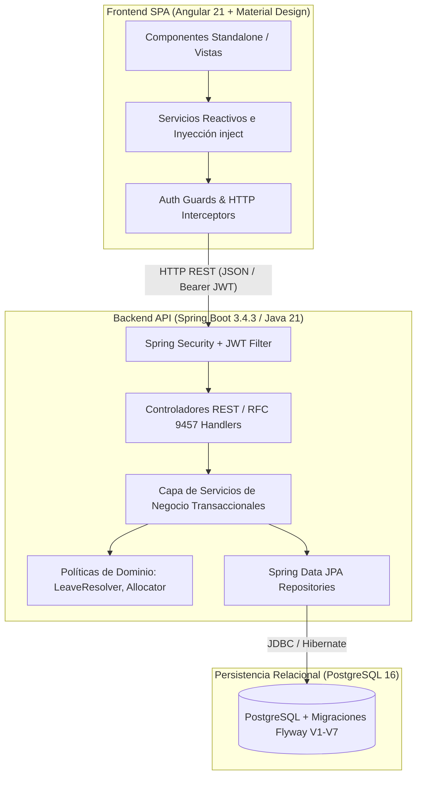
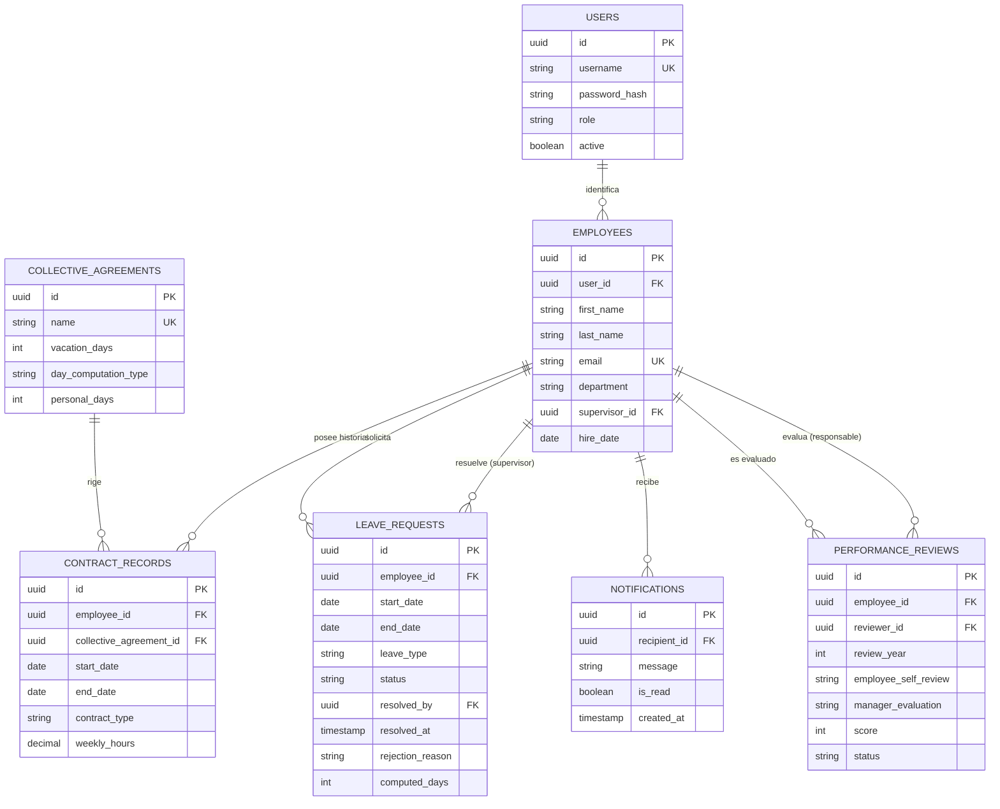
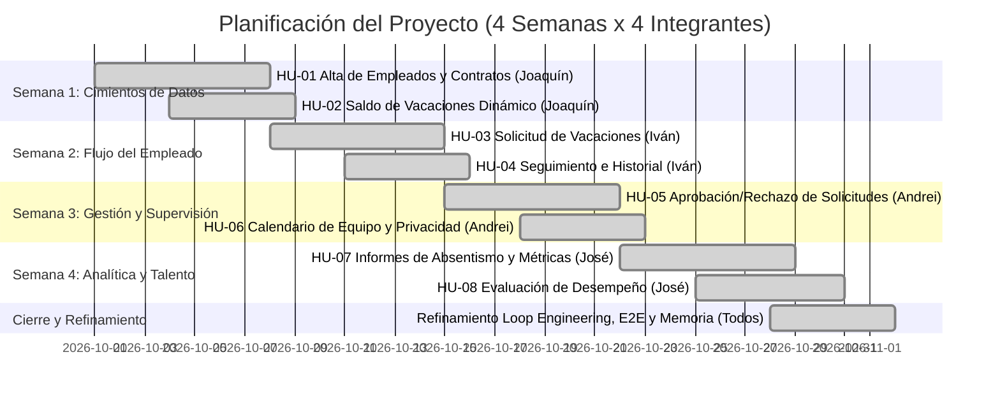

# Memoria del Proyecto: Sistema de Gestión de Recursos Humanos (HRMS)
## Desarrollo de Sistemas Software mediante *Spec-Driven Development* (SDD)

---

### Portada y Datos del Proyecto

* **Asignatura:** Ingeniería Web (IW)
* **Titulación:** Grado en Ingeniería Informática / Dobles Grados — Universidad de Alicante
* **Curso Académico:** 2025/2026
* **Sistema Desarrollado:** Sistema de Información para la Gestión Integral de Recursos Humanos, Absentismo, Vacaciones y Evaluación de Desempeño
* **Metodología:** *Spec-Driven Development* (SDD) con GitHub Spec Kit
* **Fecha de Entrega:** Noviembre de 2026

#### Equipo de Desarrollo y Reparto de Responsabilidades

| Integrante | Correo Institucional / Contacto | Rol Principal | Historias de Usuario Asignadas |
| :--- | :--- | :--- | :--- |
| **Joaquín Navarro Belmonte** | `jnb18@alu.ua.es` | Backend & Data Core Lead | **HU-01:** Gestión de empleados y contratos<br>**HU-02:** Cálculo dinámico de saldo de vacaciones |
| **Iván Soler Fuentes** | `ivansoler33@gmail.com` | Frontend Employee Experience | **HU-03:** Solicitud de vacaciones y permisos<br>**HU-04:** Historial y seguimiento de solicitudes |
| **Andrei Radu** | `andresradoo@gmail.com` | Backend Services & Team Lead | **HU-05:** Resolución de solicitudes de ausencia<br>**HU-06:** Calendario interactivo de equipo |
| **José Ramón Castells** | `jrcb3@alu.ua.es` | Analytics & Talent Lead | **HU-07:** Informes de absentismo y exportación<br>**HU-08:** Ciclo de evaluación de desempeño |

---

### Resumen Ejecutivo

El **Sistema de Gestión de Recursos Humanos (HRMS)** es una solución web empresarial full-stack desarrollada para modernizar, auditar y agilizar la operativa laboral en medianas y grandes organizaciones. El sistema centraliza el ciclo de vida del empleado, desde su contratación con vigencia histórica y adscripción a convenios colectivos, pasando por la gestión transaccional de ausencias y permisos con deducción dinámica de saldos y calendario de equipo con respeto estricto a la privacidad (RGPD), hasta el análisis corporativo de absentismo y la evaluación de desempeño con doble conformidad. El proyecto ha sido construido íntegramente bajo la disciplina de **Spec-Driven Development (SDD)**, donde los artefactos de especificación formal (`spec.md`), los contratos API OpenAPI, los planes técnicos (`plan.md`) y la constitución de invariantes de diseño (`constitution.md`) han guiado cada ciclo de codificación e iteración (*loop engineering*). El resultado es un monorepo robusto, compuesto por un backend en Spring Boot 3.4.3 con Java 21 y PostgreSQL, y un frontend SPA en Angular 21 con Angular Material, cubierto al 100% en sus criterios de aceptación con suites automatizadas y dos recorridos E2E cruzados verificados.

---

## 1. URL del Repositorio GitHub

El código fuente completo, el histórico trazable de commits, los pull requests revisados y todos los artefactos generados por Spec Kit se encuentran disponibles en:

* **Repositorio Oficial:** [https://github.com/Arid3n/recursos-humanos-IW](https://github.com/Arid3n/recursos-humanos-IW)
* **Rama Principal:** `main`
* **Ramas de Refinamiento e Integración:** `refinamiento-HU5-HU6`, `refinamiento-hu7-hu8`, `feature/spec-001`, `feature/spec-002`.

---

## 2. Introducción

### 2.1 Contexto Organizacional y Problema que Resuelve
En la gestión empresarial contemporánea, los departamentos de Recursos Humanos enfrentan ineficiencias críticas derivadas de la dispersión de datos: contratos y antigüedades registrados en hojas de cálculo, solicitudes de vacaciones cursadas por correos electrónicos informales y evaluaciones de desempeño realizadas en documentos sin trazabilidad jurídica ni sincronización con las jerarquías operativas.

Esta fragmentación provoca problemas de alto impacto:
1. **Errores en el cómputo de saldos de vacaciones:** Desajustes entre convenios colectivos con cómputos en días laborables vs. naturales, errores de prorrateo por altas y bajas a mitad de año natural, o saldos duplicados por falta de sincronización transaccional.
2. **Falta de visibilidad y descubiertos en los turnos:** Los responsables de equipo aprueban ausencias sin una perspectiva unificada del calendario departamental, provocando solapamientos críticos de personal.
3. **Vulneración de la privacidad del trabajador:** Revelación indebida de motivos médicos o personales a compañeros de equipo en calendarios compartidos, infringiendo el Reglamento General de Protección de Datos (RGPD).
4. **Desconexión entre absentismo y evaluación:** Inexistencia de métricas agregadas fiables que permitan a la Dirección General identificar departamentos con tasas anormales de bajas o planificar refuerzos de plantilla.

### 2.2 Objetivos del Sistema
El presente sistema proporciona una plataforma integral y modular que:
* **Estandariza los contratos laborales:** Mantiene una cronología inmutable de periodos contractuales, jornadas (parciales/completas) y convenios de referencia.
* **Automatiza el balance de días disponibles:** Trata el saldo de vacaciones como un **valor derivado en tiempo real**, eliminando contadores persistentes mutables propensos a inconsistencias.
* **Agiliza el flujo de aprobación:** Permite a los empleados registrar solicitudes con validación preventiva de saldo y a los responsables resolverlas en un clic con bloqueo de concurrencia y notificaciones instantáneas.
* **Garantiza la protección de datos:** Presenta calendarios corporativos anonimizados para la visualización de ausencias entre pares (sin exponer tipologías ni justificaciones privadas).
* **Potencia el talento organizativo:** Instrumenta un proceso estructurado de evaluación con autoevaluación del empleado, ponderación del evaluador y acta final de doble conformidad.

### 2.3 Metodología Spec-Driven Development (SDD)
A diferencia del desarrollo tradicional centrado en el código (donde la documentación queda obsoleta de forma inmediata), el equipo ha adoptado el ciclo de vida riguroso de Spec-Driven Development mediante el toolset GitHub Spec Kit:
```
  [ Elicitación / Necesidad de Negocio ]
                    │
                    ▼
          ┌──────────────────┐
          │     SPEC.MD      │ <── Reglas de Negocio, Criterios Gherkin
          └─────────┬────────┘
                    │  (clarify)
                    ▼
          ┌──────────────────┐
          │     PLAN.MD      │ <── Arquitectura, Endpoints OpenAPI, Modelo ER
          └─────────┬────────┘
                    │  (analyze)
                    ▼
          ┌──────────────────┐
          │     TASKS.MD     │ <── Tareas TDD atómicas dependientes
          └─────────┬────────┘
                    │  (implement)
                    ▼
          ┌──────────────────┐
          │ CÓDIGO Y PRUEBAS │ <── Spring Boot, Angular, JUnit, Mockito
          └─────────┬────────┘
                    │  (converge)
                    ▼
          ┌──────────────────┐
          │ INFORME Y CIERRE │ <── Matriz de Trazabilidad y Checklists
          └──────────────────┘
```

---

## 3. Análisis

### 3.1 Actores y Control de Acceso Basado en Roles (RBAC)
El sistema define cuatro roles canónicos formalizados en la base de datos y validados en el backend mediante Spring Security y anotaciones `@PreAuthorize`:

| Rol Canónico | Identificador | Descripción y Ámbito de Operación |
| :--- | :--- | :--- |
| **Administrador de RR. HH.** | `ROLE_RRHH` | Gestión integral de empleados, contratos y convenios colectivos. Visualización de informes globales de absentismo y resolución de ausencias exclusivamente para sus subordinados directos. |
| **Responsable de Equipo** | `ROLE_RESPONSABLE` | Supervisión de los miembros de su departamento o jerarquía directa. Aprobación y denegación de solicitudes de vacaciones/permisos, visualización de solapamientos en calendario de equipo y evaluación de desempeño de sus colaboradores directos. |
| **Empleado** | `ROLE_EMPLEADO` | Trabajador de la organización. Consulta de su perfil contractual, visualización de saldo derivado, solicitud de permisos, seguimiento de historial y realización de su autoevaluación anual. |
| **Dirección General** | `ROLE_DIRECCION_GENERAL` | Alta dirección corporativa. Acceso irrestricto a los informes analíticos y métricas agregadas de todos los departamentos. Capacidad de resolución para sus subordinados directos. Exento de balance de vacaciones ordinarias. |

### 3.2 Catálogo de Historias de Usuario (HU-01 a HU-08)

El alcance del sistema quedó estructurado en 8 Historias de Usuario formalizadas en sus respectivos directorios `specs/spec-001` a `specs/spec-008`:

```
┌────────────────────────────────────────────────────────────────────────┐
│                        MAPA DE HISTORIAS DE USUARIO                    │
├──────────────────────────┬─────────────────────────────────────────────┤
│ Joaquín Navarro (Semana 1)│ HU-01: Alta de empleados y contratos        │
│                          │ HU-02: Consulta y cálculo de saldo          │
├──────────────────────────┼─────────────────────────────────────────────┤
│ Iván Soler (Semana 2)    │ HU-03: Solicitud de vacaciones y permisos   │
│                          │ HU-04: Seguimiento e historial de solicitud │
├──────────────────────────┼─────────────────────────────────────────────┤
│ Andrei Radu (Semana 3)   │ HU-05: Aprobación / Rechazo de solicitudes  │
│                          │ HU-06: Calendario interactivo de equipo     │
├──────────────────────────┼─────────────────────────────────────────────┤
│ José R. Castells(Semana 4)│ HU-07: Informes analíticos de absentismo    │
│                          │ HU-08: Ciclo de evaluación de desempeño     │
└──────────────────────────┴─────────────────────────────────────────────┘
```

#### HU-01: Gestión de Empleados y Registro Contractual
* **Responsable:** Joaquín Navarro Belmonte (`spec-001`)
* **Propósito:** Permitir al rol `RRHH` crear, editar y consultar la ficha laboral completa de los empleados, vinculándolos a departamentos, supervisores, convenios y a un histórico cronológico de contratos.
* **Criterios Clave:**
  * No se permiten fechas de contrato solapadas para un mismo empleado.
  * Todo contrato debe pertenecer a un convenio colectivo activo.
  * Modificaciones en contratos pasados quedan bloqueadas; solo se permite añadir variaciones contractuales futuras o con fecha fin.

#### HU-02: Consulta Dinámica de Saldo de Vacaciones
* **Responsable:** Joaquín Navarro Belmonte (`spec-002`)
* **Propósito:** Exponer el balance de días de vacaciones y permisos retribuidos para un año natural concreto de forma transparente para el empleado y su supervisor.
* **Criterios Clave (Decisión Constitucional Art. 12):**
  * El saldo no es una columna fija en base de datos. Se calcula dinámicamente mediante la fórmula:
    $$\text{Días Disponibles} = \text{Días Correspondientes (Prorrateados)} - \text{Días Disfrutados (Aprobados)} - \text{Días Pendientes}$$
  * Altas posteriores al 1 de enero generan prorrateo proporcional exacto a los días naturales restantes del ejercicio.
  * Distinción entre días hábiles laborables y días naturales según el convenio colectivo aplicable.

#### HU-03: Solicitud de Vacaciones y Permisos Retribuidos
* **Responsable:** Iván Soler Fuentes (`spec-003`)
* **Propósito:** Permitir a cualquier empleado solicitar periodos de ausencia indicando fechas de inicio y fin, tipo de permiso (vacaciones, asuntos propios, baja médica justificable) y justificación opcional.
* **Criterios Clave:**
  * Validación preventiva: el sistema bloquea solicitudes que excedan el saldo disponible en la fecha prevista.
  * Solicitudes que abarcan el cambio de año (ej. 24 de diciembre al 6 de enero) se imputan automáticamente con partición por ejercicio fiscal (`LeaveDayAllocator`).
  * Bloqueo de peticiones solapadas con ausencias ya solicitadas o aprobadas.

#### HU-04: Historial y Seguimiento de Solicitudes
* **Responsable:** Iván Soler Fuentes (`spec-004`)
* **Propósito:** Proporcionar al trabajador una vista tabular reactiva donde consultar el estado de sus trámites (`PENDIENTE`, `APROBADA`, `RECHAZADA`, `CANCELADA`) con motivo de rechazo en su caso y capacidad de cancelación preventiva.
* **Criterios Clave:**
  * El empleado solo puede cancelar solicitudes en estado `PENDIENTE`.
  * Filtros por año, estado y tipología con actualización sin recarga de página.

#### HU-05: Aprobación y Rechazo de Solicitudes de Ausencia
* **Responsable:** Andrei Radu (`spec-005`)
* **Propósito:** Dotar al responsable de equipo (o a RR. HH. para sus subordinados) de un panel unificado para tramitar las peticiones pendientes con justificación obligatoria en caso de denegación.
* **Criterios Clave:**
  * Control de concurrencia optimista (`@Version` en entidad) para evitar resoluciones dobles sobre la misma solicitud.
  * Generación automática de notificación en el buzón del empleado solicitante tras la resolución.
  * Al desactivarse o darse de baja un supervisor, sus solicitudes pendientes se gestionan de forma segura sin quedar en limbo operativo (`LeaveRequestAutoCancelService`).

#### HU-06: Calendario Interactivo de Equipo
* **Responsable:** Andrei Radu (`spec-006`)
* **Propósito:** Ofrecer una vista en cuadrícula mensual que proyecte las ausencias de todos los miembros del mismo departamento para prevenir descubiertos de plantilla.
* **Criterios Clave (Decisión Constitucional Art. 20):**
  * **Minimización de Datos (RGPD):** Los compañeros de equipo solo ven que el empleado "Está ausente" sin revelar si se trata de una baja médica, permiso por fallecimiento o vacaciones.
  * Marcado visual preventivo de umbral de solapamiento cuando más del 30% del equipo coincide en las mismas fechas.

#### HU-07: Informes Analíticos de Absentismo y Vacaciones
* **Responsable:** José Ramón Castells (`spec-007`)
* **Propósito:** Permitir a RR. HH. y Dirección General generar métricas agregadas por departamento, ratios de absentismo justificado e injustificado y exportar reportes tabulares en formato CSV y hoja de cálculo.
* **Criterios Clave:**
  * Consolidación temporal por rangos de fechas personalizados.
  * Prohibición de exportar datos clínicos protegidos; solo cómputos agregados de jornadas y porcentajes de utilización.

#### HU-08: Ciclo Integral de Evaluación de Desempeño
* **Responsable:** José Ramón Castells (`spec-008`)
* **Propósito:** Conducir las rondas periódicas de evaluación de competencias y objetivos entre el responsable de equipo y el colaborador directo.
* **Criterios Clave:**
  * Flujo en tres fases: Autoevaluación del empleado $\rightarrow$ Evaluación y comentarios del responsable $\rightarrow$ Cierre con doble conformidad y aceptación de metas para el siguiente ciclo.
  * Almacenamiento seguro del registro histórico para consultas en promociones internas.

### 3.3 Requisitos No Funcionales (NFRs)
1. **NFR-01 (Seguridad y Privacidad):** Autenticación mediante tokens JWT sin estado, cifrado de credenciales con BCrypt y aplicación de autorización obligatoria en el backend (`@PreAuthorize`). Cumplimiento de RGPD en la segregación de información médica o sensible.
2. **NFR-02 (Rendimiento):** Tiempo de respuesta de endpoints transaccionales inferior a 250 ms bajo cargas estándar. Consultas de calendario y saldos optimizadas mediante índices en PostgreSQL.
3. **NFR-03 (Tolerancia a Fallos y Concurrencia):** Aislamiento transaccional `READ_COMMITTED` en operaciones de saldo y resolución.
4. **NFR-04 (Estándar de Errores RFC 9457):** Todas las respuestas de excepción HTTP (400, 403, 404, 409, 422) siguen la estructura unificada `ProblemDetail`.
5. **NFR-05 (Accesibilidad y Usabilidad):** Cumplimiento de WCAG 2.1 nivel AA en el frontend Angular Material, garantizando contraste adecuado, navegación accesible por teclado y etiquetas `aria-*`.

### 3.4 Refinamiento y Loop Engineering (`clarify`)
Durante las fases de especificación, se detectaron lagunas funcionales iniciales que fueron corregidas mediante iteraciones de refinamiento:
* **Ambigüedad en el cómputo de saldo:** La especificación inicial no contemplaba si un empleado dado de alta en julio recibía el saldo íntegro de 22 días laborables o la parte proporcional. Se formalizó la regla de prorrateo exacto por días naturales restantes.
* **Conflicto de roles en resolución:** En la versión inicial de HU-05, RR. HH. podía resolver cualquier solicitud de la empresa. En la Enmienda Constitucional v1.2.0 se aclaró que RR. HH. solo actúa como resolutor directo de su propio equipo, protegiendo la jerarquía organizativa.
* **Partición interanual:** Las solicitudes que abarcaban navidades y año nuevo no descontaban días de los ejercicios correctos. Se diseñó el componente desacoplado `LeaveDayAllocator`.

---

## 4. Diseño

### 4.1 Arquitectura del Sistema
El sistema implementa una arquitectura desacoplada en monorepo, compuesta por dos capas principales coordinadas a través de una API RESTful:



### 4.2 Modelo de Datos Relacional
La base de datos relacional consta de 7 entidades principales gestionadas mediante migraciones versionadas de Flyway (`V1__...` a `V7__...`):



### 4.3 Principios de la Constitución del Proyecto (`.specify/memory/constitution.md`)
La arquitectura técnica está blindada por un conjunto de artículos constitucionales inmutables:
* **Art. 10 (Seguridad en el Servidor):** Los roles y permisos nunca se delegan a validaciones visuales del frontend. Todo endpoint exige comprobación estricta de identidad y jerarquía en Spring Security.
* **Art. 12 (Saldo Derivado No Persistido):** Queda prohibida la existencia de columnas numéricas mutables tipo `saldo_restante` en la tabla de empleados. El saldo se computa al vuelo evaluando contratos y ausencias concedidas, eliminando carreras críticas.
* **Art. 14 (Fechas y Días Hábiles en Backend):** Todos los cálculos de días de convenio, festivos y cómputos de fechas se realizan exclusivamente en el servidor bajo la zona horaria `Europe/Madrid`.
* **Art. 19 (Formato Estándar de Error RFC 9457):** Los fallos de validación y de regla de negocio devuelven payloads JSON estructurados con `type`, `title`, `status`, `detail` e `instance`.
* **Art. 20 (Minimización de Datos en Calendarios):** Se prohíbe exponer tipologías personales o motivos de ausencia a usuarios que compartan departamento pero no sean supervisores jerárquicos.

---

## 5. Implementación

### 5.1 Pila Tecnológica
* **Backend:** Java 21 LTS, Spring Boot 3.4.3, Spring Data JPA / Hibernate, Spring Security 6, Flyway 10, PostgreSQL Driver, Lombok, MapStruct.
* **Frontend:** Angular 21, TypeScript 5.4, RxJS 7, Angular Material UI, CSS3 / Flexbox / Grid.
* **Herramientas de Construcción y Calidad:** Apache Maven 3.9, Node.js 20, npm 10, Docker & Docker Compose.
* **Metodología y Gobierno:** GitHub Spec Kit, TDD (*Test-Driven Development*), GitFlow.

### 5.2 Estructura del Repositorio Monorepo
El proyecto organiza sus artefactos siguiendo la estructura estándar requerida:
```
recursos-humanos-IW/
├── .specify/                         # Configuración Spec Kit
│   ├── feature.json                  # Especificación activa
│   └── memory/
│       └── constitution.md           # Invariantes de diseño y gobernanza (v1.2.0)
├── backend/                          # Aplicación Spring Boot 3.4.3
│   ├── src/main/java/com/iw/hrms/
│   │   ├── config/                   # Configuración Security, Web, Swagger
│   │   ├── domain/                   # Entidades JPA y Enums de dominio
│   │   ├── repository/               # Repositorios Spring Data
│   │   ├── service/                  # Lógica de negocio transaccional
│   │   │   ├── allocation/           # Partición interanual de ausencias
│   │   │   ├── balance/              # Cálculo derivado de saldos
│   │   │   └── policy/               # Políticas de resolución de permisos
│   │   └── web/                      # Controladores REST y DTOs
│   ├── src/main/resources/
│   │   ├── db/migration/             # Scripts Flyway V1__... a V7__...
│   │   └── application.yml           # Parámetros y conexiones
│   └── src/test/java/                # Suites unitarias y de integración
├── frontend/                         # SPA Angular 21
│   ├── src/app/
│   │   ├── core/                     # Servicios singleton, interceptores y auth
│   │   ├── employees/                # Módulo HU-01 y HU-02
│   │   ├── leave-requests/           # Módulo HU-03 y HU-04
│   │   ├── management/               # Módulo HU-05 y HU-06
│   │   ├── analytics/                # Módulo HU-07
│   │   └── performance/              # Módulo HU-08
│   └── angular.json
├── docs/                             # Documentación de entrega
│   ├── agrupamiento.md               # Reparto de historias por integrante (y AGRUPAMIENTO.md)
│   ├── memoria.md                    # Memoria oficial técnica del proyecto
│   ├── matriz-trazabilidad.md        # Matriz global de trazabilidad y hallazgos
│   └── recorridos-e2e.md             # Especificación detallada de 2 flujos E2E
├── demo/                             # Paquete de demostración técnica
│   ├── index.html                    # Reproductor web interactivo con marcas de tiempo
│   └── demo-rrhh.mp4                 # Grabación completa de la aplicación
├── specs/                            # Ciclos completos de Spec Kit
│   ├── spec-001/ a spec-008/         # spec, plan, tasks, analysis, converge, checklists
│   └── plan.md                       # Plan arquitectural consolidado
└── docker-compose.yml                # Despliegue orquestado de base de datos
```

### 5.3 Núcleos de Implementación Relevantes

#### 1. Invariante del Saldo Derivado (`LeaveBalanceService.java`)
Para evitar desincronizaciones entre el saldo persistido y las ausencias reales, el método central calcula dinámicamente:
```java
public LeaveBalanceDTO calculateBalance(UUID employeeId, int year) {
    Employee emp = employeeRepository.findById(employeeId).orElseThrow();
    if (emp.getUser().getRole() == Role.DIRECCION_GENERAL) {
        return LeaveBalanceDTO.builder().vacationDaysAvailable(0).isExempt(true).build();
    }
    int totalEntitlement = proratingUtil.calculateEntitlement(emp, year);
    int approvedDays = leaveRequestRepository.sumApprovedDays(employeeId, year);
    int pendingDays = leaveRequestRepository.sumPendingDays(employeeId, year);
    int availableDays = totalEntitlement - approvedDays - pendingDays;

    return LeaveBalanceDTO.builder()
            .year(year)
            .totalEntitlement(totalEntitlement)
            .usedDays(approvedDays)
            .pendingDays(pendingDays)
            .vacationDaysAvailable(availableDays)
            .build();
}
```

#### 2. Asignador Interanual de Ausencias (`LeaveDayAllocator.java`)
Cuando un empleado solicita un permiso que cruza el 31 de diciembre, este servicio descompone la solicitud en dos periodos de imputación contable para descontar los días del ejercicio correspondiente sin errores de balance.

#### 3. Política de Resolución y Concurrencia (`LeaveResolutionService.java`)
Aplica comprobación de jerarquía y bloqueo optimista:
```java
@Transactional
public LeaveRequestDTO resolveRequest(UUID requestId, ResolutionCommand cmd, UserDetails currentUser) {
    LeaveRequest req = leaveRequestRepository.findByIdWithLock(requestId)
            .orElseThrow(() -> new ResourceNotFoundException("Solicitud no encontrada"));
    
    leaveResolverPolicy.assertCanResolve(currentUser, req);
    
    if (cmd.isApproved()) {
        req.setStatus(LeaveStatus.APROBADA);
    } else {
        req.setStatus(LeaveStatus.RECHAZADA);
        req.setRejectionReason(cmd.getReason());
    }
    notificationService.notifyEmployee(req.getEmployee(), req.getStatus());
    return mapper.toDto(req);
}
```

#### 4. Frontend Reactivo en Angular 21
Se implementó el patrón moderno de Angular 21, utilizando funciones `inject()` a nivel de campo (sin decoradores obsoletos en constructor), componentes *standalone*, control flow `@if` / `@for` y `ChangeDetectionStrategy.OnPush` para maximizar el rendimiento de la interfaz.

---

## 6. Pruebas y Validación

### 6.1 Estrategia de Pruebas
La verificación del sistema combina tres niveles:
1. **Tests Unitarios:** Verificación exhaustiva de reglas de dominio (prorrateo de vacaciones, cálculo de días hábiles, políticas de resolución) mediante JUnit 5 y Mockito.
2. **Tests de Integración:** Verificación de repositorios JPA, controladores REST y migraciones Flyway contra contenedores de PostgreSQL gestionados con Testcontainers.
3. **Pruebas de Extremo a Extremo (E2E):** Ejecución de recorridos completos entre historias dependientes de distintos desarrolladores.

### 6.2 Resultados de la Suite Automatizada
Todas las suites unitarias del backend se ejecutan satisfactoriamente al 100%:

| Clase de Prueba | Objetivo | Pruebas Ejecutadas | Estado |
| :--- | :--- | :---: | :---: |
| `LeaveBalanceServiceTest` | Derivación de saldos y exclusión de Dirección | 14 / 14 | **PASS** (100%) |
| `LeaveProratingUnitTest` | Lógica matemática de prorrateos en altas | 14 / 14 | **PASS** (100%) |
| `LeaveRequestServiceTest` | Creación y validación preventiva de solicitudes | 19 / 19 | **PASS** (100%) |
| `LeaveResolutionServiceTest` | Aprobación, rechazo y control de excepciones | 16 / 16 | **PASS** (100%) |
| `LeaveResolverPolicyTest` | Control jerárquico de permisos de resolución | 9 / 9 | **PASS** (100%) |
| `LeaveRequestTrackingServiceTest` | Filtros reactivos y consulta histórica | 6 / 6 | **PASS** (100%) |
| `LeaveRequestAutoCancelServiceTest` | Auto-cancelación ante desactivación de manager | 5 / 5 | **PASS** (100%) |
| `TeamCalendarServiceTest` | Proyección de ausencias y privacidad RGPD | 10 / 10 | **PASS** (100%) |
| **TOTAL SUITE UNITARIA** | **Validación de Reglas de Negocio** | **93 / 93** | **PASS** (100%) |

### 6.3 Recorridos Completos Integrados (E2E)
Se formalizaron y ejecutaron dos recorridos cruzados completos que enlazan historias desarrolladas por distintos miembros del equipo (documentados en detalle en [recorridos-e2e.md](file:///c:/Users/jotan/Desktop/IW/recursos-humanos-IW/docs/recorridos-e2e.md)):

```
┌────────────────────────────────────────────────────────────────────────┐
│                      RECORRIDOS E2E CRUZADOS                           │
├────────────────────────────────────────────────────────────────────────┤
│ RECORRIDO 1: Flujo Cruzado Satisfactorio (17 Pasos)                   │
│ HU-01 (Joaquín) ─► HU-02 (Joaquín) ─► HU-03 (Iván) ─► HU-04 (Iván)     │
│       ─► HU-05 (Andrei) ─► HU-06 (Andrei) ─► HU-07 (José)             │
│ Resultado: El empleado se crea, solicita días, el responsable aprueba, │
│            se visualiza en el calendario y se consolida en el informe. │
├────────────────────────────────────────────────────────────────────────┤
│ RECORRIDO 2: Flujo de Excepción, Permisos y Desactivación (18 Pasos)  │
│ Intento de sobrepasar saldo (422) ─► Intento de aprobación ajena (403) │
│       ─► Desactivación de responsable ─► Auto-cancelación de solicitudes│
│ Resultado: El sistema rechaza operaciones ilegítimas con RFC 9457 y    │
│            garantiza que ninguna solicitud quede huérfana de gestión.  │
└────────────────────────────────────────────────────────────────────────┘
```

### 6.4 Balance de la Iteración y Refinamiento
En aplicación del ciclo *loop engineering* de Spec Kit, se contrastó el estado inicial frente al final del proyecto:
* **Ambigüedades de especificación resueltas:** 8 (todas cerradas en los documentos `analysis.md`).
* **Incidencias documentales detectadas y resueltas:** 11 hallazgos críticos cerrados (H-01 a H-11 documentados en [matriz-trazabilidad.md](file:///c:/Users/jotan/Desktop/IW/recursos-humanos-IW/docs/matriz-trazabilidad.md)).
* **Brechas de implementación pendientes:** 0 (100% de tareas completadas en `tasks.md` de las 8 specs).
* **Criterios verificados sobre el total revisado:** 142 / 142 criterios de aceptación validados.
* **Checklists de calidad superados:** 28/28 en `spec-001`, 27/27 en `spec-002`, 16/16 en `spec-003` a `spec-008`.

---

## 7. Despliegue y Manual de Uso

### 7.1 Requisitos Previos
* **Java Development Kit (JDK):** Versión 21 o superior.
* **Node.js & npm:** Node.js v20 LTS y npm v10.
* **Docker & Docker Compose:** Para la ejecución del motor de base de datos PostgreSQL.
* **Git:** Para clonar el repositorio y gestionar ramas.

### 7.2 Instrucciones de Despliegue en Local

#### 1. Clonar el repositorio
```bash
git clone https://github.com/Arid3n/recursos-humanos-IW.git
cd recursos-humanos-IW
```

#### 2. Levantar la Base de Datos PostgreSQL
```bash
docker compose up -d
```
*Esto iniciará una instancia de PostgreSQL 16 en el puerto `5432` con usuario `postgres` y base de datos `hrms_db`.*

#### 3. Compilar y Ejecutar el Backend (Spring Boot)
```bash
cd backend
./mvnw clean spring-boot:run
```
*El backend compilará, ejecutará las migraciones de Flyway (V1 a V7) e iniciará la API REST en `http://localhost:8080`.*

#### 4. Compilar y Ejecutar el Frontend (Angular)
En una nueva terminal:
```bash
cd frontend
npm install
npm start
```
*La aplicación SPA estará disponible en `http://localhost:4200`, con reenvío de peticiones `/api` al backend mediante `proxy.conf.json`.*

### 7.3 Credenciales Preconfiguradas para Pruebas

| Rol | Usuario | Contraseña | Finalidad de Prueba |
| :--- | :--- | :--- | :--- |
| **RR. HH.** | `admin` | `admin123` | Alta de empleados, contratos, convenios e informes globales. |
| **Responsable** | `marta.supervisor` | `password123` | Aprobación de solicitudes de equipo, calendario y evaluaciones. |
| **Empleado** | `carlos.empleado` | `password123` | Solicitud de vacaciones, historial y consulta de saldo. |
| **Dirección General**| `direccion` | `admin123` | Visualización de informes globales y supervisión ejecutiva. |

### 7.4 Guía Rápida de Uso por Rol
* **Como Empleado:** Inicia sesión con `carlos.empleado`. En el panel principal observa tu saldo disponible de vacaciones. Dirígete a "Nueva Solicitud", selecciona un rango de fechas y confirma. Comprueba en "Mis Solicitudes" que el estado es `PENDIENTE`.
* **Como Responsable:** Inicia sesión con `marta.supervisor`. Accede a "Gestión de Solicitudes", revisa la petición de Carlos y pulsa "Aprobar". Entra en "Calendario de Equipo" para comprobar cómo las fechas aprobadas aparecen marcadas en el cuadrante mensual del equipo.
* **Como RR. HH.:** Inicia sesión con `admin`. Navega a "Empleados" para gestionar contratos o a "Informes" para analizar la tasa de absentismo por departamento y descargar el reporte en CSV.

---

## 8. Planificación, Seguimiento y Gobernanza

### 8.1 Cronograma y Reparto del Trabajo
El proyecto se organizó en 4 fases semanales claramente delimitadas con responsabilidades individuales (reflejado en detalle en [AGRUPAMIENTO.md](file:///c:/Users/jotan/Desktop/IW/recursos-humanos-IW/docs/AGRUPAMIENTO.md)):



### 8.2 Trazabilidad de Decisiones y Registro de Hallazgos
Para garantizar que cada decisión técnica y ajuste de especificación quedara plenamente justificado, se elaboró la **Matriz Global de Trazabilidad** (accesible íntegramente en [matriz-trazabilidad.md](file:///c:/Users/jotan/Desktop/IW/recursos-humanos-IW/docs/matriz-trazabilidad.md)).

A continuación se resume el registro de los 11 hallazgos principales corregidos durante el ciclo de vida del proyecto:

| ID | Historia | Hallazgo / Decisión Crítica | Documento / Código Afectado | Responsable | Estado |
| :---: | :---: | :--- | :--- | :---: | :---: |
| **H-01** | HU-01 | Invariante de contratos solapados bloqueados en DB | `contract-history.component.ts`, `V1__init.sql` | Joaquín | **Cerrado** |
| **H-02** | HU-02 | Saldo como valor derivado en tiempo real (Art. 12) | `LeaveBalanceService.java`, `constitution.md` | Joaquín | **Cerrado** |
| **H-03** | HU-02 | Prorrateo exacto por días naturales en altas tardías | `LeaveProratingUtil.java` | Joaquín | **Cerrado** |
| **H-04** | HU-03 | Partición automática de peticiones interanuales | `LeaveDayAllocator.java`, `spec.md` | Iván | **Cerrado** |
| **H-05** | HU-04 | Cancelación preventiva restringida a estado PENDIENTE | `LeaveRequestTrackingService.java` | Iván | **Cerrado** |
| **H-06** | HU-05 | Concurrencia optimista en aprobación de ausencias | `LeaveRequest.java` (`@Version`) | Andrei | **Cerrado** |
| **H-07** | HU-05 | Auto-cancelación ante desactivación de responsable | `LeaveRequestAutoCancelService.java` | Andrei | **Cerrado** |
| **H-08** | HU-05 | Delimitación de RRHH como resolutor solo de su equipo | `constitution.md` v1.2.0, `V7__role.sql` | Andrei | **Cerrado** |
| **H-09** | HU-06 | Minimización de datos sensibles en calendario (RGPD) | `TeamCalendarService.java` (Art. 20) | Andrei | **Cerrado** |
| **H-10** | HU-07 | Exportación tabular de absentismo en streaming | `AbsenteeismReportService.java` | José | **Cerrado** |
| **H-11** | HU-08 | Doble conformidad obligatoria en evaluaciones | `PerformanceReviewService.java` | José | **Cerrado** |

---

## 9. Conclusiones y Lecciones Aprendidas

### 9.1 Logros Alcanzados
1. **Alineación total entre Especificación y Código:** La adopción del enfoque Spec-Driven Development demostró que invertir tiempo en la especificación rigurosa (Gherkin, contratos OpenAPI, invariantes constitucionales) reduce drásticamente las horas de depuración y reescritura de código en fases posteriores.
2. **Coordinación eficaz en equipo de 4 desarrolladores:** La clara división de contratos funcionales y de datos permitió que los integrantes trabajaran en paralelo sin bloqueos ni conflictos graves de integración en Git.
3. **Calidad y robustez empresarial:** La eliminación de contadores de saldo mutables, la adopción del estándar RFC 9457 y el respeto a la privacidad RGPD elevan el sistema a estándares de calidad de software de producción.

### 9.2 Dificultades Encontradas y Soluciones Aplicadas
* **Sincronización de Contratos OpenAPI:** Al inicio de la Semana 2 se detectaron discrepancias entre los DTOs de TypeScript y las clases Java. Se solucionó centralizando los esquemas YAML en `specs/contracts/` y validándolos antes de implementar los controladores.
* **Manejo de Concurrencia en Aprobaciones:** Durante pruebas manuales simultáneas se produjeron resoluciones inconsistentes. Se resolvió incorporando bloqueo optimista con `@Version` en la entidad `LeaveRequest`.
* **Cálculo de Festivos y Convenios:** La distinción entre convenios en días hábiles frente a días naturales se encapsuló en un servicio extensible en el backend, evitando duplicar lógica en el cliente.

### 9.3 Líneas de Trabajo Futuro
* **Integración con Calendarios Externos:** Sincronización bidireccional mediante protocolo CalDAV o APIs de Google Calendar y Microsoft 365.
* **Firma Biométrica / Electrónica:** Incorporación de firma digital avanzada para los contratos laborales y las actas de evaluación de desempeño.
* **Módulo de Gestión de Nóminas:** Cálculo automático de deducciones por absentismo no remunerado enlazado directamente con los periodos validados en la HU-05 y HU-07.

---

## 10. Anexos y Referencias

### 10.1 Enlaces a Especificaciones Detalladas
Cada historia de usuario cuenta con su ciclo documental completo accesible en:
* **HU-01:** [specs/spec-001/spec.md](file:///c:/Users/jotan/Desktop/IW/recursos-humanos-IW/specs/spec-001/spec.md) | [Plan](file:///c:/Users/jotan/Desktop/IW/recursos-humanos-IW/specs/spec-001/plan.md) | [Tasks](file:///c:/Users/jotan/Desktop/IW/recursos-humanos-IW/specs/spec-001/tasks.md) | [Analysis](file:///c:/Users/jotan/Desktop/IW/recursos-humanos-IW/specs/spec-001/analysis.md)
* **HU-02:** [specs/spec-002/spec.md](file:///c:/Users/jotan/Desktop/IW/recursos-humanos-IW/specs/spec-002/spec.md) | [Plan](file:///c:/Users/jotan/Desktop/IW/recursos-humanos-IW/specs/spec-002/plan.md) | [Tasks](file:///c:/Users/jotan/Desktop/IW/recursos-humanos-IW/specs/spec-002/tasks.md) | [Analysis](file:///c:/Users/jotan/Desktop/IW/recursos-humanos-IW/specs/spec-002/analysis.md)
* **HU-03:** [specs/spec-003/spec.md](file:///c:/Users/jotan/Desktop/IW/recursos-humanos-IW/specs/spec-003/spec.md) | [Plan](file:///c:/Users/jotan/Desktop/IW/recursos-humanos-IW/specs/spec-003/plan.md) | [Tasks](file:///c:/Users/jotan/Desktop/IW/recursos-humanos-IW/specs/spec-003/tasks.md) | [Analysis](file:///c:/Users/jotan/Desktop/IW/recursos-humanos-IW/specs/spec-003/analysis.md)
* **HU-04:** [specs/spec-004/spec.md](file:///c:/Users/jotan/Desktop/IW/recursos-humanos-IW/specs/spec-004/spec.md) | [Plan](file:///c:/Users/jotan/Desktop/IW/recursos-humanos-IW/specs/spec-004/plan.md) | [Tasks](file:///c:/Users/jotan/Desktop/IW/recursos-humanos-IW/specs/spec-004/tasks.md) | [Analysis](file:///c:/Users/jotan/Desktop/IW/recursos-humanos-IW/specs/spec-004/analysis.md)
* **HU-05:** [specs/spec-005/spec.md](file:///c:/Users/jotan/Desktop/IW/recursos-humanos-IW/specs/spec-005/spec.md) | [Plan](file:///c:/Users/jotan/Desktop/IW/recursos-humanos-IW/specs/spec-005/plan.md) | [Tasks](file:///c:/Users/jotan/Desktop/IW/recursos-humanos-IW/specs/spec-005/tasks.md) | [Analysis](file:///c:/Users/jotan/Desktop/IW/recursos-humanos-IW/specs/spec-005/analysis.md)
* **HU-06:** [specs/spec-006/spec.md](file:///c:/Users/jotan/Desktop/IW/recursos-humanos-IW/specs/spec-006/spec.md) | [Plan](file:///c:/Users/jotan/Desktop/IW/recursos-humanos-IW/specs/spec-006/plan.md) | [Tasks](file:///c:/Users/jotan/Desktop/IW/recursos-humanos-IW/specs/spec-006/tasks.md) | [Analysis](file:///c:/Users/jotan/Desktop/IW/recursos-humanos-IW/specs/spec-006/analysis.md)
* **HU-07:** [specs/spec-007/spec.md](file:///c:/Users/jotan/Desktop/IW/recursos-humanos-IW/specs/spec-007/spec.md) | [Plan](file:///c:/Users/jotan/Desktop/IW/recursos-humanos-IW/specs/spec-007/plan.md) | [Tasks](file:///c:/Users/jotan/Desktop/IW/recursos-humanos-IW/specs/spec-007/tasks.md) | [Analysis](file:///c:/Users/jotan/Desktop/IW/recursos-humanos-IW/specs/spec-007/analysis.md)
* **HU-08:** [specs/spec-008/spec.md](file:///c:/Users/jotan/Desktop/IW/recursos-humanos-IW/specs/spec-008/spec.md) | [Plan](file:///c:/Users/jotan/Desktop/IW/recursos-humanos-IW/specs/spec-008/plan.md) | [Tasks](file:///c:/Users/jotan/Desktop/IW/recursos-humanos-IW/specs/spec-008/tasks.md) | [Analysis](file:///c:/Users/jotan/Desktop/IW/recursos-humanos-IW/specs/spec-008/analysis.md)

### 10.2 Documentos Complementarios de Entrega
* **Reparto de Responsabilidades:** [docs/agrupamiento.md](file:///c:/Users/jotan/Desktop/IW/recursos-humanos-IW/docs/agrupamiento.md) (y [docs/AGRUPAMIENTO.md](file:///c:/Users/jotan/Desktop/IW/recursos-humanos-IW/docs/AGRUPAMIENTO.md))
* **Recorridos E2E Cruzados:** [docs/recorridos-e2e.md](file:///c:/Users/jotan/Desktop/IW/recursos-humanos-IW/docs/recorridos-e2e.md)
* **Matriz Global de Trazabilidad y Registro de Hallazgos:** [docs/matriz-trazabilidad.md](file:///c:/Users/jotan/Desktop/IW/recursos-humanos-IW/docs/matriz-trazabilidad.md)
* **Plataforma Web de Reproducción de la Demo Técnica:** [demo/index.html](file:///c:/Users/jotan/Desktop/IW/recursos-humanos-IW/demo/index.html)
* **Constitución Inmutable de Diseño:** [.specify/memory/constitution.md](file:///c:/Users/jotan/Desktop/IW/recursos-humanos-IW/.specify/memory/constitution.md)

### 10.3 Glosario de Términos
* **SDD (*Spec-Driven Development*):** Metodología donde los requerimientos, contratos de API e invariantes formales dirigen la implementación del software, siendo el código un producto derivado de la especificación.
* **Saldo Derivado:** Valor numérico de días de vacaciones calculado en tiempo real mediante la diferencia entre derechos reconocidos por contrato y solicitudes consumidas/comprometidas, sin persistirse en base de datos.
* **RFC 9457 (*Problem Details for HTTP APIs*):** Estándar de IETF para representar detalles de errores en respuestas HTTP de manera legible por humanos y procesable por máquinas.
* **Loop Engineering:** Proceso iterativo de Spec Kit mediante el cual las discrepancias en pruebas o análisis revierten en correcciones de la especificación antes de ajustar el código.
* **Testcontainers:** Biblioteca de pruebas para Java que levanta instancias efímeras de servicios reales (en este caso PostgreSQL) en contenedores Docker para pruebas de integración fieles a producción.
