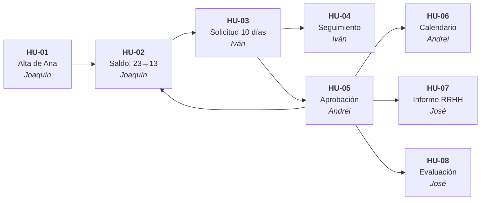
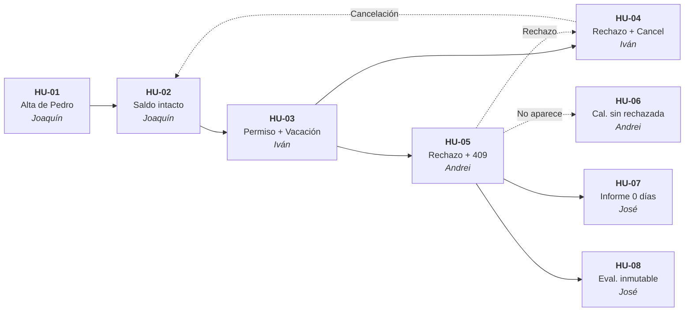

# Pruebas de Recorrido Cruzado Extremo a Extremo (E2E)

**Proyecto**: Sistema de Gestión de Recursos Humanos  
**Fecha**: 2026-11-21  
**Propósito**: Validar la integración real entre las historias de usuario de los 4 integrantes del equipo mediante recorridos completos que cruzan múltiples módulos y responsabilidades.

> **Nota de verificación (2026-11-21)**: estos recorridos se ejecutaron contra la API real (49 de 49 pasos conformes en la versión `662da39`). El resultado observado, los datos reales y las diferencias respecto a lo diseñado aquí (saldo con pendientes, `409` frente a `422` por saldo insuficiente, `204` al cancelar, rutas y usuarios semilla) están en [`verificacion-integrada.md`](verificacion-integrada.md) y en [`evidencias/e2e/resultado-recorridos.md`](evidencias/e2e/resultado-recorridos.md). Donde este documento difiere de ese resultado, vale el resultado observado.

---

## Recorrido 1 — Ciclo Exitoso Completo: Solicitud de Vacaciones Aprobada

> **Escenario**: Un empleado solicita vacaciones, su responsable las aprueba, el saldo se actualiza, las ausencias aparecen en el calendario del equipo y RRHH lo ve reflejado en el informe de absentismo.

### Actores y Roles

| Actor | Rol | Credenciales | Responsable del módulo |
| :--- | :--- | :--- | :--- |
| Ana García | `EMPLEADO` | `ana.garcia@empresa.com` | — |
| Carlos López | `RESPONSABLE_EQUIPO` | `carlos.lopez@empresa.com` | — |
| Marta Sánchez | `RRHH` | `rrhh@empresa.com` | — |

### Precondiciones

- Ana está dada de alta con contrato vigente bajo el Convenio TIC (23 días/año), asignada al departamento "Desarrollo" con Carlos como responsable directo (**HU-01, Joaquín**).
- Ana no tiene solicitudes previas de vacaciones este año.

### Pasos del Recorrido

| Paso | Acción | HU | Integrante | Resultado Esperado | Verificación |
| :---: | :--- | :---: | :--- | :--- | :--- |
| **1** | **Ana** inicia sesión y accede a "Mi Ficha y Saldo". | **HU-02** | **Joaquín** | Se muestra el perfil con datos personales (nombre, NIF, email, fecha alta, puesto, departamento, convenio, responsable) y la tarjeta de saldo: **23 días correspondientes, 0 disfrutados, 0 pendientes, 23 disponibles**. | `GET /api/v1/leave/balances/me?year=2026` → `200 OK` con `entitledDays: 23`, `spentDays: 0`, `pendingDays: 0`, `availableDays: 23`. |
| **2** | **Ana** accede al formulario "Solicitar Ausencia". El sistema comprueba que tiene un resolutor válido activo. | **HU-03** | **Iván** | El endpoint de elegibilidad confirma que Ana puede solicitar ausencias (`eligible: true`). Se renderiza el formulario con selector de tipo, rango de fechas y justificación. | `GET /api/v1/leave/requests/eligibility` → `200 OK` con `eligible: true, resolverName: "Carlos López"`. |
| **3** | **Ana** selecciona tipo "Vacaciones", fecha inicio **lunes 6 julio 2026** y fecha fin **viernes 17 julio 2026**. El sistema calcula los días laborables en tiempo real. | **HU-03** | **Iván** | El servidor devuelve el cómputo oficial: **10 días laborables** (2 semanas completas, descontando sábados y domingos; sin festivos nacionales en ese rango). | `GET /api/v1/leave/requests/calculate-days?startDate=2026-07-06&endDate=2026-07-17` → `200 OK` con `workingDays: 10`. |
| **4** | **Ana** confirma y envía la solicitud. | **HU-03** | **Iván** | La solicitud se crea en estado `PENDING` vinculada a Carlos como resolutor. Se valida que Ana tiene saldo suficiente (23 - 0 - 0 = 23 ≥ 10) y que no hay solapamiento con solicitudes previas. | `POST /api/v1/leave/requests` → `201 Created` con `status: "PENDING"`, `calculatedDays: 10`. |
| **5** | **Ana** accede a "Mis Solicitudes" y ve la solicitud recién creada en la lista. | **HU-04** | **Iván** | Aparece una fila con tipo "Vacaciones", fechas 6–17 julio, 10 días, estado `Pendiente`, con botón de "Cancelar" disponible. | `GET /api/v1/leave/requests/my-requests` → Lista con 1 entrada en estado `PENDING`. |
| **6** | **Ana** vuelve a consultar su saldo de vacaciones. | **HU-02** | **Joaquín** | El saldo refleja la reserva preventiva: **23 correspondientes, 0 disfrutados, 10 pendientes, 13 disponibles**. | `GET /api/v1/leave/balances/me?year=2026` → `pendingDays: 10`, `availableDays: 13`. |
| **7** | **Carlos** (responsable) inicia sesión y accede a "Solicitudes Pendientes del Equipo". | **HU-05** | **Andrei** | La bandeja muestra la solicitud de Ana: Vacaciones, 6–17 julio, 10 días, estado `Pendiente`. No aparecen solicitudes de empleados de otros equipos. | `GET /api/v1/leave/team-requests` → 1 resultado con `employeeName: "Ana García"`, `status: "PENDING"`. |
| **8** | **Carlos** consulta el calendario del equipo para julio de 2026 antes de decidir. | **HU-06** | **Andrei** | El calendario muestra las ausencias **pendientes** de Ana (6–17 julio) diferenciadas visualmente (badge "Pendiente"). Si otro miembro del equipo tiene ausencia esos días, el solapamiento se resalta. | `GET /api/v1/team/calendar?year=2026&month=7` → Entradas de Ana del 6 al 17 con `status: "PENDING"`. |
| **9** | **Carlos** aprueba la solicitud de Ana con un comentario opcional: "Disfruta las vacaciones". | **HU-05** | **Andrei** | La solicitud pasa a `APPROVED`. Se revalida atómicamente que Ana conserva saldo suficiente. Se genera una notificación interna para Ana. Se registra `resolved_by: Carlos.id` y `resolved_at: now()`. | `POST /api/v1/leave/requests/{id}/approve` con `comment: "Disfruta las vacaciones"` → `200 OK` con `status: "APPROVED"`. |
| **10** | **Ana** ve la notificación en la campana de avisos. | **HU-05** | **Andrei** | Campana con contador "1" no leída. Al abrir: "Tu solicitud de vacaciones del 06/07/2026 al 17/07/2026 ha sido aprobada. Comentario: Disfruta las vacaciones". | `GET /api/v1/notifications` → 1 notificación no leída con resultado de aprobación. |
| **11** | **Ana** consulta de nuevo su saldo de vacaciones. | **HU-02** | **Joaquín** | El saldo se ha actualizado: **23 correspondientes, 10 disfrutados, 0 pendientes, 13 disponibles**. Los días han pasado de pendientes a disfrutados. | `GET /api/v1/leave/balances/me?year=2026` → `spentDays: 10`, `pendingDays: 0`, `availableDays: 13`. |
| **12** | **Ana** revisa "Mis Solicitudes" y la solicitud aparece como `Aprobada`. El botón de cancelar ya no está disponible. | **HU-04** | **Iván** | La fila muestra estado `Aprobada` con la fecha y el nombre del resolutor. No se ofrece la acción de cancelar. | `GET /api/v1/leave/requests/my-requests` → Entrada con `status: "APPROVED"`, `resolvedBy: "Carlos López"`. |
| **13** | **Carlos** vuelve a consultar el calendario de julio. | **HU-06** | **Andrei** | La ausencia de Ana ahora figura como `Aprobada` (distinción visual: color firme y badge "Aprobada"). El día con solapamientos, si los hay, mantiene el indicador de alerta. | `GET /api/v1/team/calendar?year=2026&month=7` → Entradas de Ana con `status: "APPROVED"`. |
| **14** | **Marta** (RRHH) inicia sesión y genera un informe de uso de vacaciones para 2026. | **HU-07** | **José** | El informe muestra el departamento "Desarrollo" con los 10 días de Ana incluidos en el total de días disfrutados. Al expandir el desglose, aparece la fila individual de Ana con su aportación a la métrica. | `GET /api/v1/reports/department?type=VACATION_USAGE&startDate=2026-01-01&endDate=2026-12-31` → Departamento "Desarrollo" incluye `spentDays` ≥ 10. |
| **15** | **Marta** exporta el informe a CSV y verifica la paridad con la pantalla. | **HU-07** | **José** | El archivo `.csv` descargado tiene exactamente los mismos totales y desglose que la tabla en pantalla, codificado en UTF-8 con BOM. | `GET /api/v1/reports/department/export?...` → CSV con totales idénticos al JSON. |
| **16** | **Carlos** crea una evaluación de desempeño para Ana, periodo "2026-ANUAL", objetivos cumplidos, valoración 4 (Supera expectativas), comentarios positivos. | **HU-08** | **José** | La evaluación se crea en estado `PENDING_ACKNOWLEDGMENT` y es visible para Ana. | `POST /api/v1/performance-reviews` → `201 Created` con `status: "PENDING_ACKNOWLEDGMENT"`. |
| **17** | **Ana** revisa la evaluación, añade un comentario y da su conformidad. | **HU-08** | **José** | La evaluación pasa a `FINALIZED` con `finalizedAt = now()`. Queda inmutable: ni Ana ni Carlos pueden modificarla. | `POST /api/v1/performance-reviews/{id}/acknowledge` → `200 OK` con `status: "FINALIZED"`. |

### Resultado del Recorrido 1

✅ **EXITOSO** — El flujo completo atraviesa las **8 historias de usuario** y los módulos de los **4 integrantes** sin interrupciones ni inconsistencias de datos. El saldo derivado de HU-02 se actualiza coherentemente con las solicitudes de HU-03 y las resoluciones de HU-05, el calendario de HU-06 refleja el estado más reciente, y la analítica de HU-07 recoge las ausencias consolidadas.

### Trazabilidad Cruzada

---

## Recorrido 2 — Ciclo con Errores y Denegación: Solicitud de Permiso Rechazada y Cancelación

> **Escenario**: Un empleado solicita un permiso que es rechazado por su responsable. El empleado consulta el motivo. Después, crea una nueva solicitud de vacaciones que cancela voluntariamente antes de que sea resuelta. Se valida también el bloqueo ante intentos de acceso cruzado y la evaluación de desempeño con conformidad denegada.

### Actores y Roles

| Actor | Rol | Credenciales | Responsable del módulo |
| :--- | :--- | :--- | :--- |
| Pedro Martín | `EMPLEADO` | `pedro.martin@empresa.com` | — |
| Laura Ruiz | `RESPONSABLE_EQUIPO` | `laura.ruiz@empresa.com` | — |
| Ana García | `EMPLEADO` (otro equipo) | `ana.garcia@empresa.com` | — |
| Marta Sánchez | `RRHH` | `rrhh@empresa.com` | — |

### Precondiciones

- Pedro está dado de alta con convenio GENERAL (22 días/año), departamento "Administración", con Laura como responsable (**HU-01, Joaquín**).
- Laura es responsable del equipo de Administración.
- Ana pertenece al equipo de Carlos (otro equipo distinto).

### Pasos del Recorrido

| Paso | Acción | HU | Integrante | Resultado Esperado | Verificación |
| :---: | :--- | :---: | :--- | :--- | :--- |
| **1** | **Pedro** consulta su saldo. | **HU-02** | **Joaquín** | **22 días correspondientes, 0 disfrutados, 0 pendientes, 22 disponibles.** | `GET /api/v1/leave/balances/me?year=2026` → `entitledDays: 22`, `availableDays: 22`. |
| **2** | **Pedro** solicita un Permiso del 10 al 12 de noviembre, con justificación obligatoria: "Mudanza de domicilio". | **HU-03** | **Iván** | Solicitud de tipo `PERMIT`, 3 días laborables, estado `PENDING`. El campo `justification` se persiste. Los permisos **no** descuentan del saldo de vacaciones. | `POST /api/v1/leave/requests` con `leaveType: "PERMIT"`, `justification: "Mudanza de domicilio"` → `201 Created`. |
| **3** | **Pedro** intenta crear otra solicitud de permiso solapando las mismas fechas (10–12 noviembre). | **HU-03** | **Iván** | El sistema **bloquea** la solicitud por solapamiento de fechas con una solicitud existente en estado `PENDING`. | `POST /api/v1/leave/requests` → `409 Conflict` con `title: "Solapamiento de fechas"`. |
| **4** | **Pedro** consulta su saldo de vacaciones. | **HU-02** | **Joaquín** | El saldo de **vacaciones** permanece intacto: **22 disponibles**. Los permisos utilizan una bolsa independiente y no afectan al saldo anual de vacaciones. | `GET /api/v1/leave/balances/me?year=2026` → `availableDays: 22` (sin cambios). |
| **5** | **Ana** (otro equipo) intenta consultar las solicitudes de Pedro por URL directa. | **HU-04** | **Iván** | El servidor **deniega** el acceso. Ana solo puede ver sus propias solicitudes; nunca las de Pedro. | `GET /api/v1/leave/requests/my-requests` (sesión de Ana) → Solo solicitudes de Ana; las de Pedro son **invisibles**. |
| **6** | **Laura** accede a su bandeja de solicitudes pendientes. | **HU-05** | **Andrei** | Aparece la solicitud de permiso de Pedro (3 días). No aparecen solicitudes de Ana ni de otros equipos. | `GET /api/v1/leave/team-requests` → 1 resultado: Pedro, `PERMIT`, 10–12 nov. |
| **7** | **Laura** rechaza la solicitud de Pedro con motivo obligatorio: "Coincide con cierre contable trimestral. Propón fechas alternativas." | **HU-05** | **Andrei** | La solicitud transiciona a `REJECTED`. Se genera una notificación para Pedro con el motivo del rechazo. `resolved_by: Laura.id`, `resolved_at: now()`. | `POST /api/v1/leave/requests/{id}/reject` con `reason: "Coincide con cierre contable trimestral..."` → `200 OK`. |
| **8** | **Laura** intenta rechazar de nuevo la misma solicitud (doble clic accidental). | **HU-05** | **Andrei** | El sistema **bloquea** la re-resolución con HTTP `409 Conflict`: la solicitud ya fue resuelta. | `POST /api/v1/leave/requests/{id}/reject` → `409 Conflict` con `title: "Solicitud ya resuelta"`. |
| **9** | **Pedro** ve la notificación de rechazo en la campana de avisos. | **HU-05** | **Andrei** | Aviso no leído: "Tu solicitud de permiso del 10/11/2026 al 12/11/2026 ha sido rechazada. Motivo: Coincide con cierre contable trimestral…". | `GET /api/v1/notifications` → 1 notificación con resultado de rechazo y motivo. |
| **10** | **Pedro** consulta "Mis Solicitudes" y revisa el motivo de rechazo. | **HU-04** | **Iván** | La solicitud aparece como `Rechazada`. Pedro puede ver el motivo explicativo completo del rechazo. El botón de cancelar ya no está disponible (no se puede cancelar una rechazada). | `GET /api/v1/leave/requests/my-requests` → Entrada con `status: "REJECTED"`, `rejectionReason: "Coincide con..."`. |
| **11** | **Pedro** consulta el calendario del equipo de Laura para noviembre. | **HU-06** | **Andrei** | La solicitud rechazada de Pedro **NO aparece** en el calendario. Los días 10–12 de noviembre no figuran como ausencia ni computan para solapamientos. | `GET /api/v1/team/calendar?year=2026&month=11` → Sin entradas para Pedro. |
| **12** | **Pedro** crea ahora una solicitud de Vacaciones del 22 al 24 de diciembre (3 días laborables). | **HU-03** | **Iván** | La solicitud se crea exitosamente en `PENDING`. El rango 22–24 diciembre no solapa con la solicitud rechazada. Se retienen preventivamente 3 días del saldo de vacaciones. | `POST /api/v1/leave/requests` con `leaveType: "VACATION"` → `201 Created`, `calculatedDays: 3`. |
| **13** | **Pedro** decide cancelar voluntariamente la solicitud antes de que Laura la resuelva. | **HU-04** | **Iván** | La solicitud transiciona a `CANCELLED`. Los 3 días retenidos se liberan de inmediato del saldo preventivo. Las fechas 22–24 dic quedan libres para nueva solicitud. | `POST /api/v1/leave/requests/{id}/cancel` → `200 OK` con `status: "CANCELLED"`. |
| **14** | **Pedro** verifica que su saldo se ha restaurado completamente. | **HU-02** | **Joaquín** | **22 correspondientes, 0 disfrutados, 0 pendientes, 22 disponibles.** El permiso rechazado no afectó al saldo de vacaciones; la vacación cancelada liberó la retención. | `GET /api/v1/leave/balances/me?year=2026` → `availableDays: 22`. |
| **15** | **Laura** verifica su bandeja: la solicitud cancelada ya no aparece como pendiente. | **HU-05** | **Andrei** | La bandeja de solicitudes pendientes de Laura está vacía: la solicitud rechazada ya fue resuelta y la solicitud de vacaciones fue cancelada por Pedro. | `GET /api/v1/leave/team-requests` → 0 resultados. |
| **16** | **Marta** (RRHH) genera un informe de absentismo para noviembre de 2026. | **HU-07** | **José** | El departamento "Administración" muestra **0 días de permiso disfrutados** para Pedro, ya que la única solicitud de permiso fue rechazada y no se consolidó. | `GET /api/v1/reports/department?type=ABSENTEEISM&...` → Pedro sin días de absentismo en noviembre. |
| **17** | **Laura** crea una evaluación de desempeño para Pedro, periodo "2026-ANUAL", valoración 3, con objetivos y comentarios. | **HU-08** | **José** | Evaluación creada en `PENDING_ACKNOWLEDGMENT`. | `POST /api/v1/performance-reviews` → `201 Created`. |
| **18** | **Laura** intenta modificar la evaluación una vez que Pedro la ha formalizado. | **HU-08** | **José** | El sistema bloquea cualquier modificación con `409 Conflict`. El trigger de BD rechaza la operación incluso si se intenta directamente en SQL. | Acceso a evaluación `FINALIZED` → `409 Conflict` o excepción de trigger. |

### Resultado del Recorrido 2

✅ **EXITOSO** — El flujo demuestra la robustez del sistema ante **escenarios negativos y de error**: rechazos con motivo, bloqueo de solapamientos, denegación de acceso cruzado entre equipos, cancelación unilateral con liberación de saldo, inmutabilidad de resoluciones (doble clic), y protección de datos entre empleados de diferentes equipos. Los módulos de los 4 integrantes se coordinan de manera segura, estricta y trazable.

### Trazabilidad Cruzada

---

## Resumen de Cobertura Cruzada

| Criterio | Recorrido 1 (Éxito) | Recorrido 2 (Error/Denegación) |
| :--- | :---: | :---: |
| HU-01 (Alta y Contrato) — Joaquín | ✅ Precondición | ✅ Precondición |
| HU-02 (Saldo de Vacaciones) — Joaquín | ✅ 23→13 días | ✅ Saldo intacto tras rechazo y cancelación |
| HU-03 (Solicitud de Ausencia) — Iván | ✅ Vacaciones aprobadas | ✅ Permiso rechazado + Vacación cancelada + Bloqueo solapamiento |
| HU-04 (Seguimiento y Cancelación) — Iván | ✅ Estado Aprobada visible | ✅ Motivo de rechazo + Cancelación unilateral |
| HU-05 (Aprobación/Rechazo) — Andrei | ✅ Aprobación con revalidación | ✅ Rechazo con motivo + 409 en doble resolución |
| HU-06 (Calendario de Equipo) — Andrei | ✅ Ausencia en calendario | ✅ Rechazada NO aparece |
| HU-07 (Informes de RRHH) — José | ✅ Días consolidados en informe | ✅ 0 días de absentismo tras rechazo |
| HU-08 (Evaluación de Desempeño) — José | ✅ Ciclo completo con conformidad | ✅ Inmutabilidad tras formalización |
| Aislamiento de datos entre equipos | — | ✅ Ana no puede ver solicitudes de Pedro |
| Notificaciones internas | ✅ Aprobación notificada | ✅ Rechazo con motivo notificado |
| RFC 9457 Problem Details | — | ✅ 409 Conflict en solapamiento y re-resolución |
| Exportación CSV con paridad | ✅ Verificada | — |

> **Conclusión**: Los dos recorridos cubren exhaustivamente los flujos exitosos y los caminos de error de las 8 historias de usuario, demostrando que los módulos de los 4 integrantes del equipo están plenamente integrados y que las invariantes del sistema (saldo derivado, inmutabilidad, aislamiento RBAC y auditoría) se mantienen en todos los escenarios.
