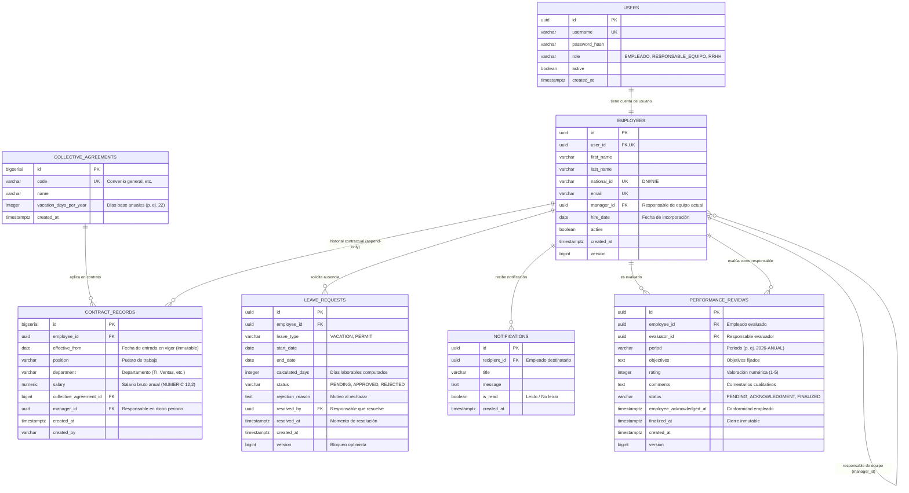

# Modelo de Datos Compartido — Sistema de Gestión de Recursos Humanos y Vacaciones

**Fecha**: 2026-10-27  
**Estado**: Acordado por el equipo (Base Común para `spec-001` a `spec-008`)  
**Motor**: PostgreSQL 16 (Gestionado con migraciones Flyway)

---

## 1. Diagrama Entidad-Relación (ER)



---

## 2. Descripción de Entidades y Restricciones Constitucionales

### 2.1. `users` (Seguridad y Autenticación)
* Gestiona credenciales y el rol principal (`EMPLEADO`, `RESPONSABLE_EQUIPO`, `RRHH`).
* Las contraseñas se almacenan mediante hash seguro (BCrypt).

### 2.2. `collective_agreements` (Convenios Colectivos)
* Fuente de verdad para el cálculo derivado de saldo de vacaciones (`vacation_days_per_year`).

### 2.3. `employees` y `contract_records` (Historial Contractual Append-Only - Art. 11)
* **`employees`**: Cabecera del trabajador y datos personales identificativos.
* **`contract_records`**: Cada cambio salarial, de puesto o de departamento genera un nuevo registro con `effective_from`.
* **Invariante**: Prohibido el borrado o actualización de registros existentes en `contract_records` (*append-only*). Las condiciones vigentes a una fecha determinada se resuelven mediante:
  ```sql
  SELECT * FROM contract_records
  WHERE employee_id = :empId AND effective_from <= :targetDate
  ORDER BY effective_from DESC, created_at DESC
  LIMIT 1;
  ```

### 2.4. `leave_requests` (Solicitudes y Saldo Derivado - Arts. 12, 13 y 14)
* **Restricción de Integridad en BD**:
  ```sql
  CONSTRAINT chk_leave_dates CHECK (end_date >= start_date)
  CONSTRAINT chk_leave_status CHECK (status IN ('PENDING', 'APPROVED', 'REJECTED'))
  CONSTRAINT chk_leave_type CHECK (leave_type IN ('VACATION', 'PERMIT'))
  ```
* **Saldo Derivado (Art. 12)**: El saldo disponible de un empleado para el año $Y$ se calcula en tiempo de ejecución:
  $$\text{Días Disponibles} = \text{Días Convenio Vigente} - \sum \text{Días de } \text{leave\_requests(status='APPROVED', type='VACATION', year=Y)}$$
* **Resolución Atómica (Art. 13)**: `PENDING → APPROVED` o `PENDING → REJECTED`. Una vez resuelto, `version` y control en servicio bloquean transiciones posteriores devolviendo `409 Conflict`.

### 2.5. `notifications` (Notificaciones Persistidas - Art. 15)
* Cada resolución de solicitud genera un registro persistido en esta tabla para el empleado solicitante.

### 2.6. `performance_reviews` (Evaluación con Conformidad - Art. 18)
* **Restricción de Integridad**:
  ```sql
  CONSTRAINT chk_review_status CHECK (status IN ('PENDING_ACKNOWLEDGMENT', 'FINALIZED'))
  CONSTRAINT chk_review_rating CHECK (rating BETWEEN 1 AND 5)
  ```
* **Inmutabilidad**: Al pulsar conformidad el empleado, se actualiza `status = 'FINALIZED'` y `finalized_at = now()`. A partir de ese momento, la entidad queda bloqueada para escritura.

---

## 3. Índices Estratégicos (Art. 8.5)

Para garantizar un rendimiento óptimo en las consultas de las 8 specs, la base común incluye:
1. `idx_contract_records_lookup`: `(employee_id, effective_from DESC)` para resolver rápidamente las condiciones vigentes.
2. `idx_leave_calendar`: `(start_date, end_date, status)` para la cuadrícula mensual del calendario de equipo (HU-06).
3. `idx_leave_employee_status`: `(employee_id, status)` para el listado filtrable de HU-04 y el cálculo de saldo de HU-02.
4. `idx_reviews_employee`: `(employee_id, period)` para la consulta de evaluaciones de HU-08.
