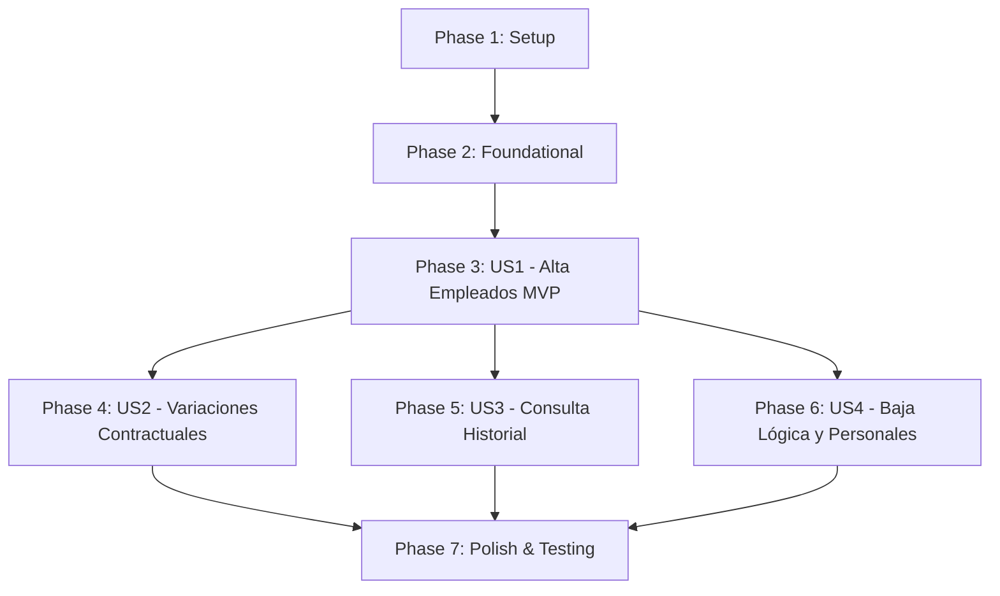

# Tasks: spec-001 — Alta de Empleados y Trayectoria Contractual

**Feature**: `spec-001` · HU-01  
**Branch**: `spec-001`  
**Input**: [specs/spec-001/plan.md](plan.md), [specs/spec-001/spec.md](spec.md), [specs/spec-001/data-model.md](data-model.md), [specs/spec-001/contracts/employee-api.yaml](contracts/employee-api.yaml)  

---

## Phase 1: Setup (Shared Infrastructure)

**Purpose**: Verificación de infraestructura base y configuración de dependencias

- [x] T001 Verify and configure database connection and Flyway migrations in backend/src/main/resources/application.yml
- [x] T002 [P] Verify backend Testcontainers setup in backend/src/test/java/com/iw/rrhh/TestcontainersConfiguration.java
- [x] T003 [P] Setup Angular routing and Material modules in frontend/src/app/app.routes.ts

---

## Phase 2: Foundational (Blocking Prerequisites)

**Purpose**: Infraestructura y entidades nucleares que bloquean la implementación de las historias de usuario

- [x] T004 [P] Create User entity with role enum ('EMPLEADO', 'RESPONSABLE_EQUIPO', 'RRHH') in backend/src/main/java/com/iw/rrhh/security/domain/User.java
- [x] T005 [P] Create UserRepository with findByUsername in backend/src/main/java/com/iw/rrhh/security/repository/UserRepository.java
- [x] T006 [P] Create CollectiveAgreement entity in backend/src/main/java/com/iw/rrhh/employee/domain/CollectiveAgreement.java
- [x] T007 [P] Create CollectiveAgreementRepository with findByCode in backend/src/main/java/com/iw/rrhh/employee/repository/CollectiveAgreementRepository.java
- [x] T008 [P] Implement PasswordGeneratorService generating secure 12-char passwords in backend/src/main/java/com/iw/rrhh/employee/service/PasswordGeneratorService.java
- [x] T009 Verify GlobalExceptionHandler maps validation errors to RFC 9457 ProblemDetail with invalidFields in backend/src/main/java/com/iw/rrhh/common/exception/GlobalExceptionHandler.java

---

## Phase 3: User Story 1 - Alta de Empleados y Credenciales Iniciales (Priority: P1) 🎯 MVP

**Goal**: Permitir al rol RRHH dar de alta a nuevos empleados con validación estricta, generando su cuenta de usuario y credencial temporal segura.

**Independent Test**: Ejecutar `EmployeeCreationIntegrationTest` contra PostgreSQL real verificando que se persiste el empleado, se crea el usuario con contraseña hasheada y se genera el primer registro contractual inicial.

### Implementation for User Story 1

- [x] T010 [P] [US1] Create Employee entity with unique national_id, unique email, hireDate, and optional manager in backend/src/main/java/com/iw/rrhh/employee/domain/Employee.java
- [x] T011 [P] [US1] Create ContractRecord entity with effectiveFrom, salary (precision 12, scale 2), position, department in backend/src/main/java/com/iw/rrhh/employee/domain/ContractRecord.java
- [x] T012 [P] [US1] Create EmployeeRepository in backend/src/main/java/com/iw/rrhh/employee/repository/EmployeeRepository.java
- [x] T013 [P] [US1] Create ContractRecordRepository in backend/src/main/java/com/iw/rrhh/employee/repository/ContractRecordRepository.java
- [x] T014 [P] [US1] Create CreateEmployeeRequest and CreateEmployeeResponse DTO records in backend/src/main/java/com/iw/rrhh/employee/dto/
- [x] T015 [US1] Implement EmployeeService.createEmployee with transactional user and contract creation in backend/src/main/java/com/iw/rrhh/employee/service/EmployeeServiceImpl.java
- [x] T016 [US1] Implement POST /api/v1/employees endpoint with @PreAuthorize("hasRole('RRHH')") in backend/src/main/java/com/iw/rrhh/employee/controller/EmployeeController.java
- [x] T017 [US1] Create integration test testCreateEmployee_Success and testCreateEmployee_ValidationErrors in backend/src/test/java/com/iw/rrhh/employee/EmployeeCreationIntegrationTest.java
- [x] T018 [P] [US1] Create TypeScript models and EmployeeService in frontend/src/app/features/employees/services/employee.service.ts
- [x] T019 [US1] Implement reactive form component EmployeeCreateComponent with mat-form-field and mat-error in frontend/src/app/features/employees/components/employee-create/employee-create.component.ts
- [x] T020 [US1] Implement PasswordDialogComponent showing autogenerated credentials in frontend/src/app/features/employees/components/password-dialog/password-dialog.component.ts

---

## Phase 4: User Story 2 - Modificaciones Contractuales Append-Only (Priority: P2)

**Goal**: Registrar variaciones de puesto, departamento, salario, convenio o responsable con fecha de entrada en vigor obligatoria (pasada, presente o futura) sin sobrescribir registros previos.

**Independent Test**: Modificar condiciones de un empleado con fecha retroactiva y verificar que el número de registros en `contract_records` se incrementa sin alterar los registros anteriores.

### Implementation for User Story 2

- [x] T021 [P] [US2] Create CreateContractVariationRequest DTO record in backend/src/main/java/com/iw/rrhh/employee/dto/CreateContractVariationRequest.java
- [x] T022 [US2] Implement EmployeeService.addContractVariation inserting new append-only ContractRecord in backend/src/main/java/com/iw/rrhh/employee/service/EmployeeServiceImpl.java
- [x] T023 [US2] Implement POST /api/v1/employees/{id}/contracts endpoint in backend/src/main/java/com/iw/rrhh/employee/controller/EmployeeController.java
- [x] T024 [US2] Add integration test testAddContractVariation_AppendOnly_Retroactive in backend/src/test/java/com/iw/rrhh/employee/ContractVariationIntegrationTest.java
- [ ] T025 [US2] Implement contract variation dialog/form component in frontend/src/app/features/employees/components/contract-variation/contract-variation.component.ts

---

## Phase 5: User Story 3 - Consulta de Trayectoria Cronológica y Ficha (Priority: P3)

**Goal**: Consultar la trayectoria contractual ordenada cronológicamente y los datos vigentes derivados del contrato activo.

**Independent Test**: Realizar varias modificaciones contractuales en diferentes fechas y comprobar que la API devuelve la lista ordenada por `effectiveFrom ASC` y el contrato vigente actual.

### Implementation for User Story 3

- [x] T026 [P] [US3] Create EmployeeDetailResponse and ContractHistoryItemResponse DTO records in backend/src/main/java/com/iw/rrhh/employee/dto/
- [x] T027 [US3] Add repository queries findCurrentContract and findFullHistoryChronological in backend/src/main/java/com/iw/rrhh/employee/repository/ContractRecordRepository.java
- [x] T028 [US3] Implement EmployeeService.getEmployeeDetail and getContractHistory in backend/src/main/java/com/iw/rrhh/employee/service/EmployeeServiceImpl.java
- [x] T029 [US3] Implement GET /api/v1/employees/{id} and GET /api/v1/employees/{id}/contracts in backend/src/main/java/com/iw/rrhh/employee/controller/EmployeeController.java
- [x] T030 [US3] Implement ContractHistoryComponent with mat-table in frontend/src/app/features/employees/components/contract-history/contract-history.component.ts

---

## Phase 6: User Story 4 - Baja Lógica y Datos Personales (Priority: P4)

**Goal**: Permitir la baja reversible del trabajador (`active = false`) y la actualización de datos de contacto no contractuales.

**Independent Test**: Ejecutar baja de un empleado, verificar que su usuario no puede autenticarse y que los tests de autorización negativa para roles no-RRHH devuelven 403 Forbidden.

### Implementation for User Story 4

- [x] T031 [P] [US4] Create UpdatePersonalDataRequest DTO record in backend/src/main/java/com/iw/rrhh/employee/dto/UpdatePersonalDataRequest.java
- [x] T032 [US4] Implement EmployeeService.deactivateEmployee and updatePersonalData in backend/src/main/java/com/iw/rrhh/employee/service/EmployeeServiceImpl.java
- [x] T033 [US4] Implement DELETE /api/v1/employees/{id} and PUT /api/v1/employees/{id}/personal-data in backend/src/main/java/com/iw/rrhh/employee/controller/EmployeeController.java
- [x] T034 [US4] Add negative authorization tests testAccessDeniedForNonHR in backend/src/test/java/com/iw/rrhh/employee/EmployeeSecurityIntegrationTest.java

---

## Phase 7: Polish & Cross-Cutting Concerns

**Purpose**: Verificaciones finales, accesibilidad WCAG y ejecución de la suite completa

- [x] T035 [P] Add OpenAPI Swagger annotations and tag descriptions in EmployeeController.java
- [x] T036 [P] Verify WCAG 2.1 AA accessibility, keyboard navigation, and aria labels in all employee components
- [x] T037 Execute full backend test suite with Testcontainers against PostgreSQL
- [x] T038 Run quickstart validation scenarios defined in specs/spec-001/quickstart.md

---

## Dependencies & Execution Order

