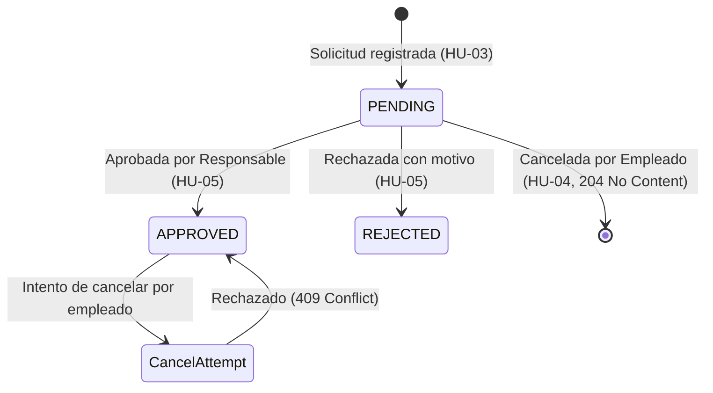

# Data Model: spec-004 — Seguimiento del Estado de Mis Solicitudes

**Feature**: `spec-004` (HU-04)  
**Date**: 2026-11-01  
**Author**: Integrante 2  

---

## 1. Entidad Principal

### `LeaveRequest` (Tabla: `leave_requests`)
Entidad existente mapeada en `com.iw.rrhh.leave.domain.LeaveRequest`.

| Campo | Tipo BD | Tipo Java | Restricciones / Notas |
|---|---|---|---|
| `id` | `UUID` | `UUID` | Clave primaria. |
| `employee_id` | `UUID` | `Employee` | FK no nula a `employees(id)`. |
| `leave_type` | `VARCHAR(50)` | `LeaveType` | `VACATION`, `PERMIT`. |
| `start_date` | `DATE` | `LocalDate` | Fecha inicio ausencia. |
| `end_date` | `DATE` | `LocalDate` | Fecha fin ausencia (`>= start_date`). |
| `calculated_days` | `INTEGER` | `Integer` | Días hábiles laborables calculados. |
| `status` | `VARCHAR(50)` | `LeaveStatus` | `PENDING`, `APPROVED`, `REJECTED`. |
| `rejection_reason` | `TEXT` | `String` | Motivo de rechazo (obligatorio si `REJECTED`). |
| `resolved_by` | `UUID` | `Employee` | FK a responsable que resolvió. |
| `resolved_at` | `TIMESTAMPTZ` | `Instant` | Momento de resolución. |
| `created_at` | `TIMESTAMPTZ` | `Instant` | Momento de registro de la solicitud. |
| `version` | `BIGINT` | `Long` | Bloqueo optimista. |

---

## 2. DTOs de Contrato y Transferencia

### 2.1 `LeaveRequestSummaryResponse` (Salida de consulta)
```java
package com.iw.rrhh.leave.dto;

import com.iw.rrhh.leave.domain.LeaveStatus;
import com.iw.rrhh.leave.domain.LeaveType;
import java.time.Instant;
import java.time.LocalDate;
import java.util.UUID;

public record LeaveRequestSummaryResponse(
    UUID id,
    LeaveType leaveType,
    LocalDate startDate,
    LocalDate endDate,
    Integer calculatedDays,
    LeaveStatus status,
    String rejectionReason,
    Instant createdAt,
    boolean canCancel
) {}
```

- **Regla `canCancel`**: `true` si y solo si `status == LeaveStatus.PENDING`.
- **Regla `rejectionReason`**: Presente únicamente si `status == LeaveStatus.REJECTED`.

### 2.2 `PageResponse<T>` (Paginación estándar)
```java
package com.iw.rrhh.common.dto;

import java.util.List;

public record PageResponse<T>(
    List<T> content,
    int page,
    int size,
    long totalElements,
    int totalPages,
    boolean first,
    boolean last
) {}
```

---

## 3. Consultas en Repositorio (`LeaveRequestRepository`)

```java
Page<LeaveRequest> findByEmployeeIdOrderByCreatedAtDesc(UUID employeeId, Pageable pageable);

Page<LeaveRequest> findByEmployeeIdAndStatusOrderByCreatedAtDesc(UUID employeeId, LeaveStatus status, Pageable pageable);
```

---

## 4. Transiciones de Estado y Reglas de Cancelación


