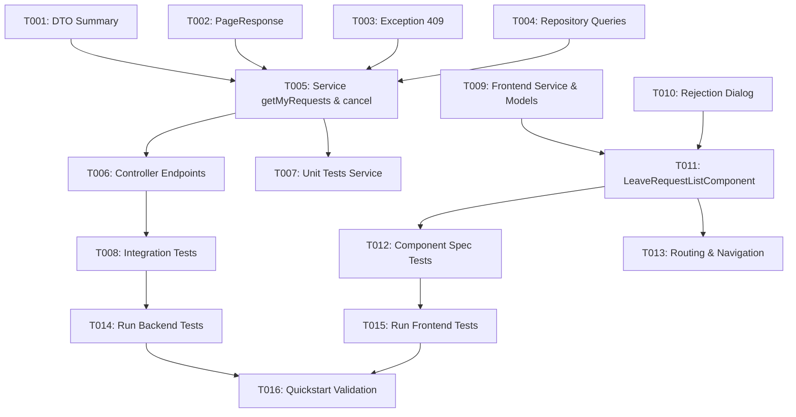

# Tasks: spec-004 — Seguimiento del Estado de Mis Solicitudes

**Feature**: `spec-004` (HU-04)  
**Input**: [specs/spec-004/plan.md](plan.md), [specs/spec-004/spec.md](spec.md), [specs/spec-004/data-model.md](data-model.md), [specs/spec-004/contracts/leave-tracking-api.yaml](contracts/leave-tracking-api.yaml)

---

## Phase 1: Setup & Foundational

**Purpose**: Estructuras base, DTOs y manejo de excepciones comunes para seguimiento de ausencias.

- [x] T001 Create `LeaveRequestSummaryResponse` record with `justification` and `CANCELLED` support in `backend/src/main/java/com/iw/rrhh/leave/dto/LeaveRequestSummaryResponse.java`
- [x] T002 [P] Create `PageResponse<T>` record in `backend/src/main/java/com/iw/rrhh/common/dto/PageResponse.java`
- [x] T003 [P] Create exception `LeaveRequestNotCancellableException` in `backend/src/main/java/com/iw/rrhh/common/exception/LeaveRequestNotCancellableException.java` and map to `409 Conflict` (RFC 9457 ProblemDetail) in `backend/src/main/java/com/iw/rrhh/common/exception/GlobalExceptionHandler.java`

**Checkpoint**: Base de DTOs y excepciones lista.

---

## Phase 2: User Story 1 - Seguimiento y Cancelación de Mis Solicitudes (Priority: P1) 🎯 MVP

**Goal**: Permitir al empleado consultar su listado histórico de solicitudes paginado y filtrable por estado (`Todas`, `Pendientes`, `Aprobadas`, `Rechazadas`, `Canceladas`), ver el motivo de denegación en solicitudes rechazadas, la justificación aportada y cancelar peticiones en estado `PENDING` transicionando formalmente a `CANCELLED`.

**Independent Test**: Iniciar sesión como `empleado@empresa.com`, cargar `/leave/my-requests`, comprobar paginación, alternar filtros por estado (`Todas`, `Pendientes`, `Aprobadas`, `Rechazadas`, `Canceladas`), abrir modal de motivo en una solicitud rechazada y cancelar una solicitud en trámite verificando que transiciona a `CANCELLED`, libera las fechas y los días preventivos de saldo.

### Backend Implementation

- [x] T004 [P] [US1] Add pagination query methods `findByEmployeeIdOrderByCreatedAtDesc` and `findByEmployeeIdAndStatusOrderByCreatedAtDesc` supporting `CANCELLED` in `backend/src/main/java/com/iw/rrhh/leave/repository/LeaveRequestRepository.java`
- [x] T005 [US1] Implement `getMyRequests(Principal, LeaveStatus, Pageable)` and `cancelRequest(Principal, UUID)` in `backend/src/main/java/com/iw/rrhh/leave/service/LeaveRequestService.java` and `backend/src/main/java/com/iw/rrhh/leave/service/LeaveRequestServiceImpl.java` ensuring transition to `CANCELLED` and identity extracted strictly from `Principal` (Art. 10)
- [x] T006 [US1] Expose endpoints `GET /api/v1/leave/my-requests` and `POST /api/v1/leave/requests/{id}/cancel` in `backend/src/main/java/com/iw/rrhh/leave/controller/LeaveRequestController.java`
- [x] T007 [P] [US1] Unit tests for tracking, `justification` mapping and cancellation logic to `CANCELLED` in `backend/src/test/java/com/iw/rrhh/leave/LeaveRequestTrackingServiceTest.java` (tagged `HU-04.CA-1`, `HU-04.CA-3`, `HU-04.CA-5`)
- [x] T008 [US1] Integration tests with MockMvc and security context verifying pagination, filter by status (including `CANCELLED`), cancellation of pending request to `CANCELLED`, 409 when cancelling approved request, and 403 when cancelling another employee's request in `backend/src/test/java/com/iw/rrhh/leave/LeaveRequestTrackingIntegrationTest.java`

### Frontend Implementation

- [x] T009 [P] [US1] Add `LeaveRequestSummary` interface with `justification` and `CANCELLED`, plus API methods `getMyRequests` and `cancelRequest` in `frontend/src/app/features/leave/models/leave.models.ts` and `frontend/src/app/features/leave/services/leave.service.ts`
- [x] T010 [P] [US1] Create accessible modal dialog `RejectionReasonDialogComponent` in `frontend/src/app/features/leave/components/rejection-reason-dialog/rejection-reason-dialog.component.ts`
- [x] T011 [US1] Implement `LeaveRequestListComponent` with Angular Material table, `justification` column, status badges (including `Cancelada`), filter buttons (`Todas`, `Pendiente`, `Aprobada`, `Rechazada`, `Cancelada`), cancellation button with confirmation dialog, and paginator in `frontend/src/app/features/leave/components/leave-request-list/leave-request-list.component.ts`, `.html`, `.scss`
- [x] T012 [P] [US1] Unit tests for `LeaveRequestListComponent` covering table render, `justification` display, status filtering including `Cancelada`, rejection dialog opening, and cancel dispatch in `frontend/src/app/features/leave/components/leave-request-list/leave-request-list.component.spec.ts`
- [x] T013 [US1] Register route `/leave/my-requests` in `frontend/src/app/app.routes.ts` and add navigation item "Mis Solicitudes" in `frontend/src/app/app.html`

**Checkpoint**: HU-04 completamente funcional en backend y frontend.

---

## Phase 3: Polish & Verification

**Purpose**: Verificación cruzada, calidad de código y tests completos.

- [x] T014 [P] Execute backend test suite (`./mvnw test -Dtest="LeaveRequestTrackingServiceTest,LeaveRequestTrackingIntegrationTest"`)
- [x] T015 [P] Execute frontend test suite (`npx ng test --watch=false`)
- [x] T016 Validate end-to-end scenarios against `specs/spec-004/quickstart.md`

---

## Dependencies & Execution Order

---

## Phase 4: Convergence

- [x] T017 Create Flyway migration V5 to update chk_leave_status constraint with CANCELLED and add justification column to leave_requests per HU04-FR-006, Constitution II/IV (contradicts)
- [x] T018 Add CANCELLED to LeaveStatus.java and modify LeaveRequestServiceImpl.cancelRequest to transition to CANCELLED instead of deleting per HU04-FR-006 (contradicts)
- [x] T019 Update LeaveRequestSummaryResponse record, LeaveRequestSummary TS model, and LeaveRequest entity mapping to include justification per HU04-FR-002 (missing)
- [x] T020 Update LeaveRequestTrackingServiceTest and LeaveRequestTrackingIntegrationTest to verify status becomes CANCELLED and record is preserved per HU04-SC-003 (contradicts)
- [x] T021 Add Canceladas filter option to LeaveRequestListComponent, add CANCELLED status badge in template, and add justification column per HU04-FR-002, HU04-FR-003 (partial)
- [x] T022 Update LeaveRequestListComponent.spec.ts covering filtering by Canceladas and justification display per HU04-FR-003 (missing)
