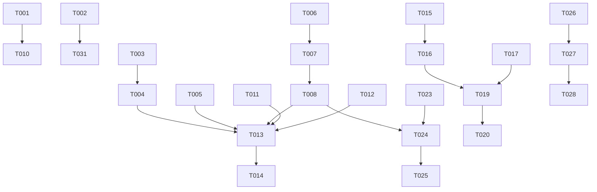

# Tasks: spec-005 — Aprobación o Rechazo de Solicitudes

**Feature**: `spec-005` (HU-05)

**Input**: [plan.md](plan.md), [spec.md](spec.md), [research.md](research.md), [data-model.md](data-model.md), [contracts/leave-resolution-api.yaml](contracts/leave-resolution-api.yaml), [quickstart.md](quickstart.md)

**Tests**: Incluidos. La constitución exige desarrollo orientado a pruebas (Art. 22) y trazabilidad HU → CA → Test (Art. 2): cada test se etiqueta con `@Tag`/`@DisplayName` `HU-05.CA-X`. Dentro de cada historia, los tests se escriben antes que la implementación y deben fallar primero.

**Organization**: Tareas agrupadas por historia de usuario (US1 = resolución por el responsable, P1; US2 = notificaciones del empleado, P2).

## Format: `[ID] [P?] [Story] Description`

- **[P]**: Paralelizable (ficheros distintos, sin dependencias pendientes)
- **[Story]**: Historia a la que pertenece (US1, US2)

---

## Phase 1: Setup

**Purpose**: Esquema de BD y datos de desarrollo necesarios para validar la HU.

- [ ] T001 Create Flyway migration `backend/src/main/resources/db/migration/V3__leave_resolution_constraints.sql` with: `CHECK chk_leave_rejection_reason (status <> 'REJECTED' OR (rejection_reason IS NOT NULL AND char_length(btrim(rejection_reason)) >= 5))`; function `fn_leave_requests_immutable_resolution()` + `BEFORE UPDATE` trigger `trg_leave_requests_immutable_resolution` raising an exception when `OLD.status <> 'PENDING'` and `status` or `rejection_reason` change (`IS DISTINCT FROM`); do NOT constrain `resolved_by`/`resolved_at` (see `research.md` §1.6); rollback steps as SQL comment
- [ ] T002 [P] Extend `backend/src/main/java/com/iw/rrhh/security/config/SecurityDataInitializer.java` to create user `responsable@empresa.com` (role `RESPONSABLE_EQUIPO`, password `admin123`) with its employee record and contract, and assign it as `manager` of `empleado@empresa.com` when that employee has no manager

---

## Phase 2: Foundational (Blocking Prerequisites)

**Purpose**: Excepción de dominio, bloqueos y creación de notificaciones, necesarios para que la resolución (US1) sea atómica y para las consultas de US2.

**⚠️ CRITICAL**: Ninguna historia puede empezar hasta completar esta fase.

- [ ] T003 [P] Create `LeaveRequestAlreadyResolvedException` in `backend/src/main/java/com/iw/rrhh/common/exception/LeaveRequestAlreadyResolvedException.java` and map it to `409 Conflict` ProblemDetail (title "Solicitud ya resuelta", type `https://api.rrhh.iw/errors/leave-already-resolved`) in `backend/src/main/java/com/iw/rrhh/common/exception/GlobalExceptionHandler.java`
- [ ] T004 Add domain methods `approve(Employee resolver, String comment, Instant now)` and `reject(Employee resolver, String reason, Instant now)` to `backend/src/main/java/com/iw/rrhh/leave/domain/LeaveRequest.java`; both throw `LeaveRequestAlreadyResolvedException` if `status != PENDING` and set `status`, `rejectionReason`, `resolvedBy`, `resolvedAt`
- [ ] T005 [P] Add `@Lock(PESSIMISTIC_WRITE) Optional<Employee> findByIdForUpdate(UUID id)` (`SELECT e FROM Employee e WHERE e.id = :id`) to `backend/src/main/java/com/iw/rrhh/employee/repository/EmployeeRepository.java`
- [ ] T006 [P] Create entity `Notification` mapped to existing table `notifications` (`recipient_id` NOT NULL → `Employee` LAZY, `title` `VARCHAR(200)` NOT NULL, `message` `TEXT` NOT NULL, `is_read` default `false` with `markAsRead()`, `created_at` `@CreationTimestamp` not updatable) in `backend/src/main/java/com/iw/rrhh/notification/domain/Notification.java`
- [ ] T007 Create `NotificationRepository` with `Page<Notification> findByRecipientIdOrderByCreatedAtDesc(UUID recipientId, Pageable pageable)` and `long countByRecipientIdAndReadFalse(UUID recipientId)` in `backend/src/main/java/com/iw/rrhh/notification/repository/NotificationRepository.java`
- [ ] T008 Create `NotificationService` interface with `void createNotification(Employee recipient, String title, String message)` and its `@Transactional` (propagation `REQUIRED`) implementation in `backend/src/main/java/com/iw/rrhh/notification/service/NotificationService.java` and `backend/src/main/java/com/iw/rrhh/notification/service/NotificationServiceImpl.java`

**Checkpoint**: Base lista; las historias pueden comenzar.

---

## Phase 3: User Story 1 - Resolver solicitudes pendientes del equipo (Priority: P1) 🎯 MVP

**Goal**: El responsable ve solo las solicitudes `PENDING` de su equipo y las aprueba (comentario opcional) o rechaza (motivo ≥ 5 caracteres) en una transacción que revalida el saldo y crea la notificación.

**Independent Test**: Como `responsable@empresa.com`, abrir `/team/requests`, aprobar una solicitud y rechazar otra con motivo; comprobar que desaparecen de la bandeja, que el saldo de HU-02 refleja la aprobación y que un segundo intento devuelve `409` (quickstart escenarios 1-5 y 7).

### Tests for User Story 1 ⚠️

> Escribir primero y verificar que FALLAN antes de implementar.

- [ ] T009 [P] [US1] Unit tests (Mockito) for `LeaveResolutionServiceImpl` in `backend/src/test/java/com/iw/rrhh/leave/LeaveResolutionServiceTest.java`: approve sets `APPROVED`/`resolvedBy`/`resolvedAt` and calls `createNotification` (`HU-05.CA-2`, `HU-05.CA-4`); reject stores stripped reason and notifies (`HU-05.CA-2`); reason shorter than 5 chars after `strip()` → `IllegalArgumentException` (`HU-05.CA-2`); resolving `APPROVED`/`REJECTED` → `LeaveRequestAlreadyResolvedException` (`HU-05.CA-3`); request of another manager's employee → `AccessDeniedException` (`HU-05.CA-1`); `VACATION` with `calculatedDays > availableDays` → `InsufficientLeaveBalanceException` and no notification (`HU-05.CA-5`); `PERMIT` approval does not query the balance (`HU-05.CA-5`)
- [ ] T010 [P] [US1] Integration tests (Testcontainers + MockMvc) in `backend/src/test/java/com/iw/rrhh/leave/LeaveResolutionIntegrationTest.java`: `GET /leave/team-requests` returns only `PENDING` of own team ordered `createdAt ASC`, `403` for role `EMPLEADO` (`HU-05.CA-1`); approve/reject `200` with `LeaveResolutionResponse` and persisted notification (`HU-05.CA-2`, `HU-05.CA-4`); reject without reason or `"abc"` → `400` with `invalidFields.reason` (`HU-05.CA-2`); second resolution → `409` (`HU-05.CA-3`); manager of another team → `403` (`HU-05.CA-1`); unknown id → `404`; approved vacation increases `spentDays` of `GET /leave/balances/employee/{id}` (`HU-05.CA-5`); insufficient balance → `409` and request stays `PENDING` (`HU-05.CA-5`); two concurrent approvals of different requests of the same employee exceeding the balance → exactly one succeeds (`HU-05.CA-5`, Art. 22.4) — the test class MUST NOT be `@Transactional`; run both approvals in separate threads, each with its own security context, so the real `FOR UPDATE` locks are exercised; direct SQL `UPDATE` of a resolved request fails due to the trigger (`HU-05.CA-3`); `NotificationService` replaced with `@MockitoSpyBean` throwing on `createNotification` → request stays `PENDING` and no notification is stored (`HU-05.CA-4`, atomicity Art. 13.7); after reassigning the employee to another manager, the previous manager gets `403` and the new one can resolve (`HU-05.CA-1`, edge case change of manager); existing suites `LeaveRequestIntegrationTest`, `LeaveBalanceIntegrationTest` and `LeaveRequestTrackingIntegrationTest` keep passing with V3 applied

### Backend Implementation for User Story 1

- [ ] T011 [P] [US1] Create DTO records in `backend/src/main/java/com/iw/rrhh/leave/dto/`: `ApproveLeaveRequest(@Size(max = 500, message = "El comentario no puede exceder 500 caracteres") String comment)`, `RejectLeaveRequest(@NotBlank(message = "El motivo del rechazo es obligatorio") @Size(min = 5, max = 500, message = "El motivo debe tener entre 5 y 500 caracteres") String reason)`, `TeamLeaveRequestResponse(id, employeeId, employeeName, leaveType, startDate, endDate, calculatedDays, createdAt)`, `LeaveResolutionResponse(id, status, reason, resolvedById, resolvedAt)`
- [ ] T012 [P] [US1] Add to `backend/src/main/java/com/iw/rrhh/leave/repository/LeaveRequestRepository.java`: `@EntityGraph(attributePaths = "employee") Page<LeaveRequest> findByEmployeeManagerIdAndStatusOrderByCreatedAtAsc(UUID managerId, LeaveStatus status, Pageable pageable)` and `@Lock(PESSIMISTIC_WRITE) @Query("SELECT lr FROM LeaveRequest lr WHERE lr.id = :id") Optional<LeaveRequest> findByIdForUpdate(UUID id)`
- [ ] T013 [US1] Create `LeaveResolutionService` and `LeaveResolutionServiceImpl` in `backend/src/main/java/com/iw/rrhh/leave/service/` with `getTeamPendingRequests(Pageable)`, `approve(UUID id, String comment)` and `reject(UUID id, String reason)`: manager from `SecurityContextHolder` (Art. 10.5); `findByIdForUpdate` → `404` if missing; scope check `employee.manager.id == manager.id` else log `WARN` (only UUIDs) and `AccessDeniedException`; for `VACATION` approvals lock employee with `EmployeeRepository.findByIdForUpdate` and revalidate with `LeaveBalanceService.getEmployeeLeaveBalance(employeeId, startDate.getYear())`; apply domain transition with `Instant.now(clock)`; create notification ("Solicitud aprobada"/"Solicitud rechazada", type, period `dd/MM/yyyy`, "Motivo: …"/"Comentario: …"); log `INFO` audit (requestId, status, resolverId); all in one `@Transactional` method (Art. 13.7). Inject `java.time.Clock` (add a `Clock` bean in `backend/src/main/java/com/iw/rrhh/common/config/ClockConfig.java` if none exists)
- [ ] T014 [US1] Create `LeaveResolutionController` in `backend/src/main/java/com/iw/rrhh/leave/controller/LeaveResolutionController.java` with `@PreAuthorize("hasRole('RESPONSABLE_EQUIPO')")`: `GET /leave/team-requests` (`page` default 0, `size` default 10) → `PageResponse<TeamLeaveRequestResponse>`; `POST /leave/requests/{id}/approve` (optional `@Valid` body) → `200 LeaveResolutionResponse`; `POST /leave/requests/{id}/reject` (`@Valid` body) → `200 LeaveResolutionResponse`

### Frontend Implementation for User Story 1

- [ ] T015 [P] [US1] Create models `TeamLeaveRequest`, `LeaveResolution`, `ApproveLeaveRequest`, `RejectLeaveRequest` in `frontend/src/app/features/team-calendar/models/team-leave.models.ts` (reuse `PageResponse`, `LeaveType`, `LeaveStatus` from `features/leave/models/leave.models.ts`)
- [ ] T016 [P] [US1] Create `TeamLeaveService` with `getTeamPendingRequests(page, size)`, `approve(id, comment?)`, `reject(id, reason)` against `/api/v1/leave` in `frontend/src/app/features/team-calendar/services/team-leave.service.ts`
- [ ] T017 [P] [US1] Create `ResolveRequestDialogComponent` (standalone, reactive form with one `textarea`; mode `approve` → optional, `maxLength(500)`; mode `reject` → `Validators.required` + `Validators.minLength(5)` + `maxLength(500)` with `mat-error` next to the field; accessible title and focus) in `frontend/src/app/features/team-calendar/components/resolve-request-dialog/resolve-request-dialog.component.ts`
- [ ] T018 [P] [US1] Unit tests (Vitest) for `TeamPendingRequestsComponent` in `frontend/src/app/features/team-calendar/components/team-pending-requests/team-pending-requests.component.spec.ts`: renders rows from service, empty-state message, approve/reject dispatch after dialog, reload after `409` error with snack-bar (`HU-05.CA-1`, `HU-05.CA-2`, `HU-05.CA-3`)
- [ ] T019 [US1] Create `TeamPendingRequestsComponent` (`mat-table` with columns Empleado, Tipo, Fechas, Días, Solicitada, Acciones; buttons "Aprobar"/"Rechazar" with icon + text; `mat-paginator` page size 10; loading spinner, error and empty-state messages; snack-bar on success/error; reload after each action) in `frontend/src/app/features/team-calendar/components/team-pending-requests/team-pending-requests.component.{ts,html,scss}`
- [ ] T020 [US1] Register lazy route `team/requests` with `authGuard` in `frontend/src/app/app.routes.ts` and add nav link "Solicitudes del Equipo" shown only when `authService.isResponsable()` in `frontend/src/app/app.html`

**Checkpoint**: US1 completa y validable de forma independiente (las notificaciones ya se persisten).

---

## Phase 4: User Story 2 - Notificación del resultado al empleado (Priority: P2)

**Goal**: El empleado ve en la cabecera el número de notificaciones no leídas, las consulta y las marca como leídas; solo accede a las suyas.

**Independent Test**: Tras resolver una solicitud, iniciar sesión como `empleado@empresa.com`, ver el contador en la campana, abrirla, marcar una notificación como leída y comprobar que el contador baja (quickstart escenario 6).

### Tests for User Story 2 ⚠️

- [ ] T021 [P] [US2] Integration tests (Testcontainers + MockMvc) in `backend/src/test/java/com/iw/rrhh/notification/NotificationIntegrationTest.java`: `GET /notifications` returns only own notifications ordered `createdAt DESC` and paginated; `GET /notifications/unread-count`; `POST /notifications/{id}/read` → `204` and idempotent; another employee's notification → `403`; unknown id → `404`; unauthenticated → `401` (`HU-05.CA-4`)
- [ ] T022 [P] [US2] Unit tests (Vitest) for `NotificationBellComponent` in `frontend/src/app/core/components/notification-bell/notification-bell.component.spec.ts`: badge shows unread count with accessible label, list renders, clicking an unread item calls `markAsRead` and decrements the count (`HU-05.CA-4`)

### Backend Implementation for User Story 2

- [ ] T023 [P] [US2] Create DTO records `NotificationResponse(id, title, message, read, createdAt)` and `UnreadCountResponse(long count)` in `backend/src/main/java/com/iw/rrhh/notification/dto/`
- [ ] T024 [US2] Add to `NotificationService`/`NotificationServiceImpl` the methods `getMyNotifications(Pageable)`, `countMyUnread()` and `markAsRead(UUID id)` using the session employee (Art. 10.5); `markAsRead` throws `NoSuchElementException` if missing and `AccessDeniedException` if `recipient` is not the session employee, in `backend/src/main/java/com/iw/rrhh/notification/service/`
- [ ] T025 [US2] Create `NotificationController` (`@PreAuthorize("isAuthenticated()")`): `GET /notifications` (`page` default 0, `size` default 10) → `PageResponse<NotificationResponse>`; `GET /notifications/unread-count` → `UnreadCountResponse`; `POST /notifications/{id}/read` → `204`, in `backend/src/main/java/com/iw/rrhh/notification/controller/NotificationController.java`

### Frontend Implementation for User Story 2

- [ ] T026 [P] [US2] Create `AppNotification` and `UnreadCount` models in `frontend/src/app/core/models/notification.models.ts` and `NotificationService` (`getMyNotifications`, `getUnreadCount`, `markAsRead`, signal `unreadCount`) in `frontend/src/app/core/services/notification.service.ts`
- [ ] T027 [US2] Create `NotificationBellComponent` (`mat-icon-button` + `matBadge` hidden when 0, `aria-label` "N notificaciones sin leer"; `mat-menu` with the 10 most recent, unread ones marked with icon + text "Nueva"; click on unread → `markAsRead`; empty message "No tienes notificaciones"; refresh count on init and on each `NavigationEnd`) in `frontend/src/app/core/components/notification-bell/notification-bell.component.{ts,html,scss}`
- [ ] T028 [US2] Add `<app-notification-bell>` to the authenticated header in `frontend/src/app/app.html` and import it in `frontend/src/app/app.ts`

**Checkpoint**: US1 y US2 funcionales de forma independiente.

---

## Phase 5: Polish & Cross-Cutting Concerns

- [ ] T029 [P] Run backend tests `cd backend && ./mvnw test` (full suite, to detect regressions in HU-01…HU-04 caused by the V3 migration)
- [ ] T030 [P] Run frontend tests `cd frontend && npx ng test --watch=false` and build `npx ng build`
- [ ] T031 Validate manual scenarios 1-7 of `specs/spec-005/quickstart.md`
- [ ] T032 Update `specs/spec-005/spec.md` status to reflect the final behaviour (Art. 1.2) if any divergence was found

---

## Dependencies & Execution Order

### Phase Dependencies

- **Setup (Phase 1)**: sin dependencias.
- **Foundational (Phase 2)**: depende de Setup; bloquea ambas historias.
- **US1 (Phase 3)**: depende de Foundational.
- **US2 (Phase 4)**: depende de Foundational; independiente de US1 en código (sus tests crean notificaciones directamente con `NotificationRepository`). La validación manual de extremo a extremo usa US1 para generarlas.
- **Polish (Phase 5)**: depende de US1 y US2.

### Within Each User Story

- Tests → DTOs/modelos → repositorio → servicio → controlador → frontend (servicio → componente → ruta).



### Parallel Opportunities

- Phase 1: T001 ‖ T002.
- Phase 2: T003 ‖ T005 ‖ T006.
- US1: T009 ‖ T010 ‖ T011 ‖ T012 ‖ T015 ‖ T016 ‖ T017 ‖ T018.
- US2: T021 ‖ T022 ‖ T023 ‖ T026.
- Backend y frontend de una misma historia pueden avanzar en paralelo una vez fijado el contrato.

### Parallel Example: User Story 1

```text
Task: "T009 Unit tests LeaveResolutionServiceTest"
Task: "T010 Integration tests LeaveResolutionIntegrationTest"
Task: "T011 DTO records in leave/dto/"
Task: "T012 Repository methods in LeaveRequestRepository"
Task: "T017 ResolveRequestDialogComponent"
```

---

## Implementation Strategy

### MVP First (User Story 1)

1. Phase 1 + Phase 2.
2. Phase 3 (US1) → validar quickstart escenarios 1-5 y 7. Las notificaciones ya quedan persistidas aunque aún no se muestren.

### Incremental Delivery

1. US1 → bandeja y resolución atómica (MVP).
2. US2 → visibilidad de las notificaciones para el empleado.
3. Polish → suite completa y validación manual.
