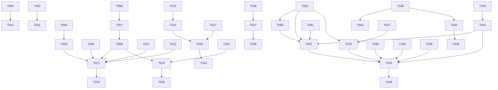

# Tasks: spec-005 — Aprobación o Rechazo de Solicitudes

**Feature**: `spec-005` (HU-05) · **Revisado**: 2026-11-16 (tras `/speckit-clarify` y `/speckit-plan` de esa fecha)

> **Estado**: T001–T032 corresponden a la implementación previa a las aclaraciones de 2026-11-16 y se conservan marcadas. Las tareas T033–T052 (Phase 6, incluye el ajuste del saldo de HU-02 por la aclaración C5; sus IDs T050–T052 no son correlativos con T044 porque se añadieron después) y T045–T049 (Phase 7) añaden lo que cambian las aclaraciones: auto-resolución, saldo por año natural, año cerrado, `422`, límite de 500 caracteres. Donde una tarea antigua contradice las aclaraciones lleva la nota «**Revisada**» y la tarea nueva que la corrige. N1 (HU-03 sin validación por año) queda como límite conocido; sin tarea en HU-05 (ver `plan.md`, Complexity Tracking). T053 (añadida tras `/speckit-analyze`) inyecta `Clock` en el saldo de HU-02. T054–T056 (Phase 8) son de `/speckit-converge`. T057–T082 (Phase 9, 2026-11-18) añaden FR-015 (bloqueo sin resolutor válido), FR-016 (cancelación automática) y FR-017 (rol `DIRECCION_GENERAL`).

**Input**: [plan.md](plan.md), [spec.md](spec.md), [research.md](research.md), [data-model.md](data-model.md), [contracts/leave-resolution-api.yaml](contracts/leave-resolution-api.yaml), [quickstart.md](quickstart.md)

**Tests**: Incluidos. La constitución exige desarrollo orientado a pruebas (Art. 22) y trazabilidad HU → CA → Test (Art. 2): cada test se etiqueta con `@Tag`/`@DisplayName` `HU-05.CA-X`. Dentro de cada historia, los tests se escriben antes que la implementación y deben fallar primero.

**Organization**: Tareas agrupadas por historia de usuario (US1 = resolución por el responsable, P1; US2 = notificaciones del empleado, P2).

## Format: `[ID] [P?] [Story] Description`

- **[P]**: Paralelizable (ficheros distintos, sin dependencias pendientes)
- **[Story]**: Historia a la que pertenece (US1, US2)

---

## Phase 1: Setup

**Purpose**: Esquema de BD y datos de desarrollo necesarios para validar la HU.

- [X] T001 Create Flyway migration `backend/src/main/resources/db/migration/V3__leave_resolution_constraints.sql` with: `CHECK chk_leave_rejection_reason (status <> 'REJECTED' OR (rejection_reason IS NOT NULL AND char_length(btrim(rejection_reason)) >= 5))`; function `fn_leave_requests_immutable_resolution()` + `BEFORE UPDATE` trigger `trg_leave_requests_immutable_resolution` raising an exception when `OLD.status <> 'PENDING'` and `status` or `rejection_reason` change (`IS DISTINCT FROM`); do NOT constrain `resolved_by`/`resolved_at` (see `research.md` §1.6); rollback steps as SQL comment
- [X] T002 [P] Extend `backend/src/main/java/com/iw/rrhh/security/config/SecurityDataInitializer.java` to create user `responsable@empresa.com` (role `RESPONSABLE_EQUIPO`, password `admin123`) with its employee record and contract, and assign it as `manager` of `empleado@empresa.com` when that employee has no manager

---

## Phase 2: Foundational (Blocking Prerequisites)

**Purpose**: Excepción de dominio, bloqueos y creación de notificaciones, necesarios para que la resolución (US1) sea atómica y para las consultas de US2.

**⚠️ CRITICAL**: Ninguna historia puede empezar hasta completar esta fase.

- [X] T003 [P] Create `LeaveRequestAlreadyResolvedException` in `backend/src/main/java/com/iw/rrhh/common/exception/LeaveRequestAlreadyResolvedException.java` and map it to `409 Conflict` ProblemDetail (title "Solicitud ya resuelta", type `https://api.rrhh.iw/errors/leave-already-resolved`) in `backend/src/main/java/com/iw/rrhh/common/exception/GlobalExceptionHandler.java`
- [X] T004 Add domain methods `approve(Employee resolver, String comment, Instant now)` and `reject(Employee resolver, String reason, Instant now)` to `backend/src/main/java/com/iw/rrhh/leave/domain/LeaveRequest.java`; both throw `LeaveRequestAlreadyResolvedException` if `status != PENDING` and set `status`, `rejectionReason`, `resolvedBy`, `resolvedAt`
- [X] T005 [P] Add `@Lock(PESSIMISTIC_WRITE) Optional<Employee> findByIdForUpdate(UUID id)` (`SELECT e FROM Employee e WHERE e.id = :id`) to `backend/src/main/java/com/iw/rrhh/employee/repository/EmployeeRepository.java`
- [X] T006 [P] Create entity `Notification` mapped to existing table `notifications` (`recipient_id` NOT NULL → `Employee` LAZY, `title` `VARCHAR(200)` NOT NULL, `message` `TEXT` NOT NULL, `is_read` default `false` with `markAsRead()`, `created_at` `@CreationTimestamp` not updatable) in `backend/src/main/java/com/iw/rrhh/notification/domain/Notification.java`
- [X] T007 Create `NotificationRepository` with `Page<Notification> findByRecipientIdOrderByCreatedAtDesc(UUID recipientId, Pageable pageable)` and `long countByRecipientIdAndReadFalse(UUID recipientId)` in `backend/src/main/java/com/iw/rrhh/notification/repository/NotificationRepository.java`
- [X] T008 Create `NotificationService` interface with `void createNotification(Employee recipient, String title, String message)` and its `@Transactional` (propagation `REQUIRED`) implementation in `backend/src/main/java/com/iw/rrhh/notification/service/NotificationService.java` and `backend/src/main/java/com/iw/rrhh/notification/service/NotificationServiceImpl.java`

**Checkpoint**: Base lista; las historias pueden comenzar.

---

## Phase 3: User Story 1 - Resolver solicitudes pendientes del equipo (Priority: P1) 🎯 MVP

**Goal**: El responsable ve solo las solicitudes `PENDING` de su equipo y las aprueba (comentario opcional) o rechaza (motivo ≥ 5 caracteres) en una transacción que revalida el saldo y crea la notificación.

**Independent Test**: Como `responsable@empresa.com`, abrir `/team/requests`, aprobar una solicitud y rechazar otra con motivo; comprobar que desaparecen de la bandeja, que el saldo de HU-02 refleja la aprobación y que un segundo intento devuelve `409` (quickstart escenarios 1-5 y 7).

### Tests for User Story 1 ⚠️

> Escribir primero y verificar que FALLAN antes de implementar.

- [X] T009 [P] [US1] Unit tests (Mockito) for `LeaveResolutionServiceImpl` in `backend/src/test/java/com/iw/rrhh/leave/LeaveResolutionServiceTest.java`: approve sets `APPROVED`/`resolvedBy`/`resolvedAt` and calls `createNotification` (`HU-05.CA-2`, `HU-05.CA-4`); reject stores stripped reason and notifies (`HU-05.CA-2`); reason shorter than 5 chars after `strip()` → `IllegalArgumentException` (`HU-05.CA-2`); resolving `APPROVED`/`REJECTED` → `LeaveRequestAlreadyResolvedException` (`HU-05.CA-3`); request of another manager's employee → `AccessDeniedException` (`HU-05.CA-1`); `VACATION` with `calculatedDays > availableDays` → `InsufficientLeaveBalanceException` and no notification (`HU-05.CA-5`); `PERMIT` approval does not query the balance (`HU-05.CA-5`)
- [X] T010 [P] [US1] Integration tests (Testcontainers + MockMvc) in `backend/src/test/java/com/iw/rrhh/leave/LeaveResolutionIntegrationTest.java`: `GET /leave/team-requests` returns only `PENDING` of own team ordered `createdAt ASC`, `403` for role `EMPLEADO` (`HU-05.CA-1`); approve/reject `200` with `LeaveResolutionResponse` and persisted notification (`HU-05.CA-2`, `HU-05.CA-4`); reject without reason or `"abc"` → `400` with `invalidFields.reason` (`HU-05.CA-2`); second resolution → `409` (`HU-05.CA-3`); manager of another team → `403` (`HU-05.CA-1`); unknown id → `404`; approved vacation increases `spentDays` of `GET /leave/balances/employee/{id}` (`HU-05.CA-5`); insufficient balance → ~~`409`~~ **Revisada 2026-11-16: `422`** (ver T035) and request stays `PENDING` (`HU-05.CA-5`); two concurrent approvals of different requests of the same employee exceeding the balance → exactly one succeeds (`HU-05.CA-5`, Art. 22.4) — the test class MUST NOT be `@Transactional`; run both approvals in separate threads, each with its own security context, so the real `FOR UPDATE` locks are exercised; direct SQL `UPDATE` of a resolved request fails due to the trigger (`HU-05.CA-3`); atomicity in separate class `backend/src/test/java/com/iw/rrhh/leave/LeaveResolutionAtomicityIntegrationTest.java` with `NotificationService` replaced by `@MockitoBean` throwing on `createNotification` → request stays `PENDING` (`HU-05.CA-4`, Art. 13.7); after reassigning the employee to another manager, the previous manager gets `403` and the new one can resolve (`HU-05.CA-1`, edge case change of manager); existing suites `LeaveRequestIntegrationTest`, `LeaveBalanceIntegrationTest` and `LeaveRequestTrackingIntegrationTest` keep passing with V3 applied

### Backend Implementation for User Story 1

- [X] T011 [P] [US1] Create DTO records in `backend/src/main/java/com/iw/rrhh/leave/dto/`: `ApproveLeaveRequest(@Size(max = 500, message = "El comentario no puede exceder 500 caracteres") String comment)`, `RejectLeaveRequest(@NotBlank(message = "El motivo del rechazo es obligatorio") @Size(min = 5, max = 500, message = "El motivo debe tener entre 5 y 500 caracteres") String reason)`, `TeamLeaveRequestResponse(id, employeeId, employeeName, leaveType, startDate, endDate, calculatedDays, createdAt)`, `LeaveResolutionResponse(id, status, reason, resolvedById, resolvedAt)`
- [X] T012 [P] [US1] Add to `backend/src/main/java/com/iw/rrhh/leave/repository/LeaveRequestRepository.java`: `@EntityGraph(attributePaths = "employee") Page<LeaveRequest> findByEmployeeManagerIdAndStatusOrderByCreatedAtAsc(UUID managerId, LeaveStatus status, Pageable pageable)` (**Revisada**: excluir solicitudes propias, ver T039) and `@Lock(PESSIMISTIC_WRITE) @Query("SELECT lr FROM LeaveRequest lr WHERE lr.id = :id") Optional<LeaveRequest> findByIdForUpdate(UUID id)`
- [X] T013 [US1] Create `LeaveResolutionService` and `LeaveResolutionServiceImpl` in `backend/src/main/java/com/iw/rrhh/leave/service/` with `getTeamPendingRequests(Pageable)`, `approve(UUID id, String comment)` and `reject(UUID id, String reason)`: manager from `SecurityContextHolder` (Art. 10.5); `findByIdForUpdate` → `404` if missing; scope check `employee.manager.id == manager.id` (**Revisada**: además denegar `employee.id == manager.id`, ver T041) else log `WARN` (only UUIDs) and `AccessDeniedException`; for `VACATION` approvals lock employee with `EmployeeRepository.findByIdForUpdate` and revalidate with `LeaveBalanceService.getEmployeeLeaveBalance(employeeId, startDate.getYear())` (**Revisada 2026-11-16**: validar cada año natural del periodo y lanzar `LeaveApprovalNotAllowedException` → `422`; ver T041); apply domain transition with `Instant.now(clock)`; create notification ("Solicitud aprobada"/"Solicitud rechazada", type, period `dd/MM/yyyy`, "Motivo: …"/"Comentario: …"); log `INFO` audit (requestId, status, resolverId); all in one `@Transactional` method (Art. 13.7). Inject `java.time.Clock` (add a `Clock` bean in `backend/src/main/java/com/iw/rrhh/common/config/ClockConfig.java` if none exists)
- [X] T014 [US1] Create `LeaveResolutionController` in `backend/src/main/java/com/iw/rrhh/leave/controller/LeaveResolutionController.java` with `@PreAuthorize("hasRole('RESPONSABLE_EQUIPO')")`: `GET /leave/team-requests` (`page` default 0, `size` default 10) → `PageResponse<TeamLeaveRequestResponse>`; `POST /leave/requests/{id}/approve` (optional `@Valid` body) → `200 LeaveResolutionResponse`; `POST /leave/requests/{id}/reject` (`@Valid` body) → `200 LeaveResolutionResponse`

### Frontend Implementation for User Story 1

- [X] T015 [P] [US1] Create models `TeamLeaveRequest`, `LeaveResolution`, `ApproveLeaveRequest`, `RejectLeaveRequest` in `frontend/src/app/features/team-calendar/models/team-leave.models.ts` (reuse `PageResponse`, `LeaveType`, `LeaveStatus` from `features/leave/models/leave.models.ts`)
- [X] T016 [P] [US1] Create `TeamLeaveService` with `getTeamPendingRequests(page, size)`, `approve(id, comment?)`, `reject(id, reason)` against `/api/v1/leave` in `frontend/src/app/features/team-calendar/services/team-leave.service.ts`
- [X] T017 [P] [US1] Create `ResolveRequestDialogComponent` (standalone, reactive form with one `textarea`; mode `approve` → optional, `maxLength(500)`; mode `reject` → `Validators.required` + `Validators.minLength(5)` + `maxLength(500)` with `mat-error` next to the field; accessible title and focus) in `frontend/src/app/features/team-calendar/components/resolve-request-dialog/resolve-request-dialog.component.ts`
- [X] T018 [P] [US1] Unit tests (Vitest) for `TeamPendingRequestsComponent` in `frontend/src/app/features/team-calendar/components/team-pending-requests/team-pending-requests.component.spec.ts`: renders rows from service, empty-state message, approve/reject dispatch after dialog, reload after `409` error with snack-bar (`HU-05.CA-1`, `HU-05.CA-2`, `HU-05.CA-3`)
- [X] T019 [US1] Create `TeamPendingRequestsComponent` (`mat-table` with columns Empleado, Tipo, Fechas, Días, Solicitada, Acciones; buttons "Aprobar"/"Rechazar" with icon + text; `mat-paginator` page size 10; loading spinner, error and empty-state messages; snack-bar on success/error; reload after each action) in `frontend/src/app/features/team-calendar/components/team-pending-requests/team-pending-requests.component.{ts,html,scss}`
- [X] T020 [US1] Register lazy route `team/requests` with `authGuard` in `frontend/src/app/app.routes.ts` and add nav link "Solicitudes del Equipo" shown only when `authService.isResponsable()` in `frontend/src/app/app.html`

**Checkpoint**: US1 completa y validable de forma independiente (las notificaciones ya se persisten).

---

## Phase 4: User Story 2 - Notificación del resultado al empleado (Priority: P2)

**Goal**: El empleado ve en la cabecera el número de notificaciones no leídas, las consulta y las marca como leídas; solo accede a las suyas.

**Independent Test**: Tras resolver una solicitud, iniciar sesión como `empleado@empresa.com`, ver el contador en la campana, abrirla, marcar una notificación como leída y comprobar que el contador baja (quickstart escenario 6).

### Tests for User Story 2 ⚠️

- [X] T021 [P] [US2] Integration tests (Testcontainers + MockMvc) in `backend/src/test/java/com/iw/rrhh/notification/NotificationIntegrationTest.java`: `GET /notifications` returns only own notifications ordered `createdAt DESC` and paginated; `GET /notifications/unread-count`; `POST /notifications/{id}/read` → `204` and idempotent; another employee's notification → `403`; unknown id → `404`; unauthenticated → `401` (`HU-05.CA-4`)
- [X] T022 [P] [US2] Unit tests (Vitest) for `NotificationBellComponent` in `frontend/src/app/core/components/notification-bell/notification-bell.component.spec.ts`: badge shows unread count with accessible label, list renders, clicking an unread item calls `markAsRead` and decrements the count (`HU-05.CA-4`)

### Backend Implementation for User Story 2

- [X] T023 [P] [US2] Create DTO records `NotificationResponse(id, title, message, read, createdAt)` and `UnreadCountResponse(long count)` in `backend/src/main/java/com/iw/rrhh/notification/dto/`
- [X] T024 [US2] Add to `NotificationService`/`NotificationServiceImpl` the methods `getMyNotifications(Pageable)`, `countMyUnread()` and `markAsRead(UUID id)` using the session employee (Art. 10.5); `markAsRead` throws `NoSuchElementException` if missing and `AccessDeniedException` if `recipient` is not the session employee, in `backend/src/main/java/com/iw/rrhh/notification/service/`
- [X] T025 [US2] Create `NotificationController` (`@PreAuthorize("isAuthenticated()")`): `GET /notifications` (`page` default 0, `size` default 10) → `PageResponse<NotificationResponse>`; `GET /notifications/unread-count` → `UnreadCountResponse`; `POST /notifications/{id}/read` → `204`, in `backend/src/main/java/com/iw/rrhh/notification/controller/NotificationController.java`

### Frontend Implementation for User Story 2

- [X] T026 [P] [US2] Create `AppNotification` and `UnreadCount` models in `frontend/src/app/core/models/notification.models.ts` and `NotificationService` (`getMyNotifications`, `getUnreadCount`, `markAsRead`, signal `unreadCount`) in `frontend/src/app/core/services/notification.service.ts`
- [X] T027 [US2] Create `NotificationBellComponent` (`mat-icon-button` + `matBadge` hidden when 0, `aria-label` "N notificaciones sin leer"; `mat-menu` with the 10 most recent, unread ones marked with icon + text "Nueva"; click on unread → `markAsRead`; empty message "No tienes notificaciones"; refresh count on init and on each `NavigationEnd`) in `frontend/src/app/core/components/notification-bell/notification-bell.component.{ts,html,scss}`
- [X] T028 [US2] Add `<app-notification-bell>` to the authenticated header in `frontend/src/app/app.html` and import it in `frontend/src/app/app.ts`

**Checkpoint**: US1 y US2 funcionales de forma independiente.

---

## Phase 5: Polish & Cross-Cutting Concerns

- [X] T029 [P] Run backend tests `cd backend && ./mvnw test` (full suite, to detect regressions in HU-01…HU-04 caused by the V3 migration)
- [X] T030 [P] Run frontend tests `cd frontend && npx ng test --watch=false` and build `npx ng build`
- [X] T031 Validate manual scenarios 1-7 of `specs/spec-005/quickstart.md`
- [X] T032 Update `specs/spec-005/spec.md` status to reflect the final behaviour (Art. 1.2) if any divergence was found

---

## Phase 6: Refinamiento tras las aclaraciones de 2026-11-16 (US1)

**Purpose**: Adaptar la implementación existente a las aclaraciones (`spec.md` sesión 2026-11-16; `plan.md` «Decisiones de la sesión»). Orden: tests primero (deben FALLAR con el código actual), después implementación.

**Goal**: (1) nadie resuelve sus propias solicitudes; (2) saldo validado por año natural; (3) `409` resuelta/simultánea · `404` retirada · `422` saldo/año cerrado; (4) motivo 5–500 y comentario ≤ 500; (5) no se aprueban fechas de años cerrados.

**Independent Test**: quickstart escenarios 8–11 y los escenarios 3 y 7 revisados.

### Tests (escribir primero, verificar que FALLAN)

- [X] T033 [P] [US1] Unit tests (JUnit 5) for the new `LeaveDayAllocator` in `backend/src/test/java/com/iw/rrhh/leave/LeaveDayAllocatorTest.java` (the existing `backend/src/test/java/com/iw/rrhh/common/HolidayCalendarServiceTest.java` is NOT modified): single-year range returns `{year: calculatedDays}` without recalculation; 28/12–08/01 returns working days of the first year (today's calendar, capped at `calculatedDays`) and the remainder for the last year; sum always equals `calculatedDays` even when today's working days differ from `calculatedDays` (festivos changed) — both when today's count is higher and lower; ranges over three years; `daysInYear(request, year)` returns 0 for a year the request does not touch (`HU-05.CA-5`, Art. 14.3; aclaración C4)
- [X] T034 [P] [US1] Extend `backend/src/test/java/com/iw/rrhh/leave/LeaveResolutionServiceTest.java` (Mockito, inject fixed `Clock`): resolver == request employee → `AccessDeniedException` with `manager_id` pointing to itself and no state change (`HU-05.CA-1`); any date in a year < current year → approve throws `LeaveApprovalNotAllowedException` (year closed) without querying the balance, while reject succeeds (`HU-05.CA-5`); cross-year vacation: first year OK and second year insufficient → `LeaveApprovalNotAllowedException` carrying `year`, no notification (`HU-05.CA-5`); both years sufficient → approved; replace the existing expectation of `InsufficientLeaveBalanceException` on approve by `LeaveApprovalNotAllowedException` (`HU-05.CA-5`); request in status `CANCELLED` (HU-04) → `NoSuchElementException` (`404`) on approve and reject after the scope check, no notification (`HU-05.CA-3`)
- [X] T035 [P] [US1] Extend `backend/src/test/java/com/iw/rrhh/leave/LeaveResolutionIntegrationTest.java` (Testcontainers + MockMvc, fixed `Clock`): insufficient balance on approve → `422` with `requestedDays`/`availableDays`/`year` and request stays `PENDING` (replaces the `409` expectation, `HU-05.CA-5`); approve with dates in a closed year → `422` and later reject with reason → `200` (`HU-05.CA-5`); cross-year request: `422` naming the failing year, `200` when both years have balance (`HU-05.CA-5`); manager's own request → `403` on approve and reject, absent from own `GET /leave/team-requests`, present in the superior's inbox and resolvable by the superior (`HU-05.CA-1`, Art. 10.7); manager whose own `manager_id` points to an employee without role `RESPONSABLE_EQUIPO`, or has no superior: nobody resolves it, the request stays `PENDING` and the superior-without-role gets `403` (`HU-05.CA-1`, límite conocido C7); request cancelled by the employee through the HU-04 endpoint (status `CANCELLED`) before resolving → `404` on approve and reject, while an out-of-scope manager still gets `403` (`HU-05.CA-3`); two concurrent resolutions of the SAME request (separate threads, class not `@Transactional`) → exactly one `200` and one `409` (`HU-05.CA-3`, Art. 22.4); reject reason of 501 chars and approve comment of 501 chars → `400` with `invalidFields.reason` / `invalidFields.comment` (`HU-05.CA-2`); reject reason of 500 chars accepted; direct SQL `UPDATE ... rejection_reason` of 501 chars violates `chk_leave_rejection_reason_max` (`HU-05.CA-2`, Art. 8.2); existing suites of HU-03/HU-04 still pass with V6 applied; approved request appears in the team calendar: after `POST .../approve`, `TeamCalendarService` (HU-06, `VISIBLE_STATUSES` PENDING+APPROVED) returns it for the manager's team and month with status `APPROVED`, and a rejected one does not appear (`HU-05.CA-5`, FR-012)
- [X] T036 [P] [US1] Extend `frontend/src/app/features/team-calendar/components/team-pending-requests/team-pending-requests.component.spec.ts` and a new `resolve-request-dialog.component.spec.ts`: after `404` or `409` the list reloads and a snack-bar shows the message; after `422` the snack-bar shows the problem `detail` and the row stays; textarea over 500 chars shows `mat-error` next to the field in both modes and shows the character counter (`HU-05.CA-2`, `HU-05.CA-3`, `HU-05.CA-5`)
- [X] T050 [P] [US1] Adapt and extend HU-02 tests so the balance counts cross-year requests (`HU-05.CA-5`, Art. 12.1): in `backend/src/test/java/com/iw/rrhh/leave/LeaveBalanceServiceTest.java` replace the mock of `sumCalculatedDays` (proxy at line ~119) by the new `findOverlappingByYear`; add cases — an `APPROVED` 28/12–08/01 request contributes its share to `spentDays` of BOTH years and a `PENDING` one to `pendingDays` of both; a request contained in one year gives the same result as before; a future year uses the normal convenio balance (and 0 entitled days if hired after that year). In `backend/src/test/java/com/iw/rrhh/leave/LeaveBalanceIntegrationTest.java` (Testcontainers) add the same cross-year scenario with fixtures relative to the fixed `Clock`. Existing HU-02 tests (`LeaveProratingUnitTest`, etc.) MUST keep passing unchanged; `LeaveRequestIntegrationTest` (HU-03) keeps passing without changes **Nota 2026-11-18**: la variante de integración en `LeaveBalanceIntegrationTest` falla si es de las dos primeras de la clase por un fallo previo de sus fixtures (los ids 1 y 2 de `collective_agreements` los ocupa el seed `V2`); el mismo escenario (28/12–08/01 cuenta en ambos años) se verifica en `LeaveResolutionIntegrationTest.crossYear_bothYearsSufficient_approvedAndCountedInBothBalances`.

### Backend Implementation

- [X] T037 [P] [US1] Create Flyway migration `backend/src/main/resources/db/migration/V6__leave_resolution_reason_max_length.sql` with `ALTER TABLE leave_requests ADD CONSTRAINT chk_leave_rejection_reason_max CHECK (rejection_reason IS NULL OR char_length(rejection_reason) <= 500)`; rollback `ALTER TABLE leave_requests DROP CONSTRAINT chk_leave_rejection_reason_max` as SQL comment. Do NOT edit `V3` (already in `main`, Flyway checksum); if V6 is taken by another branch at merge time, renumber (see `research.md` §1.6)
- [X] T038 [P] [US1] Create `LeaveApprovalNotAllowedException` (`detail`, `year`, nullable `requestedDays`/`availableDays`) in `backend/src/main/java/com/iw/rrhh/common/exception/LeaveApprovalNotAllowedException.java` and map it to `422` ProblemDetail (title "Aprobación no permitida", type `https://api.rrhh.iw/errors/leave-approval-not-allowed`, properties `year`, `requestedDays`, `availableDays`) in `GlobalExceptionHandler.java`. Keep `InsufficientLeaveBalanceException` → `409` untouched (HU-03)
- [X] T039 [US1] Update `LeaveRequestRepository`: replace the inbox query by `findByEmployeeManagerIdAndEmployeeIdNotAndStatusOrderByCreatedAtAsc(UUID managerId, UUID excludedEmployeeId, LeaveStatus status, Pageable)` (called with `excludedEmployeeId = managerId`) in `backend/src/main/java/com/iw/rrhh/leave/repository/LeaveRequestRepository.java` and use it in `getTeamPendingRequests`
- [X] T040 [US1] Create `LeaveDayAllocator` (`@Component`, stateless, constructor-injected `HolidayCalendarService`) in `backend/src/main/java/com/iw/rrhh/leave/service/LeaveDayAllocator.java` with `Map<Integer,Integer> allocate(LocalDate start, LocalDate end, int calculatedDays)` and `int daysInYear(LeaveRequest request, int year)` following the rule in `data-model.md` §5 / `research.md` §1.4 (total = `calculatedDays`; every year but the last = `min(working days of that stretch today, remaining)`; last year = remaining). It is the single day-computation component reused by the resolution and the balance (Art. 14.3); no duplicated computation
- [X] T041 [US1] Update `LeaveResolutionServiceImpl` in `backend/src/main/java/com/iw/rrhh/leave/service/LeaveResolutionServiceImpl.java`: `loadInScope` also throws `AccessDeniedException` (log `WARN`, UUIDs only) when `request.employee.id == manager.id`; in `approve`, order `404` → `403` → `CANCELLED` (treated as withdrawn → `404`, after the scope check) → `409` → closed year (`LeaveApprovalNotAllowedException`, year < the current year computed with `clock.withZone(Europe/Madrid)` (single zone constant, Art. 14.2), applies to approve only) → per-year balance via `LeaveDayAllocator.daysInYear(request, year)` + `LeaveBalanceService.getEmployeeLeaveBalance(employeeId, year)` for each year of the period (the request is still `PENDING`, so its share is compared against `availableDays` of that year), throwing `LeaveApprovalNotAllowedException` with `year`, `requestedDays`, `availableDays` instead of `InsufficientLeaveBalanceException`; keep employee `FOR UPDATE` lock before the balance checks; keep `PERMIT` without balance checks
- [X] T042 [US1] Verify `ApproveLeaveRequest`/`RejectLeaveRequest` messages and `max = 500` in `backend/src/main/java/com/iw/rrhh/leave/dto/` (already present); add the `invalidFields.comment` assertion path only if the field name differs; no code change expected

### Frontend Implementation

- [X] T043 [US1] Update `ResolveRequestDialogComponent` (`frontend/src/app/features/team-calendar/components/resolve-request-dialog/resolve-request-dialog.component.ts`): `maxLength(500)` with `mat-hint` character counter in both modes; length validation over the trimmed text; texts externalised (Art. 21.3)
- [X] T044 [US1] Update `TeamPendingRequestsComponent` and `TeamLeaveService` (`frontend/src/app/features/team-calendar/`): reload the list on `404` and `409`; on `422` show the ProblemDetail `detail` in `MatSnackBar` and keep the row; generic fallback message for other errors (Art. 19.4: no internal details)

### Ajuste de HU-02 para solicitudes que cruzan años (aclaración C5)

- [X] T051 [US1] Add `List<LeaveRequest> findOverlappingByYear(UUID employeeId, LeaveType leaveType, LeaveStatus status, LocalDate startOfYear, LocalDate endOfYear)` (`startDate <= :endOfYear AND endDate >= :startOfYear`) to `backend/src/main/java/com/iw/rrhh/leave/repository/LeaveRequestRepository.java`; KEEP `sumCalculatedDays`: `LeaveRequestServiceImpl` (HU-03, `createRequest`) still calls it for pending days (límite conocido N1, `plan.md` Complexity Tracking); do NOT modify HU-03 in this feature
- [X] T052 [US1] Update `calculateBalance` in `backend/src/main/java/com/iw/rrhh/leave/service/LeaveBalanceServiceImpl.java`: `spentDays` = sum of `LeaveDayAllocator.daysInYear(r, year)` over `APPROVED` VACATION requests from `findOverlappingByYear`, `pendingDays` likewise for `PENDING`; keep the rest of the calculation (convenio, prorrateo, `availableDays`) untouched so contained-in-one-year requests give identical results; inject `LeaveDayAllocator` by constructor (Art. 7.5). Do not introduce stored counters (Art. 12.1)

- [X] T053 [US1] Inject `java.time.Clock` (bean from `ClockConfig`) into `LeaveBalanceServiceImpl` in `backend/src/main/java/com/iw/rrhh/leave/service/LeaveBalanceServiceImpl.java` and replace the three `LocalDate.now()` uses (target year default, `currentYear`/`isClosedYear`, `referenceDate`) by `LocalDate.now(clock)` where the clock is zoned to `Europe/Madrid` (Art. 14.2) (Art. 22.5, hallazgo N5); update the `LeaveBalanceService` unit tests to pass a fixed `Clock`; existing HU-02 tests keep passing

**Checkpoint**: T033–T036 y T050 pasan; HU-02 sigue en verde; quickstart escenarios 8–11 validados.

---

## Phase 7: Polish de la revisión 2026-11-16

- [X] T045 [P] Run backend tests `cd backend && ./mvnw test` (full suite; regressions of HU-01…HU-04/HU-08 with V6 applied)
- [X] T046 [P] Run frontend tests `cd frontend && npx ng test --watch=false` and build `npx ng build`
- [X] T047 Validate manual scenarios 1–11 of `specs/spec-005/quickstart.md` (scenarios 3 and 7 revised, 8–11 new) **Nota 2026-11-18**: validado en navegador (1, 2, 3, 6, calendario) y por API real (4, 5, 10, 11). 7, 8 y 9 requieren fixtures de BD y quedan cubiertos por tests automatizados.
- [X] T048 Check Art. 24.3 Definition of Done for HU-05: every CA covered by a tagged test, OpenAPI `contracts/leave-resolution-api.yaml` v1.1.0 matches the implemented responses (`409`/`404`/`422`/`403`), no personal data in logs
- [X] T049 Update `specs/spec-005/spec.md` status and, if any divergence is found, spec first (Art. 1.3)

---

## Dependencies & Execution Order

### Phase Dependencies

- **Setup (Phase 1)**: sin dependencias.
- **Foundational (Phase 2)**: depende de Setup; bloquea ambas historias.
- **US1 (Phase 3)**: depende de Foundational.
- **US2 (Phase 4)**: depende de Foundational; independiente de US1 en código (sus tests crean notificaciones directamente con `NotificationRepository`). La validación manual de extremo a extremo usa US1 para generarlas.
- **Polish (Phase 5)**: depende de US1 y US2.
- **Refinamiento (Phase 6)**: depende de Phases 1–4 (código previo). Dentro: T033–T036 y T050 antes de T037–T044 y T051–T052; T053 antes de T050, T052 y T035; T038 y T040 antes de T041; T039 antes de T041; T041 antes de T035 en verde; T043–T044 antes de T036 en verde.
- **Polish 2 (Phase 7)**: depende de Phase 6.
- **Phase 9 (2026-11-18)**: T057–T060 (Constitución y specs, Art. 1.3 y 27) bloquean todo el código de la fase; tests T061–T067 y T083 antes de la implementación T068–T079 y T084 (T084 después de T069 y T076) (deben FALLAR); T068 (V7) y T069 (`UserRole`) antes de T070–T075; T070 antes de T071–T073; T073 antes de T065 en verde; T076 antes de T077–T079; Polish T080–T082 al final.

### Within Each User Story

- Tests → DTOs/modelos → repositorio → servicio → controlador → frontend (servicio → componente → ruta).



### Parallel Opportunities

- Phase 1: T001 ‖ T002.
- Phase 2: T003 ‖ T005 ‖ T006.
- US1: T009 ‖ T010 ‖ T011 ‖ T012 ‖ T015 ‖ T016 ‖ T017 ‖ T018.
- US2: T021 ‖ T022 ‖ T023 ‖ T026.
- Phase 6: T033 ‖ T034 ‖ T035 ‖ T036 ‖ T050 (tests); T051 ‖ T040 antes de T052; T037 ‖ T038 después; T043 ‖ T044 en frontend mientras avanza T041 en backend.
- Backend y frontend de una misma historia pueden avanzar en paralelo una vez fijado el contrato.

### Parallel Example: User Story 1

```text
Task: "T009 Unit tests LeaveResolutionServiceTest"
Task: "T010 Integration tests LeaveResolutionIntegrationTest"
Task: "T011 DTO records in leave/dto/"
Task: "T012 Repository methods in LeaveRequestRepository"
Task: "T017 ResolveRequestDialogComponent"
```

---

## Implementation Strategy

### MVP First (User Story 1)

1. Phase 1 + Phase 2.
2. Phase 3 (US1) → validar quickstart escenarios 1-5 y 7. Las notificaciones ya quedan persistidas aunque aún no se muestren.

### Incremental Delivery

1. US1 → bandeja y resolución atómica (MVP).
2. US2 → visibilidad de las notificaciones para el empleado.
3. Polish → suite completa y validación manual.
4. Refinamiento 2026-11-16 (Phase 6) → reglas aclaradas; entregable independiente sobre el MVP ya implementado, validable con quickstart 8–11.

---

## Phase 8: Convergence

**Purpose**: Huecos detectados por `/speckit-converge` (2026-11-18) entre el código de HU-05 y `spec.md`/`plan.md`. Tests primero: deben FALLAR con el código actual.

- [X] T054 [US1] Make the server-side length validation of the reject reason and approve comment operate on the trimmed text and report field errors, in `backend/src/main/java/com/iw/rrhh/leave/dto/RejectLeaveRequest.java` and `ApproveLeaveRequest.java` (e.g. trim-aware constraint or compact constructor) and drop the `IllegalArgumentException` fallback in `LeaveResolutionServiceImpl.reject`: today `@Size` runs on the untrimmed value, so `"  abc  "` passes the DTO and returns `400` without `invalidFields.reason`, and a 500-char reason with surrounding spaces is rejected. Add to `LeaveResolutionIntegrationTest.java` (`HU-05.CA-2`): `"  abc  "` → `400` with `invalidFields.reason`; 500 chars + surrounding spaces → `200`; same for approve comment (`invalidFields.comment` only when the trimmed text exceeds 500) per FR-003 (partial)
- [X] T055 [P] [US1] Add integration test in `backend/src/test/java/com/iw/rrhh/leave/LeaveResolutionIntegrationTest.java`: after `POST .../reject` with a reason, the employee calls the HU-04 endpoint (my requests) and sees status `REJECTED` and the same `rejectionReason`; an approve comment is not exposed as a rejection (`HU-05.CA-2`, US1/AC3, FR-005) (partial: only an HU-04 test with a hand-built fixture exists, not the HU-05 → HU-04 flow)
- [X] T056 [P] [US1] Add audit-log tests (log appender capture) in `backend/src/test/java/com/iw/rrhh/leave/LeaveResolutionServiceTest.java`: approve and reject emit one `INFO` line with request id, status and resolver UUID; out-of-scope and self-resolution attempts emit `WARN` "Acceso denegado"; no log line contains employee name, reason or comment (`HU-05.CA-1`, FR-013, Art. 20.4-20.5) per FR-013 (partial: behavior implemented, no test)

---

## Phase 9: Resolutor válido, cancelación automática y Dirección General (2026-11-18)

**Purpose**: Implementar FR-015, FR-016 y FR-017 (`spec.md` sesión 2026-11-18; `plan.md` «Decisiones de la sesión de aclaraciones 2026-11-18»). Primero Constitución y specs (Art. 1.3 y 27), después tests (deben FALLAR), después implementación.

**Goal**: (1) sin resolutor válido no se pueden crear solicitudes; (2) si el superior deja de ser válido, las `PENDING` pasan a `CANCELLED` con notificación, en la misma transacción de HU-01; (3) rol `DIRECCION_GENERAL`: no solicita, sí resuelve y ve el calendario de sus subordinados directos.

**Independent Test**: quickstart escenarios 12–14.

### Gobierno: Constitución y specs (bloquea el código de esta fase)

> T057–T060 van en su propio commit/PR, antes del código (Art. 27.1).

- [ ] T057 Amend `.specify/memory/constitution.md` (MINOR, Art. 27): add the `DIRECCION_GENERAL` role to Art. 10.1, a row in the Art. 10.4 scope table («solo las personas que lo tienen de superior directo: solicitudes y calendario; no solicita ausencias»), the Annex A term, and a note in Annex B question 11 (Dirección General resolves its direct reports; who approves Dirección General's own absences stays open). Bump the version to 1.1.0 with the amendment date, and register the review of the affected `spec.md`/`plan.md`/`tasks.md` (Art. 27.3).
- [ ] T058 [P] Update `specs/spec-001/spec.md` (and `plan.md`/`tasks.md` if affected): hiring with the option «Sin responsable (solo Dirección General)» creates the user with role `DIRECCION_GENERAL`; add FR-016 (deactivating a superior cancels the pending requests of their direct reports; contract variations are out of scope). Remove the `isTopManagement` position check from hiring (no manager ⇒ `DIRECCION_GENERAL`; everyone else must have a manager), and require an explicit `withoutManager=true` flag for that case. Also update the files that state the old rule: `specs/spec-001/spec.md` (Clarifications line 16, line 66, FR-011), `data-model.md` (lines 39 and 127) and `analysis.md` (line 42). `EmployeeServiceImpl.addContractVariation` keeps its own `isTopManagement` check: contract variations are out of scope, so it is a leftover, not a change. Record that role validation at superior assignment stays a pending improvement.
- [ ] T059 [P] Update `specs/spec-003/spec.md` (and `plan.md`/`tasks.md` if affected): add FR-015 (creation blocked with `422` and the message «no tienes un responsable asignado» when there is no valid resolver) and FR-017 (`DIRECCION_GENERAL` cannot create requests); add the eligibility endpoint to its contract.
- [ ] T060 [P] Update `specs/spec-006/spec.md` and `contracts/team-calendar-api.yaml`: the calendar endpoint accepts `DIRECCION_GENERAL` with the same scope (direct reports); add the test case to its quickstart.

### Tests (escribir primero, verificar que FALLAN)

- [ ] T061 [P] [US1] Unit tests for `LeaveResolverPolicy` in `backend/src/test/java/com/iw/rrhh/leave/LeaveResolverPolicyTest.java`: no manager, inactive manager, manager without manager role (`EMPLEADO`, `RRHH`), self-referencing manager, valid `RESPONSABLE_EQUIPO`, valid `DIRECCION_GENERAL`.
- [ ] T062 [P] [US1] Extend `backend/src/test/java/com/iw/rrhh/leave/LeaveRequestServiceTest.java`: `createLeaveRequest` throws `LeaveCreationNotAllowedException` when the caller has no valid resolver and when the caller has role `DIRECCION_GENERAL` (even with a valid manager); nothing is persisted; valid resolver still creates.
- [ ] T063 [P] [US1] Extend `backend/src/test/java/com/iw/rrhh/leave/LeaveRequestIntegrationTest.java` (Testcontainers + MockMvc): `POST /leave/requests` → `422` problem+json with the message for no resolver, and for `DIRECCION_GENERAL`; `GET /leave/requests/eligibility` → `canRequest` true/false with `reason`; `401` without session.
- [ ] T064 [P] [US1] Unit tests (Mockito, fixed `Clock`) for `LeaveRequestAutoCancelService` in `backend/src/test/java/com/iw/rrhh/leave/LeaveRequestAutoCancelServiceTest.java`: only `PENDING` requests become `CANCELLED` (`APPROVED`/`REJECTED` untouched), one notification per employee with the reason, one `INFO` audit line without personal data, no row deleted.
- [ ] T065 [P] [US1] Extend `backend/src/test/java/com/iw/rrhh/employee/EmployeeIntegrationTest.java`: deactivating a manager cancels the pending requests of their direct reports and notifies them; one notification per employee even with several pending requests; a failure in the cancellation rolls back the HU-01 change (Art. 13.7).
- [ ] T066 [P] [US1] Extend `backend/src/test/java/com/iw/rrhh/leave/LeaveResolutionIntegrationTest.java` and `TeamCalendarIntegrationTest.java`: a `DIRECCION_GENERAL` user lists, approves (vacation with balance check, no `403` from the balance service) and rejects requests of direct reports, `403` for requests outside their team and for their own; the calendar returns only their direct reports; `EMPLEADO` and `RRHH` keep getting `403`; the `V7` constraint accepts the new role.
- [ ] T067 [P] [US1] Frontend specs: `auth.service.spec.ts` (`isDireccionGeneral`), `app` menu spec (hides «Solicitar Ausencia» and «Mis Solicitudes» for `DIRECCION_GENERAL`, shows the inbox and calendar links), guard spec (URL access shows «Dirección General no solicita ausencias»), `leave-request-create` spec (eligibility `canRequest=false` shows the reason instead of the form).
- [ ] T083 [P] [US1] Extend `backend/src/test/java/com/iw/rrhh/employee/EmployeeIntegrationTest.java` (negative tests first): `POST` hiring without `managerId` and without `withoutManager` → `400`; with `withoutManager=true` → user with role `DIRECCION_GENERAL`; with both `managerId` and `withoutManager=true` → `400`; with `managerId` → role `EMPLEADO`. Add `withoutManager` to `CreateEmployeeRequest` (T069).

### Backend Implementation

- [ ] T068 [P] [US1] Create Flyway migration `backend/src/main/resources/db/migration/V7__direccion_general_role.sql` (drop and recreate `chk_user_role` with `EMPLEADO`, `RESPONSABLE_EQUIPO`, `RRHH`, `DIRECCION_GENERAL`, see `data-model.md` §2.3).
- [ ] T069 [P] [US1] Add `DIRECCION_GENERAL` to `backend/src/main/java/com/iw/rrhh/security/domain/UserRole.java`; in `EmployeeServiceImpl.createEmployee` create the user with that role when no `managerId` is given, i.e. RRHH picked «Sin responsable (solo Dirección General)» in the form (T058 defines the rule; the request carries `withoutManager=true`, see T083); remove the `isTopManagement` position check from `createEmployee`, adapting the HU-01 tests that expect `400` for a non-director without manager.
- [ ] T070 [US1] Create `LeaveResolverPolicy` (`hasValidResolver(Employee)`) in `backend/src/main/java/com/iw/rrhh/leave/service/LeaveResolverPolicy.java` (T061).
- [ ] T071 [US1] Create `LeaveCreationNotAllowedException` in `backend/src/main/java/com/iw/rrhh/common/exception/`, map it to `422` in `GlobalExceptionHandler`, and call the policy and the role check at the start of `LeaveRequestServiceImpl.createLeaveRequest` (T062, T063).
- [ ] T072 [US1] Add `GET /leave/requests/eligibility` to `LeaveRequestController` with `LeaveEligibilityResponse(canRequest, reason)` and the matching service method (T063).
- [ ] T073 [US1] Create `LeaveRequestAutoCancelService` in `backend/src/main/java/com/iw/rrhh/leave/service/`; add `EmployeeRepository.findByManagerId...` and the `PENDING` finder in `LeaveRequestRepository`; call it from `EmployeeServiceImpl.deactivateEmployee` as in `research.md` §1.19 (contract variations out of scope; one notification per employee), in the same transaction (T064, T065).
- [ ] T074 [P] [US1] Change `@PreAuthorize` to `hasAnyRole('RESPONSABLE_EQUIPO','DIRECCION_GENERAL')` in `LeaveResolutionController` and `TeamCalendarController`; in `LeaveBalanceServiceImpl.getEmployeeLeaveBalance` give `DIRECCION_GENERAL` the same hierarchy access as `RESPONSABLE_EQUIPO` (T066).
- [ ] T075 [P] [US1] Seed data: in `SecurityDataInitializer` add `direccion@empresa.com` (`DIRECCION_GENERAL`, no superior, password `admin123`) as superior of `responsable@empresa.com` and `rrhh@empresa.com` (every employee but Dirección General has a manager; re-check the HU-01 to HU-08 tests that assume `rrhh@` has no superior); create the `Employee` and `ContractRecord` of `direccion@` like the other seed users, and assign the superior of the existing `rrhh@` and `responsable@` only when missing (idempotent, also for an existing dev DB); update `research.md` §1.9 and `quickstart.md` if the credentials differ.

### Frontend Implementation

- [ ] T076 [US1] Add `'DIRECCION_GENERAL'` to `frontend/src/app/core/models/auth.models.ts` (type and label «Dirección General»); add `isDireccionGeneral` to `AuthService`; update `app.html` and `landing.component.ts` so the inbox and calendar show for `isResponsable() || isDireccionGeneral()` and the two absence links are hidden for `DIRECCION_GENERAL` (T067).
- [ ] T077 [US1] Add a route guard in `frontend/src/app/core/guards/auth.guard.ts` for the absence routes: `DIRECCION_GENERAL` sees the message «Dirección General no solicita ausencias»; allow the inbox and calendar routes for the new role (T067).
- [ ] T078 [US1] In `leave-request-create`, call the eligibility endpoint through the leave service and show `reason` instead of the form when `canRequest` is false (T067).
- [ ] T079 [P] [US1] Check that the leave list, team pending requests and team calendar screens render for `DIRECCION_GENERAL` without role-specific text; fix any remaining `isResponsable()`-only conditions found with a search.
- [ ] T084 [P] [US1] In `frontend/src/app/employees/components/employee-create/employee-create.component.ts` send `withoutManager: true` when the option «Sin responsable (solo Dirección General)» is chosen and `managerId` otherwise; add a spec for both payloads.

### Polish

- [ ] T080 Run the full suites: `cd backend && JAVA_TOOL_OPTIONS="-Dapi.version=1.44" sh ./mvnw test` and `cd frontend && npx ng test --watch=false`; all green, no regression in HU-01 to HU-08 (Docker must be up).
- [ ] T081 Validate quickstart scenarios 12–14 manually (frontend in Chrome, API with `curl`), and record the result in this file.
- [ ] T082 Definition of Done check (Art. 24.3) and update the status of `spec.md` of spec-005, spec-001, spec-003 and spec-006; update the Obsidian notes.
