# Tasks: spec-006 — Calendario de Ausencias del Equipo

**Feature**: `spec-006` (HU-06)

**Input**: [plan.md](plan.md), [spec.md](spec.md), [research.md](research.md), [data-model.md](data-model.md), [contracts/team-calendar-api.yaml](contracts/team-calendar-api.yaml), [quickstart.md](quickstart.md)

**Tests**: Incluidos (Art. 22 test-first y Art. 2 trazabilidad): cada test se etiqueta con `@DisplayName` `HU-06.CA-X`. Dentro de cada historia, los tests se escriben antes que la implementación y deben fallar primero.

**Organization**: US1 = calendario mensual con coincidencias (P1, MVP); US2 = filtro por empleado (P2).

## Format: `[ID] [P?] [Story] Description`

- **[P]**: Paralelizable (ficheros distintos, sin dependencias pendientes)
- **[Story]**: Historia a la que pertenece (US1, US2)

---

## Phase 1: Setup

**Purpose**: No aplica. Sin migraciones, dependencias ni datos de desarrollo nuevos (se reutilizan los de spec-005).

---

## Phase 2: Foundational (Blocking Prerequisites)

**Purpose**: Nombre de los festivos en el componente único de calendario (Art. 14.3), necesario para clasificar los días.

- [ ] T001 Add tests for `getHolidayName` to `backend/src/test/java/com/iw/rrhh/common/HolidayCalendarServiceTest.java`: fixed holiday returns its name (e.g. `2026-12-08` → "Inmaculada Concepción"), movable holiday returns "Viernes Santo"/"Jueves Santo", working day returns `Optional.empty()`; existing tests stay unchanged
- [ ] T002 Refactor `backend/src/main/java/com/iw/rrhh/common/service/HolidayCalendarService.java`: replace `Set<MonthDay> FIXED_HOLIDAYS` by `Map<MonthDay, String>` with the names now in comments, add `Optional<String> getHolidayName(LocalDate date)` (fixed + "Jueves Santo"/"Viernes Santo"), and implement `isHoliday(date)` as `getHolidayName(date).isPresent()` without behaviour change

**Checkpoint**: `HolidayCalendarServiceTest` en verde (existentes + nuevos).

---

## Phase 3: User Story 1 - Consultar el calendario mensual del equipo (Priority: P1) 🎯 MVP

**Goal**: El responsable ve el mes con las ausencias `APPROVED`/`PENDING` de su equipo, distingue su estado, ve resaltados los días laborables con ≥ 2 personas ausentes y navega entre meses; nunca ve otros equipos.

**Independent Test**: Quickstart escenarios 1-4.

### Tests for User Story 1 ⚠️

- [ ] T003 [P] [US1] Unit tests (Mockito, `Clock` not needed) for `TeamCalendarServiceImpl` in `backend/src/test/java/com/iw/rrhh/leave/TeamCalendarServiceTest.java`: returns one `TeamCalendarDayResponse` per day of the month in order (`HU-06.CA-1`); events only on `WORKING` days within each request range, including a request crossing the month boundary, with the full `startDate`/`endDate` (`HU-06.CA-1`); `WEEKEND` and `HOLIDAY` days (with `holidayName`) have no events and `absentCount = 0` (`HU-06.CA-3`); two distinct employees on the same working day → `absentCount = 2`, `hasConflict = true`; one employee with two requests the same day counts once; a single absence → `hasConflict = false` (`HU-06.CA-3`); events keep `status` `PENDING`/`APPROVED` (`HU-06.CA-2`); repository is called with the session manager id, `[PENDING, APPROVED]` and the first/last day of the month (`HU-06.CA-4`)
- [ ] T004 [P] [US1] Integration tests (Testcontainers + MockMvc, class NOT `@Transactional`) in `backend/src/test/java/com/iw/rrhh/leave/TeamCalendarIntegrationTest.java`: `GET /leave/team-calendar?month=2026-12` returns 31 days and team members (`HU-06.CA-1`); approved and pending events present, rejected absent (`HU-06.CA-2`); common working day of two team members has `hasConflict = true` and `absentCount = 2` (`HU-06.CA-3`); absences of another manager's employee and of an inactive team member never appear in events, counts or members (`HU-06.CA-4`); role `EMPLEADO` → `403` (`HU-06.CA-4`); `month=2026-13` and missing `month` → `400` ProblemDetail; holiday `2026-12-08` returned as `HOLIDAY` with name "Inmaculada Concepción"

### Backend Implementation for User Story 1

- [ ] T005 [P] [US1] Create enum `CalendarDayType { WORKING, WEEKEND, HOLIDAY }` in `backend/src/main/java/com/iw/rrhh/leave/domain/CalendarDayType.java`
- [ ] T006 [P] [US1] Create DTO records in `backend/src/main/java/com/iw/rrhh/leave/dto/`: `TeamCalendarResponse(YearMonth month, List<TeamMemberResponse> members, List<TeamCalendarDayResponse> days)`, `TeamMemberResponse(UUID id, String name)`, `TeamCalendarDayResponse(LocalDate date, CalendarDayType dayType, String holidayName, int absentCount, boolean hasConflict, List<TeamCalendarEventResponse> events)`, `TeamCalendarEventResponse(UUID requestId, UUID employeeId, String employeeName, LeaveType leaveType, LeaveStatus status, LocalDate startDate, LocalDate endDate)`
- [ ] T007 [P] [US1] Add `findTeamCalendarRequests(UUID managerId, List<LeaveStatus> statuses, LocalDate rangeStart, LocalDate rangeEnd)` to `backend/src/main/java/com/iw/rrhh/leave/repository/LeaveRequestRepository.java` with `SELECT lr FROM LeaveRequest lr JOIN FETCH lr.employee e WHERE e.manager.id = :managerId AND e.active = true AND lr.status IN :statuses AND lr.startDate <= :rangeEnd AND lr.endDate >= :rangeStart ORDER BY e.lastName, e.firstName, lr.startDate`
- [ ] T008 [US1] Create `TeamCalendarService` and `TeamCalendarServiceImpl` (`@Transactional(readOnly = true)`) with `TeamCalendarResponse getTeamCalendar(YearMonth month)` in `backend/src/main/java/com/iw/rrhh/leave/service/`: manager from `SecurityContextHolder` (Art. 10.5); members from `EmployeeRepository.findByManagerIdAndActiveTrue` sorted by last name, first name; requests from T007; per day: `WEEKEND` (precedence) / `HOLIDAY` with `getHolidayName` / `WORKING`; events only on `WORKING` days; `absentCount` = distinct `employeeId`s; `hasConflict = absentCount >= 2` (Art. 16.3)
- [ ] T009 [US1] Create `TeamCalendarController` (`@PreAuthorize("hasRole('RESPONSABLE_EQUIPO')")`) with `GET /leave/team-calendar` and required `@RequestParam YearMonth month` → `200 TeamCalendarResponse`, in `backend/src/main/java/com/iw/rrhh/leave/controller/TeamCalendarController.java`

### Frontend Implementation for User Story 1

- [ ] T010 [P] [US1] Create models `CalendarDayType`, `TeamMember`, `TeamCalendarEvent`, `TeamCalendarDay`, `TeamCalendar` in `frontend/src/app/features/team-calendar/models/team-calendar.models.ts` (reuse `LeaveType` from `features/leave/models/leave.models.ts`; status typed `'PENDING' | 'APPROVED'`)
- [ ] T011 [P] [US1] Create `TeamCalendarService.getTeamCalendar(month: string)` (`month` as `YYYY-MM`) against `/api/v1/leave/team-calendar` in `frontend/src/app/features/team-calendar/services/team-calendar.service.ts`
- [ ] T012 [P] [US1] Create `AbsenceDetailDialogComponent` (standalone, `MAT_DIALOG_DATA` = `TeamCalendarEvent`; shows employee name, type, full range `dd/MM/yyyy` and status with icon + text; close button) in `frontend/src/app/features/team-calendar/components/absence-detail-dialog/absence-detail-dialog.component.ts`
- [ ] T013 [P] [US1] Unit tests (Vitest) for `TeamCalendarComponent` in `frontend/src/app/features/team-calendar/components/team-calendar/team-calendar.component.spec.ts`: loads current month on init; "Mes anterior"/"Mes siguiente" request the right `YYYY-MM` (including year change) (`HU-06.CA-1`); renders events with name and status text "Aprobada"/"Pendiente" and a legend (`HU-06.CA-2`); conflict day shows text "2 ausencias coincidentes" (`HU-06.CA-3`); holiday name shown; empty-month message; clicking an event opens `AbsenceDetailDialogComponent` with that event (`HU-06.CA-1`)
- [ ] T014 [US1] Create `TeamCalendarComponent` in `frontend/src/app/features/team-calendar/components/team-calendar/team-calendar.component.{ts,html,scss}`: month title in Spanish via `Intl.DateTimeFormat('es-ES', { month: 'long', year: 'numeric' })`; prev/next buttons with `aria-label`; semantic `<table>` Lun…Dom with one row per week (leading empty cells only for layout); each event a `button` with name, type icon and status badge (approved: `check_circle` + "Aprobada", solid; pending: `schedule` + "Pendiente", dashed border); conflict cell with highlighted border + `warning` icon + "N ausencias coincidentes"; weekend/holiday cells muted, holiday with its name; legend; loading, error and "No hay ausencias en este mes" states
- [ ] T015 [US1] Register lazy route `team/calendar` with `authGuard` in `frontend/src/app/app.routes.ts` and add nav link "Calendario del Equipo" shown only when `authService.isResponsable()` in `frontend/src/app/app.html`

**Checkpoint**: US1 completa y validable de forma independiente.

---

## Phase 4: User Story 2 - Filtrar el calendario por empleado (Priority: P2)

**Goal**: El responsable aísla la planificación de una persona de su equipo y vuelve a la vista completa; las coincidencias siguen reflejando todo el equipo.

**Independent Test**: Quickstart escenario 5.

### Tests for User Story 2 ⚠️

- [ ] T016 [US2] Add unit tests (Vitest) to `frontend/src/app/features/team-calendar/components/team-calendar/team-calendar.component.spec.ts`: filter options are "Todo el equipo" + `members`; selecting an employee shows only their events while the conflict text of the day remains; selecting "Todo el equipo" shows all events again; changing month keeps the selected employee and does not send any employee id to the API

### Implementation for User Story 2

- [ ] T017 [US2] Add the employee filter (`mat-select` with label "Empleado", option "Todo el equipo" + `members`; signal `selectedEmployeeId`; view-only filtering of `events` with a `computed`) to `frontend/src/app/features/team-calendar/components/team-calendar/team-calendar.component.{ts,html}`

**Checkpoint**: US1 y US2 funcionales.

---

## Phase 5: Polish & Cross-Cutting Concerns

- [ ] T018 [P] Run backend tests `cd backend && sh ./mvnw test -DargLine="-Dapi.version=1.44"` (full suite; HU-06 tests and `HolidayCalendarServiceTest` must pass; the 4 pre-existing failures reported in spec-005 are out of scope)
- [ ] T019 [P] Run frontend tests `cd frontend && npx ng test --watch=false` and build `npx ng build` (no warnings, initial budget respected)
- [ ] T020 Validate manual scenarios 1-5 of `specs/spec-006/quickstart.md`
- [ ] T021 Update `specs/spec-006/spec.md` if any divergence with the final behaviour was found (Art. 1.2)

---

## Dependencies & Execution Order

### Phase Dependencies

- **Foundational (Phase 2)**: bloquea US1 (clasificación de festivos).
- **US1 (Phase 3)**: depende de Phase 2.
- **US2 (Phase 4)**: depende de T014 (mismo componente); no necesita cambios de backend.
- **Polish (Phase 5)**: depende de US1 y US2.

```mermaid
graph TD
    T001 --> T002 --> T008
    T005 --> T006 --> T008
    T007 --> T008 --> T009
    T003 --> T008
    T004 --> T009
    T010 --> T011 --> T014
    T012 --> T014
    T013 --> T014 --> T015
    T014 --> T016 --> T017
```



### Parallel Opportunities

- US1: T003 ‖ T004 ‖ T005 ‖ T006 ‖ T007 ‖ T010 ‖ T011 ‖ T012 ‖ T013.
- Backend y frontend de US1 avanzan en paralelo una vez fijado el contrato.

### Parallel Example: User Story 1

```text
Task: "T003 Unit tests TeamCalendarServiceTest"
Task: "T004 Integration tests TeamCalendarIntegrationTest"
Task: "T007 Repository query findTeamCalendarRequests"
Task: "T012 AbsenceDetailDialogComponent"
Task: "T013 TeamCalendarComponent spec"
```

---

## Implementation Strategy

### MVP First (User Story 1)

1. Phase 2 → Phase 3 (US1) → validar quickstart escenarios 1-4.

### Incremental Delivery

1. US1 → calendario con estados y coincidencias (MVP).
2. US2 → filtro por empleado.
3. Polish → suites completas y validación manual.
